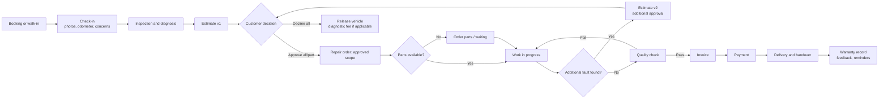
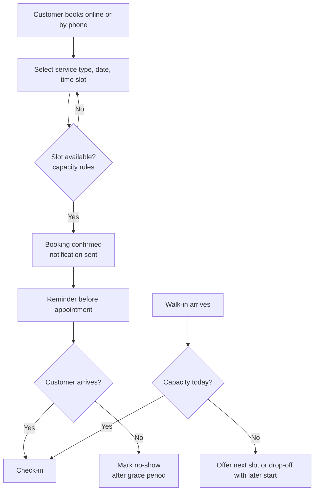
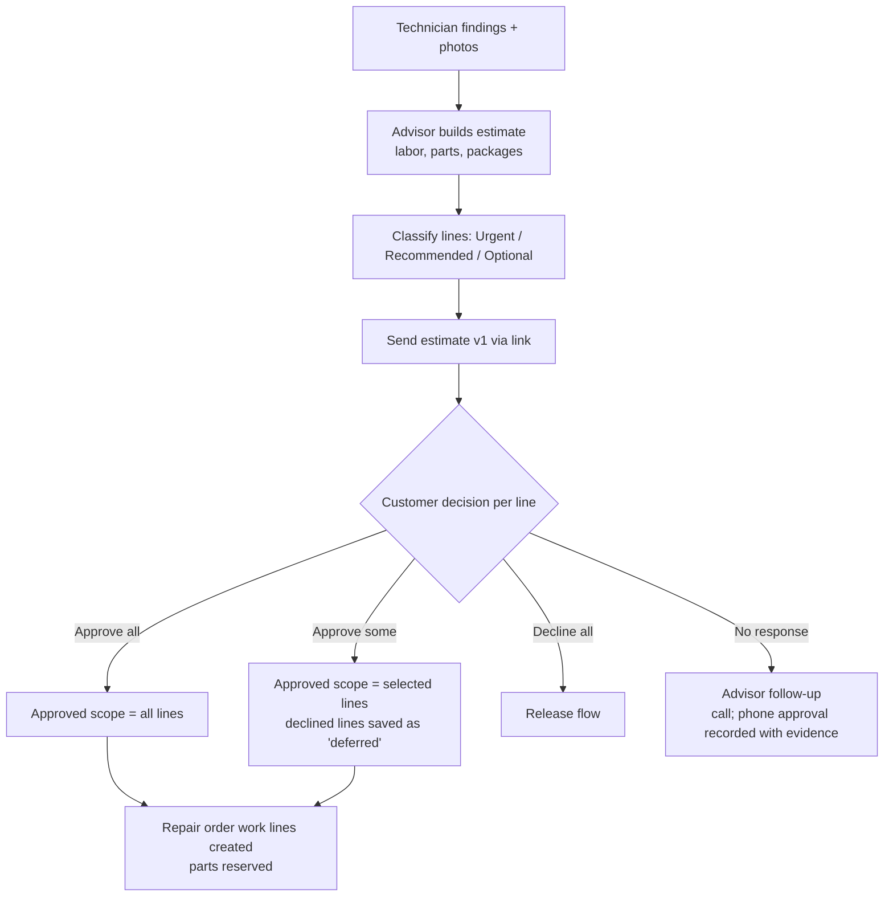
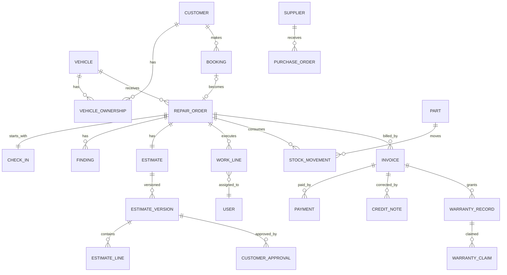
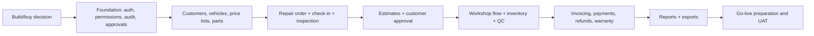

# Product Requirements Document — Garage Operations Platform
## Independent Car Repair Garage, Sharjah, UAE

| Item | Value |
|---|---|
| Version | 0.1 — First complete draft |
| Date | 14 October 2026 |
| Status | Draft for partner review — **not approved for build** |
| Inputs | Discovery document (Stage 1) + partner decisions on Q1–Q8 |
| Currency / timezone | AED / Asia/Dubai (UTC+04:00, no daylight saving) |
| Languages | Arabic (RTL) and English (LTR) |

### Labeling conventions used throughout

| Label | Meaning |
|---|---|
| **PD-#** | Partner decision — provisionally agreed by the partners (working assumption, reversible) |
| **A-#** | Unvalidated assumption — proposed by the product team, needs confirmation |
| **D-#** | Open decision — must be answered by the partners; see Section 10 and the Decision Register |
| **V-#** | Requires professional verification (legal, tax, accounting, licensing) |
| **T-#** | Configurable threshold — value intentionally left blank until partners approve |

Nothing in this document is a market price, licensing fact, or financial projection. Any value shown as `[TBD]` must be set by the partners.

---

## Table of Contents
1. Executive Summary and Assumptions
2. Business Goals and KPIs
3. Personas, Governance, Permissions, and Approval Matrix
4. End-to-End Workflows and Exception Scenarios
5. Epics, Features, User Stories, and Acceptance Criteria
6. MVP Scope, Out of Scope, and Roadmap
7. Initial Data Model
8. Financial Reporting Definitions and Calculation Rules
9. Security, Privacy, Audit, and Operational Requirements
10. Dependencies, Risks, and Unresolved Decisions
11. Prioritized Implementation Backlog and Definition of Done
12. Decision Register

---

## 1. Executive Summary and Assumptions

### 1.1 Summary

Two partners plan to open a single-branch, independent general repair and maintenance garage in Sharjah for economy and mid-range passenger cars and light SUVs. The business will compete on **transparency and trust**. Every vehicle is photographed at check-in, every repair is itemized and approved by the customer before work begins, and every job is traceable in the vehicle's service history.

The supporting platform is a **responsive web application** with three experiences:

1. **Management dashboard** — for partners and the manager: operations, approvals, and financial reporting with access controlled per user.
2. **Staff and workshop interface** — for service advisors, receptionists, and technicians: bookings, check-in, inspection, estimates, repair orders, parts, invoicing, and payments.
3. **Customer web experience** — mobile-friendly booking, repair status tracking, estimate approval, and invoice viewing. There is no native app in the MVP.

The backend is the single source of truth for bookings, repair orders, estimates, approvals, invoices, and payments. WhatsApp and/or SMS notifications are used where available and affordable (D-18).

The MVP aims to let the garage open and run day-to-day operations with financial control from day one, while avoiding enterprise features a small startup does not need.

### 1.2 Partner decisions (provisionally validated)

| ID | Decision | Source |
|---|---|---|
| PD-1 | Day-one services: general mechanical repair, routine maintenance and oil changes, electrical diagnostics and repair, AC inspection and servicing, computer diagnostics and fault-code scanning, brake/battery/basic consumables. | Q1 |
| PD-2 | Excluded from MVP: bodywork, painting, insurance repairs, tyres, detailing, other specialized services. | Q1 |
| PD-3 | Target vehicles: economy and mid-range cars and light SUVs, common Japanese, Korean, and selected European brands. Not positioned as luxury specialist. | Q2 |
| PD-4 | Bays, technicians, and capacity are configurable, not fixed in the architecture. | Q2 |
| PD-5 | Two partners with separate accounts and configurable permissions. No hardcoded hierarchy between them. | Q3 |
| PD-6 | All approval thresholds are configurable. Small discounts can be approved by advisors within a limit. Larger discounts, refunds over threshold, and supplier payments over threshold need extra approval. Financial settings changes are logged. | Q4 |
| PD-7 | A manager or service advisor may run daily operations. Access to net profit, partner drawings, bank details, and ownership information is separately configurable. Technicians see no business financials. | Q5 |
| PD-8 | Initial customers are individual retail (walk-in and online booking). No credit terms or unpaid corporate accounts by default. Fleet accounts come later. | Q6 |
| PD-9 | Customer-supplied parts are allowed only when explicitly accepted by an authorized employee, with recorded source, acknowledgment, labor charge, warranty limitation, inspection outcome, and installation notes. No automatic parts warranty. | Q7 |
| PD-10 | Both fixed-price jobs/packages and hourly labor are supported. Rates, prices, markups, discounts, and diagnostic fees are configurable. Estimates are itemized and versioned. Changes to approved price or scope trigger re-approval. | Q8 |
| PD-11 | Single branch at launch, but don't block future multi-branch expansion. | Principles |
| PD-12 | Responsive web MVP. A native customer app will be reassessed after validation. | Strategy |

### 1.3 Unvalidated assumptions (product team proposals)

| ID | Assumption | Why it matters | Validate by |
|---|---|---|---|
| A-1 | The garage is VAT-registered and must issue tax invoices. The VAT rate is configurable (not hardcoded). | Drives invoice format and VAT reporting. | V-2, before development of invoicing |
| A-2 | A customer is identified mainly by mobile number. One customer may own several vehicles, and a vehicle may change owner. | Drives the data model and the customer portal login. | Partner review |
| A-3 | Vehicles are identified by plate number (emirate + code + number) and, where available, VIN. | Drives search and service history. | Partner review |
| A-4 | The customer portal uses a one-time passcode (OTP) to a mobile number, or a secure single-use link, rather than passwords. | Simpler for retail customers. | Depends on SMS/WhatsApp provider (D-18) |
| A-5 | A vehicle is released only after the invoice is fully paid, unless an authorized user records an override. | Consistent with PD-8 (no credit by default). | Partner review |
| A-6 | Parts inventory is valued at weighted average cost. | Drives cost of goods and gross profit. | V-3 accountant |
| A-7 | Revenue is recognized in management reports when an invoice is issued, and cash is reported separately when collected. | Drives the revenue vs cash reports. | V-3 accountant |
| A-8 | Statutory accounting stays in external accounting software, or with an external accountant. The platform provides management reports and data exports, not statutory financial statements. | Avoids building an accounting system. | D-17 |
| A-9 | Technicians use a shared or personal tablet/phone in the workshop with reliable internet. | Drives the technician UI and offline needs. | Site survey |
| A-10 | Customer-facing approval of estimates can be digital (link), in person (signature on tablet), or by phone (recorded by advisor). Phone approval is allowed but flagged as weaker evidence. | Dispute risk. | V-4 lawyer, partner review |
| A-11 | The platform is cloud-hosted. Data residency requirements are not yet known. | Hosting choice. | V-1 lawyer |
| A-12 | Expected scale is low: one branch, fewer than 30 staff users, and hundreds (not millions) of repair orders per month. | Keeps architecture simple. | Partner review |

---

## 2. Business Goals and KPIs

### 2.1 Business goals

| ID | Goal | Description |
|---|---|---|
| G1 | Earn customer trust | Transparent estimates, photo evidence, no unapproved work, clear warranty. |
| G2 | Operate profitably with visibility | Know revenue, parts cost, labor cost, expenses, gross and net profit at any time. |
| G3 | Maximize workshop throughput | Use bays and technicians efficiently, and reduce waiting for approvals and parts. |
| G4 | Control and governance between partners | Every sensitive financial action is permissioned, approved where required, and auditable. |
| G5 | Build repeat business | Service history and maintenance reminders bring customers back. |

### 2.2 KPIs

Targets are **not set** in this document. The recommended approach is to measure a baseline for the first 60–90 days of operation, then the partners set targets (D-25).

| KPI | Definition / formula | Goal | Source |
|---|---|---|---|
| Vehicles serviced | Count of repair orders delivered in period | G3 | Repair orders |
| Average repair order value (ARO) | Invoiced revenue excl. VAT ÷ number of invoiced repair orders | G2 | Invoices |
| Estimate approval rate | Approved estimate value ÷ total estimated value sent (also by count) | G1, G2 | Estimates |
| Additional-work approval rate | Approved additional items ÷ additional items proposed | G1, G2 | Estimate versions |
| Turnaround time | Median time from check-in to "Ready for collection" | G3 | Status history |
| On-time promise rate | % repair orders ready by the promised time | G1, G3 | Repair orders |
| Time to estimate | Median time from check-in to estimate sent | G3 | Status history |
| Approval wait time | Median time from estimate sent to customer decision | G3 | Approvals |
| Parts wait time | Median time repair orders spend in "Waiting for parts" | G3 | Status history |
| Comeback / warranty rate | Warranty claims accepted ÷ repair orders delivered (rolling period) | G1 | Warranty claims |
| QC first-pass rate | % repair orders passing QC on first check | G1 | QC records |
| No-show rate | No-show bookings ÷ confirmed bookings | G3 | Bookings |
| Repeat customer rate | % of customers with 2+ repair orders in trailing 12 months | G5 | Repair orders |
| Reminder conversion | Bookings attributed to a reminder ÷ reminders sent | G5 | Reminders |
| Customer satisfaction | Average post-delivery rating (1–5) | G1 | Customer feedback |
| Gross profit and margin | See Section 8 | G2 | Reports |
| Net operating profit (management) | See Section 8 | G2 | Reports |
| Labor vs parts revenue mix | Labor revenue ÷ total revenue | G2 | Invoices |
| Discount rate | Total discounts ÷ gross revenue before discounts | G2, G4 | Invoices |
| Refund rate | Refunds ÷ revenue | G1, G2 | Credit notes |
| Inventory value and stockouts | Stock value at cost; count of repair orders delayed by unavailable stock | G2, G3 | Inventory |
| Bay utilization (optional) | Booked/occupied bay hours ÷ available bay hours | G3 | Depends on D-1, D-2 |
| Technician productivity (optional) | Billed labor hours ÷ clocked hours | G3 | Depends on D-8 |
| Digital adoption (product KPI) | % repair orders with photo check-in; % approvals done digitally | G1 | Platform |

---

## 3. Personas, Governance, Permissions, and Approval Matrix

### 3.1 Personas

**P1 — Partner (two instances: Partner A, Partner B)**
- Goals: protect the investment, know the profit, control spending, and trust the numbers without being in the garage all day.
- Needs: a financial dashboard, approval queue, audit log, and user/permission administration (subject to governance).
- Pain points to avoid: one partner silently changing prices, refunds, or permissions; numbers that don't reconcile.
- **Important:** the two partners do not automatically have identical access. Each partner's permissions are configured individually (PD-5).

**P2 — Operations / Workshop Manager** (may be a hired employee or one of the partners)
- Goals: keep bays full, jobs moving, and customers informed.
- Needs: a live board of all repair orders by status, a technician workload view, parts waiting list, daily cash summary, and the ability to approve discounts within limit.
- Restricted by default: net profit, partner drawings, bank details, ownership information (PD-7).

**P3 — Service Advisor / Receptionist** (the two roles may be one person at launch)
- Goals: book quickly, check in accurately, sell needed work honestly, collect payment.
- Needs: fast search by plate or phone, check-in with photos, estimate builder, approval links, invoice and payment screens.
- Restricted: no cost prices by default (configurable), no reports beyond their own daily cash, discounts only up to T-1.

**P4 — Technician / Mechanic**
- Goals: know what to do next, have parts ready, record findings, and not be blamed for unapproved work.
- Needs: a "My jobs" list on a phone or tablet, inspection checklist, approved scope only, photo/video upload, parts request, mark complete.
- Restricted: no prices, no customer phone numbers by default, no financials.

**P5 — Parts / Store Keeper** (optional role; at launch likely the advisor or manager)
- Needs: receive goods, issue parts to repair orders, stock counts, reorder list.

**P6 — External Accountant** (optional, read-only)
- Needs: exports of invoices, credit notes, payments, expenses, and VAT summary.

**P7 — Customer**
- Goals: fair price, no surprises, car back on time, proof of what was done.
- Needs: easy booking, status updates, a clear estimate to approve or decline per line, invoice and warranty details, reminders.
- Language: Arabic or English, chosen per customer.

### 3.2 Recommended governance model

The governance model separates six decision domains. For each domain, the partners assign which users may **act**, which may **approve**, and which may **view**. The system enforces the assignment. The written partnership agreement should define who holds which rights (V-5).

| Domain | Typical actions | Recommended control |
|---|---|---|
| 1. Daily operations | Bookings, check-in, assigning technicians, job status | Manager and advisors act. Partners view. No approval needed. |
| 2. Purchasing and supplier payments | Purchase orders, recording supplier invoices, paying suppliers | Manager raises POs. Payments above T-4 need a second approver who is not the person who raised the payment. |
| 3. Pricing and discounts | Labor rates, package prices, markups, discounts | Price lists changed only by users with "manage pricing". Discounts above T-1 need manager approval; above T-2 need partner approval. Every price-list change is logged with before/after values. |
| 4. Refunds | Credit notes and refund payments | Any refund needs a reason. Refunds above T-3 need a second approver. The requester cannot approve their own refund. |
| 5. Financial reports | P&L, net profit, partner drawings, bank info | Each report group is a separate permission. Net profit, drawings, and bank details are off by default for everyone except users the partners explicitly grant. |
| 6. User permissions and financial settings | Creating users, granting roles, changing thresholds, VAT settings | Changes to sensitive permissions and thresholds take effect only after a second partner approves (recommended default, configurable — D-5). All changes logged. |

**Safeguards that apply regardless of configuration:**
- No user can approve a request they raised themselves.
- No record that affects money or stock can be deleted. It can only be voided or reversed, with a reason, and is visible in the audit log.
- The audit log cannot be edited or deleted by any user, including partners.
- **Lockout protection:** if one partner is unavailable, a pre-agreed fallback (for example, a time-limited emergency approval that is flagged for review) must be defined in the partnership agreement (D-6).

**Items that must be finalized in the written partnership agreement (V-5):**
1. Ownership split and profit distribution, and how partner drawings are recorded.
2. Signing authority for bank and supplier payments, and the threshold values T-1 to T-7.
3. Who has user-administration rights, and whether changing them needs both partners.
4. Who can see which financial reports.
5. What happens when partners disagree or one is unavailable (deadlock and emergency approval).
6. Who is accountable for day-to-day operations and hiring.
7. Policy on related-party purchases (e.g., buying from a supplier connected to a partner).

### 3.3 Roles and permissions

Roles are **templates**. Each user gets one or more roles, and individual permissions can be added or removed per user. Partner A and Partner B each start from the "Partner" template, but each one's final permissions are configured separately.

Legend: ✔ = granted by default, C = configurable (off by default), ✗ = not available to this role

| Permission group | Partner | Manager | Advisor / Reception | Technician | Store Keeper | Accountant (read-only) |
|---|---|---|---|---|---|---|
| Customers and vehicles — view/edit | ✔ | ✔ | ✔ | View vehicle only | ✗ | ✗ |
| Customer contact details | ✔ | ✔ | ✔ | C | ✗ | ✗ |
| Bookings — manage | ✔ | ✔ | ✔ | ✗ | ✗ | ✗ |
| Check-in and photos | ✔ | ✔ | ✔ | ✔ | ✗ | ✗ |
| Inspections — record findings | ✔ | ✔ | View | ✔ | ✗ | ✗ |
| Estimates — create/send | ✔ | ✔ | ✔ | ✗ | ✗ | ✗ |
| See part cost prices and margins | C | C | C | ✗ | C | ✔ |
| Repair orders — assign technicians | ✔ | ✔ | C | ✗ | ✗ | ✗ |
| Repair orders — update own job status | ✔ | ✔ | ✔ | ✔ (assigned jobs only) | ✗ | ✗ |
| QC sign-off | C | ✔ | C | C (not own job) | ✗ | ✗ |
| Inventory — receive/issue | C | ✔ | C | Request only | ✔ | ✗ |
| Inventory — adjustments / write-offs | C | Up to T-6 | ✗ | ✗ | Request only | ✗ |
| Purchase orders — create | C | ✔ | ✗ | ✗ | ✔ | ✗ |
| Supplier payments — record | C | C | ✗ | ✗ | ✗ | ✗ |
| Supplier payments — approve | C | ✗ | ✗ | ✗ | ✗ | ✗ |
| Invoices and payments — take payment | ✔ | ✔ | ✔ | ✗ | ✗ | View |
| Discounts | Up to T-2 (above → second partner?) | Up to T-2 | Up to T-1 | ✗ | ✗ | ✗ |
| Refunds — request | ✔ | ✔ | ✔ | ✗ | ✗ | ✗ |
| Refunds — approve | C | Up to T-3 | ✗ | ✗ | ✗ | ✗ |
| Release vehicle with unpaid balance | C | C | ✗ | ✗ | ✗ | ✗ |
| Expenses — record | C | ✔ | ✗ | ✗ | ✗ | ✗ |
| Operational dashboard | ✔ | ✔ | Own day | Own jobs | Stock only | ✗ |
| Revenue and gross profit reports | C | C | ✗ | ✗ | ✗ | ✔ |
| Net profit report | C | ✗ (C) | ✗ | ✗ | ✗ | C |
| Partner drawings / capital | C | ✗ | ✗ | ✗ | ✗ | C |
| Bank account details | C | ✗ | ✗ | ✗ | ✗ | C |
| Pricing, labor rates, markups — manage | C | C | ✗ | ✗ | ✗ | ✗ |
| Thresholds and financial settings — change | C (+ second partner approval) | ✗ | ✗ | ✗ | ✗ | ✗ |
| Users and permissions — manage | C (+ second partner approval for sensitive) | ✗ | ✗ | ✗ | ✗ | ✗ |
| Audit log — view | ✔ | Operational events only | ✗ | ✗ | ✗ | Financial events |
| Data export | C | ✗ | ✗ | ✗ | ✗ | ✔ |

### 3.4 Approval matrix

All threshold values are **[TBD] by the partners**. The system stores each threshold with an effective date, the user who set it, and the approver.

| ID | Action | Rule | Who can approve | Notes |
|---|---|---|---|---|
| T-1 | Discount by advisor | ≤ T-1 (% and/or AED, whichever is lower): advisor self-approves | — | Reason code mandatory for every discount |
| T-2 | Discount above T-1 | > T-1 and ≤ T-2: manager; > T-2: partner | Manager / Partner | Requester cannot approve own discount |
| T-3 | Refund | ≤ T-3: one approver (not requester); > T-3: two approvers | Manager (≤T-3), Partner(s) | Refund to original payment method by default (D-15) |
| T-4 | Supplier payment | ≤ T-4: one authorized user; > T-4: initiator plus one independent approver | Partner(s) per agreement | Bank details changes for a supplier always need second approval (fraud control) |
| T-5 | Purchase order | ≤ T-5: manager/store keeper; > T-5: partner approval before sending | Partner | |
| T-6 | Stock adjustment / write-off | ≤ T-6 value at cost: manager; > T-6: partner | Manager / Partner | Reason mandatory |
| T-7 | Expense entry | ≤ T-7: recorded directly; > T-7: partner approval | Partner | |
| — | Change to approved estimate | Any increase in price or scope: new customer approval (default tolerance 0) | Customer | Tolerance configurable but recommended to stay 0 |
| — | Release vehicle with balance due | Always needs an authorized override with reason | Users with permission | |
| — | Warranty claim acceptance | Advisor proposes; manager or partner decides | Manager / Partner | |
| — | Customer-supplied part acceptance | Authorized employee accepts; recorded acknowledgment | Manager / Advisor (if granted) | PD-9 |
| — | Price list, labor rate, markup change | Logged; optional second approval | Partner(s) | D-5 |
| — | Threshold or sensitive permission change | Second partner approval (recommended) | Other partner | D-5 |

**Recommendation framework for setting threshold values (for partners):**
1. **Start conservative.** Set low values at launch so most exceptions reach a partner. This gives visibility while staff are new.
2. **Anchor to real data.** After 60–90 days, review average repair order value, discount frequency, refund frequency, and typical supplier invoice size from the platform's reports.
3. **Set by risk, not convenience.** Refunds and supplier payments move cash out and carry the highest fraud risk. Keep those thresholds tighter than discount thresholds.
4. **Combine % and absolute AED.** For discounts, use the lower of a percentage and an AED cap so large jobs don't allow large absolute discounts.
5. **Review quarterly**, and log every change.
6. **Time-to-approve:** the approval queue shows pending items with age so approvals don't stall the workshop. Partners receive notifications for pending approvals.

---

## 4. End-to-End Workflows and Exception Scenarios

### 4.1 Vehicle service lifecycle (overview)

### 4.2 Repair order status model

Internal statuses are detailed. The customer sees a simplified status.

| # | Internal status | Entered when | Exits to | Customer sees |
|---|---|---|---|---|
| 1 | Checked in | Check-in completed | Inspecting, Cancelled | "Vehicle received" |
| 2 | Inspecting | Technician starts inspection | Estimate pending | "Inspection in progress" |
| 3 | Estimate pending | Findings submitted, advisor preparing estimate | Awaiting approval | "Inspection in progress" |
| 4 | Awaiting approval | Estimate sent to customer | Approved, Declined | "Awaiting your approval" |
| 5 | Approved | At least one line approved | Waiting for parts, In progress | "Approved — scheduled for work" |
| 6 | Waiting for parts | Approved parts not in stock | In progress | "Waiting for parts" |
| 7 | In progress | Technician starts approved work | On hold – approval, QC | "Repair in progress" |
| 8 | On hold – additional approval | Additional work proposed (estimate v2+) | In progress | "Awaiting your approval" |
| 9 | Quality check | Technician marks work complete | In progress (fail), Ready | "Final checks" |
| 10 | Ready for collection | QC passed and invoice issued | Delivered | "Ready for collection" |
| 11 | Delivered | Vehicle handed over (payment rule met) | Closed | "Delivered" |
| 12 | Closed | Automatic after delivery (no open payment) | — | — |
| — | Declined – released | Customer declined all work | Delivered | "Ready for collection" |
| — | Cancelled | Cancelled before any work | — | "Cancelled" |

Payment status is a separate attribute: Unpaid, Partially paid, Paid, Refunded (partial/full).

### 4.3 Booking and walk-in workflow

### 4.4 Estimate and approval workflow

### 4.5 Exception scenarios

Each scenario has an expected system behavior. These form the basis of the acceptance criteria in Section 5.

| ID | Scenario | Expected behavior |
|---|---|---|
| EX-01 | **Customer cancels booking** | Customer can cancel via link or advisor cancels. Reason captured. Slot released. If a deposit was taken, refund or retention follows the cancellation policy (D-13). Notification sent. |
| EX-02 | **Customer reschedules** | Customer picks a new available slot via link, or advisor reschedules. Original booking linked to the new one. History kept. Rescheduling limit configurable (D-13). |
| EX-03 | **No-show** | After a configurable grace period, advisor marks no-show (or system flags it). No-show count kept on the customer profile. Deposit rules per D-13. |
| EX-04 | **Garage must reschedule** (technician absent, overbooked) | Advisor reschedules and the customer gets a notification with options. Logged as garage-initiated. |
| EX-05 | **Walk-in when full** | System shows today's capacity. Advisor offers next slot or drop-off. If accepted as drop-off, repair order is created with expected start time. |
| EX-06 | **Estimate fully rejected** | Repair order moves to "Declined – released". Diagnostic fee invoiced if policy says so (D-12). Declined items saved as deferred recommendations on the vehicle history. Vehicle released after any fee is paid. |
| EX-07 | **Estimate partially approved** | Only approved lines become work lines. Declined lines saved as deferred and may trigger a reminder later (D-24). |
| EX-08 | **Customer doesn't respond to estimate** | Configurable reminder after X hours. Advisor sees overdue approvals list. Phone approval allowed only with call time, approver name, and advisor note (A-10). Vehicle storage rules apply after a configurable period (D-14). |
| EX-09 | **Additional fault found during repair** | Technician records finding with photo. Repair order goes to "On hold – additional approval". Advisor issues estimate v2 containing only the change. No work on the new item until approved. Previous approved work may continue if independent. |
| EX-10 | **Price of an approved part changes** (supplier price increase) | If the total customer price increases, a new estimate version and re-approval are required. If the garage absorbs the increase, the customer price stays and the margin impact is visible in reports. |
| EX-11 | **Approved part unavailable** | Repair order goes to "Waiting for parts". Options: order from supplier (expected date captured), offer an alternative part (OEM vs aftermarket — new estimate version if price/spec changes), or customer collects vehicle and returns later (repair order paused, parts on order linked). Customer notified with expected date. |
| EX-12 | **Wrong or defective part received** | Store keeper records supplier return against the goods receipt. Stock and supplier balance adjusted. Repair order stays waiting. |
| EX-13 | **Customer-supplied part** | Authorized employee accepts or refuses. Records source, condition inspection, customer acknowledgment (signed or via link), labor price, warranty limitation text (D-11/V-4). Line shows "Customer-supplied — AED 0 part, labor only". If the part fails inspection, the customer is informed and must approve an alternative. |
| EX-14 | **QC fails** | Repair order returns to "In progress" with QC notes. QC failure logged (KPI). Promise time may be updated and customer notified. |
| EX-15 | **Customer disputes invoice at collection** | Advisor can view approval evidence (versions, timestamps, photos). Any goodwill adjustment is a discount requiring approval per T-1/T-2, or a credit note after issue. |
| EX-16 | **Partial payment** | Payment recorded. Balance due remains. Vehicle release blocked unless an authorized override is recorded (A-5). |
| EX-17 | **Vehicle not collected** | After a configurable number of days after "Ready for collection", reminders are sent and storage charges apply per policy (D-14, V-4). |
| EX-18 | **Warranty claim (comeback)** | Customer reports a problem. Advisor searches original repair order. System shows active warranty records. Warranty repair order created and linked. Inspection determines cause. Manager/partner decides: accepted (no charge; internal cost tracked as warranty cost), partially accepted, or rejected (normal estimate). Supplier warranty recovery for parts recorded where applicable. |
| EX-19 | **Refund after payment** | Request with reason and amount, linked to invoice and lines. Approval per T-3. On approval, a credit note is issued (invoice is never edited). Refund payment recorded with method. If parts are returned to stock, stock movement recorded. |
| EX-20 | **Invoice error found after issue** | Issued invoices are never edited. Correct via credit note and new invoice, with approval and reason. |
| EX-21 | **Customer cancels after work started** | Work stopped. Completed approved work and parts used are invoiced. Unused ordered parts handled by supplier return or stock. Approval required for any write-off. |
| EX-22 | **Technician reassigned mid-job** | Manager reassigns. Both technicians and the time are recorded. |
| EX-23 | **Vehicle ownership change** | Vehicle linked to a new customer. Service history stays with the vehicle. Previous owner's personal data is not shown to the new owner. |
| EX-24 | **Notification fails** (WhatsApp/SMS) | Failure logged. Advisor sees a "notification failed" flag and can resend or call. |

---

## 5. Epics, Features, User Stories, and Acceptance Criteria

**Priority key (MoSCoW):** M = Must have for launch, S = Should have (launch if possible, otherwise first post-launch release), C = Could have (later), W = Won't have in this phase.

Acceptance criteria use Given / When / Then. All criteria implicitly include: works in Arabic and English, amounts in AED with 2 decimals, times displayed in Asia/Dubai, and the relevant audit event is written.

---

### EP-01 Platform Foundation (users, roles, settings, localization, audit)

| ID | Story | Pri |
|---|---|---|
| US-01.1 | As a partner, I want to create staff accounts and assign role templates so each person sees only what they need. | M |
| US-01.2 | As a partner, I want to grant or remove individual permissions per user so Partner A and Partner B can have different access. | M |
| US-01.3 | As a partner, I want sensitive permission and threshold changes to require approval by the other partner so neither partner can act alone on governance. | M |
| US-01.4 | As any user, I want to switch the interface between Arabic and English so I can work in my language. | M |
| US-01.5 | As a partner, I want to configure business settings (business name, TRN, address, working hours, bays, VAT rate, currency display, invoice numbering) so documents are correct. | M |
| US-01.6 | As a partner, I want an immutable audit log of all sensitive actions so I can trust the data. | M |
| US-01.7 | As a user, I want secure login with optional two-factor authentication (mandatory for partners and finance permissions). | M |
| US-01.8 | As a partner, I want to deactivate a user immediately when they leave so they lose access. | M |

**Acceptance criteria (selected):**
- **AC-01.2a** Given Partner A has "manage users" and Partner B does not, when Partner B opens user administration, then access is denied and the attempt is logged.
- **AC-01.2b** Given two users with the Partner template, when one has "view net profit" removed, then that user cannot see net profit in any dashboard, report, or export.
- **AC-01.3** Given approval for sensitive changes is enabled, when Partner A changes a threshold or grants a sensitive permission, then the change is saved as *Pending*, Partner B is notified, and the change takes effect only after Partner B approves. A rejected change is logged with reason.
- **AC-01.4** Given the user selects Arabic, then all labels, menus, validation messages, dates, and number formats render in Arabic with right-to-left layout, and no English-only strings appear on core screens.
- **AC-01.6** Given any create/update/void/approve action on money, stock, prices, permissions, or settings, then the audit log records user, action, entity, before/after values, timestamp (stored UTC, displayed Asia/Dubai), and source (web/device). No user can edit or delete audit entries.
- **AC-01.8** Given a user is deactivated, then their active sessions end within 5 minutes and any login attempt fails.

---

### EP-02 Customers and Vehicles

| ID | Story | Pri |
|---|---|---|
| US-02.1 | As an advisor, I want to register a customer with name (Arabic and/or English), mobile, optional email, preferred language, and consent for marketing messages. | M |
| US-02.2 | As an advisor, I want to register a vehicle with plate (emirate, code, number), make, model, year, VIN (optional), colour, and odometer. | M |
| US-02.3 | As an advisor, I want to search by plate, mobile, name, or VIN and find a match in seconds. | M |
| US-02.4 | As an advisor, I want to prevent duplicate customers and vehicles (warn on matching mobile/plate/VIN). | M |
| US-02.5 | As an advisor, I want to transfer a vehicle to a new owner while keeping the vehicle's service history. | S |
| US-02.6 | As an advisor, I want to see a vehicle's full service history (repair orders, findings, deferred items, warranty) on one screen. | M |
| US-02.7 | As a partner, I want to fulfil a customer's data access or deletion request where legally allowed. | S |

**Acceptance criteria (selected):**
- **AC-02.3** Given 10,000 vehicles in the system, when an advisor searches by partial plate number, then results appear in under 2 seconds.
- **AC-02.4** Given a mobile number already exists, when an advisor creates a new customer with that number, then the system shows the existing customer and requires explicit confirmation to create a separate record.
- **AC-02.5** Given a vehicle is transferred, then the new owner sees service records but never the previous owner's name, phone, or invoices.
- **AC-02.1** Given a customer has not consented to marketing, then they receive only service-related notifications, never promotional ones.

---

### EP-03 Booking and Scheduling

| ID | Story | Pri |
|---|---|---|
| US-03.1 | As a customer, I want to book a service online by choosing a service type, date, and available time slot, in Arabic or English. | M |
| US-03.2 | As an advisor, I want to create bookings for phone customers. | M |
| US-03.3 | As a partner/manager, I want to configure opening hours, holidays, slot length, daily capacity per service type, and walk-in buffer. | M |
| US-03.4 | As a customer, I want to cancel or reschedule my booking via a link. | M |
| US-03.5 | As an advisor, I want to see today's and upcoming bookings and walk-ins on one board. | M |
| US-03.6 | As an advisor, I want to mark no-shows and see a customer's no-show history. | S |
| US-03.7 | As a partner, I want optional booking deposits with configurable rules. | C (D-13) |
| US-03.8 | As an advisor, I want to register a walk-in without a booking. | M |

**Acceptance criteria (selected):**
- **AC-03.1** Given capacity rules are configured, when a customer selects a date, then only slots with remaining capacity are shown, and a confirmed booking reduces capacity immediately (no double-booking under concurrent requests).
- **AC-03.4** Given a booking more than the configured cut-off time away, when the customer cancels via link, then the booking is cancelled, the slot released, the reason captured, and a confirmation sent. Inside the cut-off, the link shows the garage phone number instead.
- **AC-03.3** Given a public holiday is configured, then no slots are offered on that date.
- **AC-03.8** Given a walk-in, when the advisor checks in the vehicle, then a repair order is created without a booking and flagged "walk-in" for reporting.

---

### EP-04 Vehicle Check-in

| ID | Story | Pri |
|---|---|---|
| US-04.1 | As an advisor, I want to check in a vehicle by recording odometer, fuel level, customer concerns, warning lights, and personal belongings. | M |
| US-04.2 | As an advisor, I want to take multiple condition photos (and optional short videos) from a tablet/phone and attach them to the repair order. | M |
| US-04.3 | As an advisor, I want to mark existing damage on a simple vehicle diagram. | S |
| US-04.4 | As a customer, I want to receive a check-in summary with photos and acknowledge it. | S |
| US-04.5 | As an advisor, I want to set a promised completion time or "to be confirmed after inspection". | M |
| US-04.6 | As an advisor, I want to record key tag / key handover. | S |

**Acceptance criteria (selected):**
- **AC-04.2** Given a configurable minimum number of photos (e.g., `[TBD]`), when the advisor tries to complete check-in with fewer photos, then the system warns and requires a reason to proceed.
- **AC-04.2b** Photos are timestamped and linked to the repair order, cannot be deleted by advisors or technicians after check-in completion, and are compressed for mobile upload without losing evidential clarity.
- **AC-04.4** Given the customer opens the check-in summary link, then they see odometer, fuel, concerns, and photos, and can tap "acknowledge"; the timestamp is recorded.

---

### EP-05 Inspection and Diagnosis

| ID | Story | Pri |
|---|---|---|
| US-05.1 | As a technician, I want to see a configurable inspection checklist for the job type (e.g., periodic service, AC, electrical). | M |
| US-05.2 | As a technician, I want to record each finding with status (OK / Attention soon / Urgent), notes, photos, and fault codes. | M |
| US-05.3 | As a technician, I want to keep internal notes separate from customer-visible notes. | M |
| US-05.4 | As a manager, I want to create and edit checklist templates. | S |
| US-05.5 | As an advisor, I want technician findings to flow directly into the estimate builder. | M |

**Acceptance criteria (selected):**
- **AC-05.3** Given a finding has an internal note, then the internal note never appears on any customer-facing screen, message, estimate, or PDF.
- **AC-05.2** Given a finding is marked Urgent, then it appears pre-selected in the estimate builder as "Urgent", and the advisor must either include it or record why it was excluded.

---

### EP-06 Estimates and Customer Approvals

| ID | Story | Pri |
|---|---|---|
| US-06.1 | As an advisor, I want to build an itemized estimate with labor lines (fixed price or hours × rate), parts lines (price from price list or markup rule), service packages, discounts, VAT, and total. | M |
| US-06.2 | As an advisor, I want to classify lines as Urgent, Recommended, or Optional. | M |
| US-06.3 | As an advisor, I want to send the estimate by link (WhatsApp/SMS) and as a PDF, in the customer's language. | M |
| US-06.4 | As a customer, I want to approve or decline each line on my phone and see the total update before confirming. | M |
| US-06.5 | As an advisor, I want to record an in-person signature or a phone approval with evidence. | M |
| US-06.6 | As an advisor, I want every change after sending to create a new estimate version, and only the delta to need approval. | M |
| US-06.7 | As an advisor, I want to apply discounts within my limit and request approval above it. | M |
| US-06.8 | As an advisor, I want to add a customer-supplied part line with acknowledgment and warranty limitation. | M |
| US-06.9 | As an advisor, I want estimates to have a validity period. | S |
| US-06.10 | As a partner, I want reports of declined and deferred work. | S |

**Acceptance criteria (selected):**
- **AC-06.1** Given an estimate, then it shows for each line: description, quantity, unit price, discount, net amount; and at the bottom: subtotal, total discount, VAT (rate and amount), and total payable in AED. Calculations round to 2 decimals per the rule in Section 8.
- **AC-06.4** Given the customer approves 3 of 5 lines, then only those 3 lines become work lines, the 2 declined lines are stored as deferred recommendations, and the customer receives a confirmation of the approved total.
- **AC-06.5** Given phone approval is used, then the advisor must enter call time, person spoken to, and the lines approved; the approval is marked "Phone – verbal" in the record and visible on the invoice audit trail.
- **AC-06.6** Given estimate v1 is approved, when the advisor adds a line or increases any price, then version v2 is created, v1 remains unchanged and viewable, and work on the new or changed lines is blocked until v2 is approved.
- **AC-06.6b** Given the advisor reduces a price or removes a not-yet-started line, then a new version is created and the customer is notified, but re-approval is not required (configurable).
- **AC-06.7** Given a discount above T-1, then the estimate cannot be sent until the discount is approved, and the approver cannot be the requester.
- **AC-06.8** Given a customer-supplied part line, then the estimate shows the part at AED 0, the labor charge, and the configured warranty limitation text, and the customer must acknowledge the line specifically.
- **AC-06.3** Given an approval link, then it is unique, expires after the validity period, cannot be used after a newer version exists, and does not expose other customers' data.

---

### EP-07 Repair Orders and Technician Work

| ID | Story | Pri |
|---|---|---|
| US-07.1 | As a manager, I want a workshop board showing all open repair orders by status, technician, bay, and promised time. | M |
| US-07.2 | As a manager, I want to assign or reassign technicians (and optionally a bay) to repair order lines. | M |
| US-07.3 | As a technician, I want a "My jobs" view with only approved work, required parts, and vehicle info. | M |
| US-07.4 | As a technician, I want to start, pause, and complete work lines. | M |
| US-07.5 | As a technician, I want to report an additional finding during repair, which puts the job on hold for approval. | M |
| US-07.6 | As a QC checker, I want a QC checklist to pass or fail the vehicle before it's marked ready. | M |
| US-07.7 | As a manager, I want optional time tracking per work line to measure productivity. | C (D-8) |
| US-07.8 | As a manager, I want to see repair orders at risk of missing their promised time. | S |

**Acceptance criteria (selected):**
- **AC-07.3** Given a technician, then they see only repair orders assigned to them, only approved lines, no prices, and no customer phone number unless permitted.
- **AC-07.4** Given a line is not approved, then the technician cannot start it.
- **AC-07.5** Given a technician reports an additional finding, then the repair order moves to "On hold – additional approval", the advisor is notified, and the new item cannot be started until approved.
- **AC-07.6** Given QC is required (default yes), then a repair order cannot move to "Ready for collection" without a recorded QC pass by a user with QC permission; if "QC by a different person" is enabled (D-10), the technician who did the work cannot pass QC on their own job.

---

### EP-08 Parts, Inventory, and Suppliers

| ID | Story | Pri |
|---|---|---|
| US-08.1 | As a store keeper, I want a parts catalogue with part number, description (AR/EN), brand, type (OEM/aftermarket/other), unit, cost, selling price or markup rule, and reorder level. | M |
| US-08.2 | As a store keeper, I want to receive goods against a purchase order or as a direct purchase, updating stock and average cost. | M |
| US-08.3 | As a technician/advisor, I want approved parts reserved for the repair order and issued when used. | M |
| US-08.4 | As a store keeper, I want to return unused parts from a repair order to stock. | M |
| US-08.5 | As a manager, I want to create purchase orders to suppliers, with approval above T-5. | M |
| US-08.6 | As a manager, I want a supplier register (name, contact, TRN, payment terms, bank details — restricted). | M |
| US-08.7 | As a store keeper, I want to record supplier returns and supplier warranty claims. | S |
| US-08.8 | As a manager, I want stock counts and adjustments with reason and approval per T-6. | M |
| US-08.9 | As a manager, I want a reorder list of items below reorder level. | S |
| US-08.10 | As a partner, I want supplier invoices and supplier payments recorded with dual approval above T-4. | M |
| US-08.11 | As an advisor, I want to add a non-stock part bought specifically for a job ("special order"). | M |

**Acceptance criteria (selected):**
- **AC-08.2** Given a goods receipt of 10 units at a new cost, then stock quantity increases by 10 and the weighted average cost is recalculated (A-6); the receipt is linked to supplier, PO (if any), and user.
- **AC-08.3** Given a part is issued to a repair order, then stock decreases, the cost at issue is stored on the repair order line, and it cannot be issued beyond available quantity (negative stock not allowed by default).
- **AC-08.8** Given a stock adjustment, then a reason is mandatory, adjustments above T-6 require approval, and the movement appears in the stock movement history.
- **AC-08.10** Given a supplier payment above T-4, then it requires initiator plus one independent approver before it is marked paid.
- **AC-08.6** Given a change to supplier bank details, then the change requires approval by a second authorized user and generates an alert to partners.

---

### EP-09 Customer Notifications and Customer Web Experience

| ID | Story | Pri |
|---|---|---|
| US-09.1 | As a customer, I want automatic notifications at key events (booking confirmed, reminder, vehicle received, estimate ready, approval needed, waiting for parts, ready for collection, invoice, thank-you/feedback). | M |
| US-09.2 | As a customer, I want a tracking link showing my vehicle's current status in my language. | M |
| US-09.3 | As a partner, I want to configure message templates in Arabic and English and turn events on/off. | M |
| US-09.4 | As a customer, I want to view my vehicles, past invoices, and warranty details after verifying my mobile (OTP). | S |
| US-09.5 | As an advisor, I want to see which notifications were delivered or failed. | S |
| US-09.6 | As a customer, I want to rate my service after delivery. | S |

**Acceptance criteria (selected):**
- **AC-09.1** Given a customer's preferred language is Arabic, then all notifications are sent in Arabic.
- **AC-09.2** Given a tracking link, then it shows only customer-facing status and customer-facing notes, never internal notes, cost prices, or technician names (configurable).
- **AC-09.5** Given a message fails to send, then the advisor's board shows a warning on that repair order within 5 minutes.
- **AC-09.1b** Notifications are not sent between configurable quiet hours, except approval requests the advisor explicitly sends.

---

### EP-10 Invoicing, Payments, and Refunds

| ID | Story | Pri |
|---|---|---|
| US-10.1 | As an advisor, I want to generate an invoice from the approved and completed lines of a repair order. | M |
| US-10.2 | As an advisor, I want bilingual tax invoices (Arabic/English) with the required tax fields (V-2). | M |
| US-10.3 | As an advisor, I want to record one or more payments by method (cash, card, bank transfer, payment link — configurable per D-16). | M |
| US-10.4 | As an advisor, I want the system to block vehicle release if a balance is due, unless an authorized override is recorded. | M |
| US-10.5 | As an advisor, I want to request a refund with reason; the system issues a credit note after approval. | M |
| US-10.6 | As a manager, I want a daily cash-up report by payment method and user, with variance recording. | M |
| US-10.7 | As a customer, I want my invoice by link and PDF. | M |
| US-10.8 | As a partner, I want invoice numbering that is sequential and gap-free. | M |
| US-10.9 | As a partner, I want online payment links via a payment gateway. | C (D-16) |

**Acceptance criteria (selected):**
- **AC-10.1** Given a repair order, then only approved and completed lines (plus any approved diagnostic fee) can be invoiced; declined or deferred lines cannot.
- **AC-10.2** Given an issued invoice, then it cannot be edited or deleted; corrections are made only through a credit note linked to the original invoice.
- **AC-10.5** Given a refund request of amount X, then: a reason is mandatory; X cannot exceed the amount paid on that invoice minus prior refunds; approval follows T-3; on approval a credit note with VAT reversal is issued; the refund payment method is recorded; and stock returns (if any) are recorded.
- **AC-10.6** Given a cash-up, then the system shows expected amounts by method, the user enters counted amounts, and any difference is recorded with a reason and visible to managers/partners.
- **AC-10.8** Given two invoices are issued at the same moment, then they receive distinct consecutive numbers with no gaps.

---

### EP-11 Warranty

| ID | Story | Pri |
|---|---|---|
| US-11.1 | As a partner, I want to configure warranty terms (days and/or km) by line type: labor, garage-supplied parts, customer-supplied parts (default: none or limited per policy). | M |
| US-11.2 | As an advisor, I want warranty records created automatically for each delivered invoice line, shown on the invoice. | M |
| US-11.3 | As an advisor, I want to open a warranty claim linked to the original repair order and see whether it's within warranty. | M |
| US-11.4 | As a manager, I want to accept, partially accept, or reject a claim with reason. | M |
| US-11.5 | As a partner, I want warranty costs tracked separately from normal costs. | M |
| US-11.6 | As a store keeper, I want to record supplier warranty recovery for failed parts. | S |

**Acceptance criteria (selected):**
- **AC-11.3** Given a claim, then the system shows the original lines, their warranty end date and km limit, and the current odometer, and flags "In warranty / Expired / Not covered (customer-supplied)".
- **AC-11.4** Given an accepted claim, then the warranty repair order lines are priced at AED 0 to the customer, while parts and labor costs are recorded as warranty cost in reports.
- **AC-11.1** Given warranty values are not yet set by partners, then the system will not allow invoicing until a warranty policy (even "no warranty") is configured — preventing undocumented promises.

---

### EP-12 Expenses and Financial Reporting

| ID | Story | Pri |
|---|---|---|
| US-12.1 | As a manager, I want to record operating expenses with category, amount, VAT (if recoverable), date, payee, attachment, and payment method. | M |
| US-12.2 | As a partner, I want to configure expense categories (rent, salaries, utilities, etc.). | M |
| US-12.3 | As a partner, I want a revenue report (labor, parts, packages, diagnostic fees; gross, discounts, refunds, net) for any period. | M |
| US-12.4 | As a partner, I want a gross profit report separating parts margin and labor. | M |
| US-12.5 | As a partner, I want a management P&L (net operating profit) for any period. | M |
| US-12.6 | As a partner, I want a cash report (collected vs invoiced, by method) separate from revenue. | M |
| US-12.7 | As a partner, I want to record partner capital contributions and drawings in a restricted area, excluded from expenses. | S |
| US-12.8 | As the accountant, I want CSV/Excel exports of invoices, credit notes, payments, expenses, supplier invoices, and a VAT summary. | M |
| US-12.9 | As a partner, I want to close a period (month) so that transactions in it can't be changed without reopening (with approval and log). | S |

**Acceptance criteria (selected):**
- **AC-12.3–12.5** Given a period, then each report figure matches the calculation rules in Section 8, and each total can be drilled down to the underlying documents.
- **AC-12.5** Given a user without "view net profit", then the P&L report and any widget showing net profit are hidden, and API requests for that data are rejected.
- **AC-12.7** Given a partner drawing, then it never appears in expense totals or reduces net operating profit.
- **AC-12.9** Given a closed period, then no invoice, expense, or stock movement can be dated in that period without reopening it via approval.

---

### EP-13 Service History and Maintenance Reminders

| ID | Story | Pri |
|---|---|---|
| US-13.1 | As an advisor, I want a vehicle timeline of all repair orders, findings, deferred items, photos, and warranty. | M |
| US-13.2 | As a partner, I want configurable reminder rules (e.g., next service by date or km after an oil change; follow-up on deferred items). | S |
| US-13.3 | As a customer, I want a reminder with a booking link when service is due. | S |
| US-13.4 | As an advisor, I want to set the next service date/km at delivery and print it on the invoice. | S |

**Acceptance criteria (selected):**
- **AC-13.2** Given a reminder rule "X days after service type Y" (values configurable), then the customer receives the reminder on the due date (Asia/Dubai, within business hours), only if they have not opted out, and only once per due item.
- **AC-13.3** Given a customer books via a reminder link, then the booking is attributed to that reminder for the reminder conversion KPI.

---

### EP-14 Dashboards

| ID | Story | Pri |
|---|---|---|
| US-14.1 | As a manager, I want an operations dashboard: today's bookings, vehicles on site by status, overdue approvals, parts waiting, ready for collection, and promised-time risks. | M |
| US-14.2 | As a partner, I want a business dashboard with KPIs from Section 2, filtered by period, showing only widgets I'm permitted to see. | S |
| US-14.3 | As a partner, I want an approvals inbox showing pending approvals with age. | M |

**Acceptance criteria (selected):**
- **AC-14.2** Given a widget requires a permission the user lacks, then the widget is not rendered and its data is not sent to the browser.
- **AC-14.3** Given an approval pending longer than a configurable time, then the approver receives a reminder notification.

---

## 6. MVP Scope, Out of Scope, and Roadmap

### 6.1 MVP (Release 1 — launch-critical)

The MVP is everything marked **M** in Section 5. In summary:
- Users, roles, per-user permissions, two-partner governance, audit log, 2FA for sensitive roles.
- Arabic/English, AED, Asia/Dubai, configurable business settings, VAT configuration.
- Customers, vehicles, search, service history.
- Online and phone booking, walk-ins, capacity configuration, cancel/reschedule.
- Check-in with photos, promised time.
- Inspection checklists and findings with internal/customer notes separated.
- Itemized, versioned estimates; per-line digital approval; in-person and phone approval with evidence; customer-supplied parts handling.
- Repair orders, technician assignment, workshop board, technician job view, additional-work approval, QC.
- Parts catalogue, goods receipt, reservation/issue/return, POs, suppliers, stock adjustments, supplier invoices and payments with approvals.
- Status notifications (one channel at minimum — D-18), tracking link, bilingual templates.
- Tax invoices, multiple payments, release control, refunds via credit notes, cash-up, gap-free numbering.
- Warranty terms, records, and claims.
- Expenses, revenue, gross profit, management P&L, cash report, exports.
- Operations dashboard and approvals inbox.

### 6.2 Release 1.1 (first post-launch, items marked S)

Vehicle ownership transfer; damage diagram; check-in acknowledgment by customer; customer portal with OTP; delivery-status view for notifications; customer ratings; reminders and next-service; reorder list; supplier returns/warranty recovery; partner capital/drawings; period close; business KPI dashboard; at-risk repair orders; data subject requests.

### 6.3 Out of scope for MVP (explicitly)

| Item | Reason / revisit trigger |
|---|---|
| Native iOS/Android customer app | Reassess after web MVP validation (PD-12) |
| Bodywork, paint, insurance claims workflow | Not a day-one service (PD-2) |
| Tyres, detailing | PD-2 |
| Fleet/corporate accounts and credit terms | PD-8 |
| Full double-entry accounting, payroll, WPS | A-8; use external software/accountant |
| Multi-branch operations | PD-11 (data model is branch-ready only) |
| Loyalty points, memberships, maintenance plans | Future revenue stream |
| Pickup/drop-off logistics and courtesy cars | D-3 |
| Online payment gateway | C unless D-16 decides otherwise |
| Technician time-clock and commission calculation | D-8 |
| Automated supplier price comparison / supplier portal | Later |
| VIN decoding, parts catalogue integrations, labor-time databases | Later; subject to licensing and cost |
| Accounting software integration (API sync) | Later; exports in MVP (D-17) |
| E-invoicing system integration | Monitor requirement (V-2); design invoice data to be exportable |
| AI diagnostics, predictive maintenance | Later |

### 6.4 Roadmap (indicative — no dates until D-21 is decided)

| Phase | Theme | Content |
|---|---|---|
| R0 | Foundation | EP-01, data model, hosting, localization framework, notification provider setup |
| R1 | Launch MVP | All M stories |
| R1.1 | Stabilize and retain | S stories, fixes from first weeks of operation |
| R2 | Grow | Online payments, accounting integration, fleet accounts, maintenance plans, technician productivity |
| R3 | Expand | Native app (if validated), multi-branch, pickup/delivery, possibly new service lines |

---

## 7. Initial Data Model

### 7.1 Core entities

All entities carry: `id`, `branch_id` (for future multi-branch, single value at launch), `created_at`, `created_by`, `updated_at`, `updated_by`. All timestamps are stored in UTC and displayed in Asia/Dubai. Money amounts are stored as decimal with 2 places (fils precision) in AED.

| Entity | Key attributes | Relationships |
|---|---|---|
| Branch | name_ar, name_en, TRN, address, phone, working hours, holidays | Has bays, users, settings |
| User | name, mobile, email, language, status, 2FA, last_login | Has roles, permission overrides |
| Role | name, description, permission set | Many-to-many with users |
| Permission | key, group | Linked to roles and user overrides |
| ApprovalPolicy | action_type, threshold_value (T-#), threshold_type (% / AED), approver rule, effective_from, approved_by | — |
| ApprovalRequest | action_type, entity_ref, amount, requester, status, approvers, reasons, timestamps | Linked to the entity being approved |
| Setting | key, value, changed_by, approved_by | Branch |
| Customer | name_ar, name_en, mobile, email, preferred_language, marketing_consent, no_show_count, status | Has vehicles (via ownership), bookings, repair orders, invoices |
| Vehicle | plate_emirate, plate_code, plate_number, VIN, make, model, year, colour, last_odometer | Ownership history, repair orders |
| VehicleOwnership | customer_id, vehicle_id, from_date, to_date | Customer ↔ Vehicle |
| ServiceType / ServicePackage | name_ar/en, fixed price or components, duration estimate, active | Used in bookings and estimates |
| Bay | name, type, active | Branch |
| Booking | customer, vehicle, service_types, slot_start, slot_end, source (online/phone/reminder), status, deposit, linked_rescheduled_from | → RepairOrder |
| RepairOrder | number, customer, vehicle, booking (optional), walk_in flag, status, payment_status, promised_at, advisor, odometer_in | Has check-in, inspections, estimates, lines, invoice(s), warranty claims |
| CheckIn | odometer, fuel_level, concerns, warning_lights, belongings, key_tag, customer_ack_at | RepairOrder; has media |
| MediaAsset | type (photo/video/signature/document), storage_ref, taken_at, taken_by, visibility (internal/customer) | Polymorphic link |
| ChecklistTemplate / ChecklistItem | job type, items | Used by inspections |
| Inspection / Finding | technician, item, status (OK/Soon/Urgent), fault_codes, customer_note, internal_note | RepairOrder; media |
| Estimate | repair_order, current_version, validity | Has versions |
| EstimateVersion | version_no, status (draft/sent/approved/partially approved/declined/superseded/expired), totals, sent_at | Has lines; has approvals |
| EstimateLine | type (labor/part/package/fee/customer-supplied part), description, qty, unit_price, discount, VAT, priority (urgent/recommended/optional), decision (approved/declined/deferred) | Linked to finding, part |
| CustomerApproval | version, method (link/in-person signature/phone), approver_name, timestamp, IP/device, evidence media, advisor note | EstimateVersion |
| CustomerSuppliedPart | description, source, condition result, acknowledgment media, warranty_limitation_text, accepted_by | EstimateLine |
| WorkLine (RO line) | from estimate line, technician(s), bay, status, started/completed, qc_result | RepairOrder |
| QCRecord | checker, checklist results, pass/fail, notes | RepairOrder |
| Part | part_no, name_ar/en, brand, type (OEM/aftermarket/other), unit, avg_cost, sell_price or markup_rule, reorder_level, active | Stock movements |
| StockMovement | part, type (receipt/issue/return/adjustment/supplier return), qty, unit_cost, reference, reason, approved_by | Part, RepairOrder/PO/GRN |
| Supplier | name, contact, TRN, payment terms, bank details (restricted) | POs, invoices, payments |
| PurchaseOrder / POLine | supplier, status, expected date, lines | GoodsReceipt |
| GoodsReceipt | PO, supplier, received lines, supplier invoice ref | StockMovements |
| SupplierInvoice / SupplierPayment | amounts, VAT, due date, approval, method | Supplier |
| Invoice | number (sequential), repair_order, customer, issue datetime, totals, VAT, status (issued/partially paid/paid/credited) | Has lines, payments, credit notes |
| InvoiceLine | snapshot of approved line: description, qty, price, discount, VAT, cost snapshot (internal), warranty terms | WarrantyRecord |
| Payment | invoice, method, amount, reference, received_by, datetime | CashUp |
| CreditNote / Refund | original invoice, lines, amount, VAT, reason, approvals, refund method | Invoice |
| CashUp | user, date, expected by method, counted, variance, reason | Payments |
| WarrantyRecord | invoice_line, type, start_date, end_date, km_limit, coverage note | WarrantyClaim |
| WarrantyClaim | original RO, new RO, status, decision, reason, cost, supplier recovery | — |
| Expense | category, amount, VAT, date, payee, method, attachment, approval | ExpenseCategory |
| PartnerTransaction (restricted) | partner, type (capital/drawing), amount, date | — |
| NotificationTemplate / NotificationLog | event, channel, language, body / recipient, status, error | — |
| ReminderRule / Reminder | trigger, offset, template / due date, sent, converted booking | Vehicle |
| Feedback | rating, comment | RepairOrder |
| AuditLog | actor, action, entity, before, after, timestamp, source | Append-only |

### 7.2 Core relationships (simplified)

### 7.3 Data design rules
1. Documents with money impact (estimate versions, invoices, credit notes, payments, stock movements) are **append-only**: corrections are new records.
2. Invoice lines **snapshot** prices, descriptions, VAT rate, and cost at issue so later price-list changes don't alter history.
3. Customer-facing and internal fields are separate columns/records, never one field with a flag inside text.
4. Bilingual reference data (services, parts, checklist items, templates) stores both Arabic and English names.
5. `branch_id` exists on all operational records from day one, but the UI does not expose branches until multi-branch is needed.

---

## 8. Financial Reporting Definitions and Calculation Rules

These are **management reporting** definitions. They are not statutory financial statements. All definitions require confirmation by an accountant (V-3).

### 8.1 General rules
- **Currency:** AED, 2 decimal places.
- **Rounding (A-13):** VAT is calculated per line and rounded half-up to 2 decimals; invoice VAT = sum of line VAT. To be confirmed with tax agent (V-2).
- **Prices:** catalogue prices are stored **excluding VAT** (configurable display including VAT for customers — D-26).
- **Reporting date:** an invoice belongs to the period of its issue date (Asia/Dubai). A credit note belongs to the period of its issue date, not the original invoice's.
- **Revenue excludes VAT** in all revenue and profit figures. VAT is reported separately.

### 8.2 Definitions

| Measure | Calculation rule |
|---|---|
| Gross sales | Sum of invoice line amounts before discounts, excluding VAT |
| Discounts | Sum of line and invoice discounts, excluding VAT |
| Refunds / credit notes | Sum of credit note amounts, excluding VAT |
| **Net revenue** | Gross sales − Discounts − Credit notes. Reported by category: Labor, Parts, Packages, Diagnostic fees, Other fees (storage etc.) |
| Package revenue split | Packages are reported as one category by default. Optional split into labor/parts by configured allocation (D-27) |
| **Parts cost (COGS – parts)** | Sum of (quantity issued × weighted average cost at issue) for parts on invoiced repair orders, minus cost of parts returned to stock on credit notes |
| Customer-supplied parts | No parts revenue or cost; labor revenue only |
| **Gross profit – parts** | Parts net revenue − Parts cost |
| **Direct labor cost** | Depends on D-8. MVP default: technician salaries recorded as an operating expense category "Technician wages" and treated as direct labor cost in the report. If time tracking is adopted later, cost can be allocated per job |
| **Gross profit** | Net revenue − Parts cost − Direct labor cost − Warranty cost of parts |
| Gross margin % | Gross profit ÷ Net revenue |
| **Warranty cost** | Cost of parts issued + configured internal labor cost (if any) on accepted warranty repair orders, minus supplier warranty recoveries |
| Inventory adjustments | Value of write-offs (cost) reported as a separate line under cost of sales |
| **Operating expenses** | Sum of expenses by category (excluding VAT where recoverable — V-2), excluding the direct labor category already counted above, and excluding partner drawings and capital |
| **Net operating profit (management)** | Gross profit − Inventory adjustments − Operating expenses. Pre-tax. **Not** statutory profit (excludes depreciation unless entered as an expense, corporate tax, accruals) |
| **Cash collected** | Sum of payments received in period by method − refunds paid in period |
| Accounts receivable | Issued invoices − payments − credit notes (should normally be near zero given PD-8) |
| VAT output | VAT on invoices − VAT on credit notes |
| VAT input (recorded) | VAT on supplier invoices and expenses marked recoverable |
| Stock value | Quantity on hand × weighted average cost |
| Partner drawings / capital | Reported in a restricted statement; never part of expenses or profit |

### 8.3 Report list (MVP)

| Report | Default access |
|---|---|
| Daily cash-up | Manager, Partners |
| Revenue by category and period | Permission "revenue reports" |
| Gross profit (parts and total) | Permission "gross profit reports" |
| Management P&L (net operating profit) | Permission "net profit" — off by default |
| Cash vs revenue | Permission "revenue reports" |
| Discounts and refunds (by user, reason) | Partners |
| Stock valuation and movements | Manager, Store keeper, Partners |
| Supplier balances and payments | Partners |
| VAT summary (output, input) | Partners, Accountant |
| Warranty claims and cost | Manager, Partners |
| Declined/deferred work | Manager, Partners |
| Operational KPIs (Section 2) | Manager, Partners |
| Exports (CSV/Excel) | Accountant, Partners with export permission |

---

## 9. Security, Privacy, Audit, and Operational Requirements

### 9.1 Non-functional requirements

| ID | Area | Requirement |
|---|---|---|
| NFR-01 | Access control | Role-based plus per-user permissions, enforced on the server for every request (not only hidden in the UI). |
| NFR-02 | Authentication | Strong passwords; 2FA mandatory for partners and users with financial, pricing, or admin permissions; session timeout configurable (default 30 minutes idle on shared devices). |
| NFR-03 | Customer authentication | OTP or single-use signed links with expiry; no customer passwords in MVP (A-4). |
| NFR-04 | Encryption | TLS for all traffic; encryption at rest for database, backups, and media. |
| NFR-05 | Sensitive fields | Supplier bank details and partner financial data stored with restricted access and masked in the UI. |
| NFR-06 | Audit | Append-only audit log for all money, stock, price, permission, settings, approval, and data-export events; retention per V-1. |
| NFR-07 | Privacy | Collect only data needed for service; marketing consent stored separately from service communication; customer data access and deletion process (subject to legal retention of invoices). V-1. |
| NFR-08 | Media privacy | Vehicle photos may show plates, people, or personal items; media accessible only to authorized staff and the owning customer. Retention period per V-1. |
| NFR-09 | Data residency | Hosting region to be confirmed after legal advice (A-11, V-1). |
| NFR-10 | Localization | Full Arabic RTL and English LTR; bilingual documents (estimates, invoices); Arabic and English customer names; Arabic-Indic or Western digits per setting (D-28). |
| NFR-11 | Time | All timestamps stored in UTC; displayed and scheduled in Asia/Dubai; business days and weekend configurable. |
| NFR-12 | Performance | Common screens load in under 2 seconds on a typical 4G connection; photo upload works on mobile networks with retry. |
| NFR-13 | Availability | Target availability during business hours `[TBD]`; planned maintenance outside opening hours. |
| NFR-14 | Backup and recovery | Automated daily backups (minimum), tested restore at least quarterly; recovery objectives `[TBD]` by partners. |
| NFR-15 | Offline resilience | MVP assumes connectivity (A-9). Minimal fallback: printable blank check-in and job sheets for outage periods, entered later. |
| NFR-16 | Devices | Desktop browser for front desk and management; tablet/phone browsers for check-in, technician work, and customers. Latest two versions of major browsers. |
| NFR-17 | Accessibility | Readable font sizes, sufficient contrast, large touch targets for workshop use (gloves, dirty hands). |
| NFR-18 | Scalability | Sized for A-12; no microservices or enterprise infrastructure required. |
| NFR-19 | Data export | Partners can export all their business data in standard formats (avoid vendor lock-in). |
| NFR-20 | Logging | Application logs must not contain customer personal data, passwords, OTPs, or payment details. |
| NFR-21 | Payments | No card data stored in the platform; card payments via terminal or certified gateway only (V-6). |
| NFR-22 | Messaging | WhatsApp/SMS use only approved templates and respects opt-outs and quiet hours. |

### 9.2 Items requiring professional verification

| ID | Topic | Questions to resolve | Professional |
|---|---|---|---|
| V-1 | Data protection | Which UAE data protection laws apply; consent wording; retention periods for customer data, photos, invoices; data residency; cross-border transfer (e.g., cloud hosting, messaging providers) | UAE lawyer |
| V-2 | VAT and e-invoicing | Registration status and threshold; tax invoice mandatory fields and Arabic requirements; rounding; credit note rules; recoverable VAT on expenses; whether and when UAE e-invoicing applies to the business | UAE tax agent |
| V-3 | Accounting | Inventory costing method; revenue recognition; treatment of warranty costs, partner drawings, packages; corporate tax implications | Accountant |
| V-4 | Consumer and contract terms | Estimate and approval validity (including phone approval); warranty terms; customer-supplied parts disclaimer; storage charges for uncollected vehicles; cancellation and deposit terms; terms and conditions shown to customers | UAE lawyer |
| V-5 | Partnership agreement | Decision rights, signing authority, thresholds, deadlock, drawings, related-party transactions | UAE lawyer |
| V-6 | Payments | Payment provider requirements, card terminal compliance, refund rules | Bank / payment provider |
| V-7 | Licensing and premises | Trade license activities for the services in PD-1; workshop approvals; civil defence; environmental handling of oil, batteries, refrigerant, and waste; any requirements to keep service records | Sharjah authorities, PRO |
| V-8 | Employment | Technician contracts, any commission scheme, working hours, payroll/WPS if ever in scope | Lawyer / HR advisor |
| V-9 | Messaging | WhatsApp Business / SMS sender registration and rules in the UAE | Messaging provider |

---

## 10. Dependencies, Risks, and Unresolved Decisions

### 10.1 External dependencies

| ID | Dependency | Needed for | Blocks |
|---|---|---|---|
| DEP-1 | SMS/WhatsApp provider account and approved templates | Notifications, OTP, approval links | EP-09, US-06.3 |
| DEP-2 | Hosting account and region decision | All | R0 |
| DEP-3 | VAT registration details (TRN) and invoice format confirmation | Invoices | EP-10 |
| DEP-4 | Card terminal / payment provider | Card payment recording; gateway later | EP-10 (manual recording works without integration) |
| DEP-5 | Initial master data: services, packages, labor rates, parts catalogue, suppliers, checklist templates | Go-live | Launch |
| DEP-6 | Partner approval of thresholds, warranty policy, cancellation/diagnostic/storage policies | Go-live configuration | Launch |
| DEP-7 | Workshop devices and Wi-Fi | Technician and check-in flows | Launch |
| DEP-8 | Legal-approved customer terms text (AR/EN) | Estimates, invoices, booking | Launch |

### 10.2 Risks

| ID | Risk | Impact | Likelihood* | Mitigation |
|---|---|---|---|---|
| R-1 | Scope creep toward a full ERP/accounting system | Delays launch, high cost | Medium | Strict MVP list; external accounting (A-8) |
| R-2 | Staff don't use the system consistently (e.g., skip photos, verbal approvals) | Lost trust data, disputes | Medium | Simple mobile UI; mandatory steps with reason overrides; manager reports on compliance |
| R-3 | Partner disagreement on permissions or thresholds | Blocked approvals, conflict | Medium | Governance model; written agreement (V-5); lockout protocol (D-6) |
| R-4 | Messaging costs or template approvals delay launch | No notifications | Medium | Start with one channel; fall back to SMS or manual calls |
| R-5 | Invoice/VAT non-compliance | Penalties | Low–Medium | V-2 review before launch; configurable invoice template |
| R-6 | Data breach or misuse of customer data | Legal, reputational | Low–Medium | NFR-01–NFR-08; least privilege; audit |
| R-7 | Inventory records drift from physical stock | Wrong profit, stockouts | Medium | Issue against repair orders only; regular counts; adjustment approvals |
| R-8 | Internet outage at the workshop | Work stops | Low–Medium | Mobile data backup; paper fallback (NFR-15) |
| R-9 | Building custom software takes longer than buying an existing garage system | Late launch | Medium | Make a build-vs-buy decision early (D-22); use this PRD as evaluation criteria |
| R-10 | Fraud: refunds, discounts, supplier bank detail changes | Financial loss | Low–Medium | Approval matrix; no self-approval; alerts on bank detail changes |
| R-11 | Phone approvals disputed by customers | Unpaid work, disputes | Medium | Prefer digital approval; record call evidence; legal review (V-4) |
| R-12 | Thresholds set too loosely or too tightly | Loss of control or workshop delays | Medium | Recommendation framework (Section 3.4); quarterly review |

*Likelihood is a product-team judgement for discussion, not a measured estimate.

### 10.3 Unresolved decisions (Q9–Q25 and new) with product impact

"Settle before" = the latest point the decision can be made without rework.

| ID | Decision | Impact on product | Settle before |
|---|---|---|---|
| D-1 | Opening hours, weekend, shifts | Booking slots, capacity, reminders, quiet hours (configurable, so data only) | Launch |
| D-2 | Number of bays, walk-in buffer, capacity per service type | Capacity engine settings (configurable) | Launch |
| D-3 | Pickup/drop-off or courtesy cars | If yes at launch: new workflow, driver role, vehicle handover records — would expand MVP | **Development** |
| D-4 | Parts stocking strategy and supplier count | Depth of inventory features (stock-heavy needs counts and reorder; job-order-heavy needs fast special orders) | **Development** |
| D-5 | Second-partner approval for permission, threshold, and price-list changes | Approval workflow configuration | **Development** (mechanism), Launch (setting) |
| D-6 | Lockout/emergency protocol when a partner is unavailable | Emergency approval feature | **Development** |
| D-7 | OEM vs aftermarket policy and customer choice | Estimate shows alternatives per part or not | **Development** |
| D-8 | Technician compensation (salary only vs commission) | Time tracking and productivity reports; direct labor cost method | **Development** (if commission at launch), otherwise R2 |
| D-9 | Who performs QC | Permission configuration | Launch |
| D-10 | Must QC be done by someone other than the technician? | Validation rule (configurable) | Launch |
| D-11 | Warranty policy for labor, garage parts, customer-supplied parts | Warranty configuration and printed terms | Launch (blocks invoicing per AC-11.1) |
| D-12 | Diagnostic fee policy (charged, waived if approved, amount) | Fee line rules on estimates and declined repair orders | Launch |
| D-13 | Cancellation, no-show, rescheduling limits, deposits | Booking rules; deposits need payment capture → may need gateway | **Development** (if deposits), else Launch |
| D-14 | Storage charges for uncollected vehicles | Fee rules and reminders | Launch |
| D-15 | Refund methods allowed (original method, cash, credit note) | Refund workflow options | Launch |
| D-16 | Payment methods, including payment links/instalments | Payment recording vs gateway integration | **Development** |
| D-17 | Accounting software or external accountant | Export formats; future integration | Launch (exports), R2 (integration) |
| D-18 | WhatsApp Business API vs SMS vs both | Notification and OTP design, cost | **Development** |
| D-19 | Should advisors see part cost prices and margins? | Permission default | Launch |
| D-20 | Should technicians see customer names/phones? | Permission default | Launch |
| D-21 | Target launch date | Release planning, scope cut-line | **Development** |
| D-22 | Build in-house, outsource, or buy/customize an existing system | Whole delivery approach | **Development** (first) |
| D-23 | Platform budget | Scope and build approach | **Development** |
| D-24 | Follow-up reminders for deferred/declined work | Reminder rules | R1.1 |
| D-25 | KPI targets | Dashboard targets | 60–90 days after launch |
| D-26 | Show customer prices including or excluding VAT | Estimate and booking display | Launch |
| D-27 | Split package revenue into labor/parts for reporting | Report configuration | Launch |
| D-28 | Number format in Arabic (Arabic-Indic vs Western digits) | Localization setting | Launch |
| D-29 | Branding (name, logo, colours) in Arabic and English | All customer-facing screens and documents | Launch |

---

## 11. Prioritized Implementation Backlog and Definition of Done

### 11.1 Prioritized backlog

Order reflects dependencies and risk: foundation and money controls first, customer-facing polish later. Sizes are relative (S/M/L) for planning, not time estimates.

| # | Backlog item | Stories | Release | Depends on | Size |
|---|---|---|---|---|---|
| 1 | Decision on build vs buy, budget, launch date | D-21, D-22, D-23 | Pre-R0 | — | — |
| 2 | Hosting, environments, CI/CD, backups | NFR-04, NFR-14 | R0 | 1 | M |
| 3 | Localization framework (AR/EN, RTL), timezone, currency formatting | US-01.4, NFR-10, NFR-11 | R0 | 2 | M |
| 4 | Authentication, 2FA, sessions | US-01.7, US-01.8 | R0 | 2 | M |
| 5 | Roles, permissions, per-user overrides (server-enforced) | US-01.1, US-01.2 | R0 | 4 | L |
| 6 | Audit log (append-only) | US-01.6 | R0 | 5 | M |
| 7 | Approval engine (thresholds, requests, no self-approval, second-partner approval) | US-01.3, Section 3.4 | R0 | 5, 6 | L |
| 8 | Business settings and VAT configuration | US-01.5 | R0 | 5, DEP-3 | S |
| 9 | Customers and vehicles, search, duplicates | US-02.1–02.4 | R1 | 3, 5 | M |
| 10 | Service types, packages, labor rates, price lists | US-06.1 (data) | R1 | 8 | M |
| 11 | Parts catalogue and suppliers | US-08.1, US-08.6 | R1 | 8 | M |
| 12 | Booking, capacity rules, walk-ins | US-03.1–03.5, US-03.8 | R1 | 9, 10, D-1, D-2 | L |
| 13 | Repair order core and status model | Section 4.2 | R1 | 9 | M |
| 14 | Check-in with photos and media storage | US-04.1, US-04.2, US-04.5 | R1 | 13 | M |
| 15 | Inspection checklists and findings (internal vs customer notes) | US-05.1–05.3, US-05.5 | R1 | 13, 14 | M |
| 16 | Notification service (provider, templates AR/EN, logging) | US-09.1, US-09.3 | R1 | DEP-1, D-18 | M |
| 17 | Estimate builder, versioning, discounts with approval | US-06.1, 06.2, 06.6, 06.7 | R1 | 10, 11, 7, 15 | L |
| 18 | Customer approval (link, signature, phone evidence), customer-supplied parts | US-06.3–06.5, US-06.8 | R1 | 16, 17 | L |
| 19 | Workshop board, technician assignment, technician job view, additional-work hold | US-07.1–07.5 | R1 | 13, 18 | L |
| 20 | Inventory: receipt, reservation, issue, return, POs, adjustments | US-08.2–08.5, 08.8, 08.11 | R1 | 11, 7, 19 | L |
| 21 | QC | US-07.6 | R1 | 19, D-9, D-10 | S |
| 22 | Customer tracking link | US-09.2 | R1 | 13, 16 | S |
| 23 | Invoicing (tax invoice, numbering), payments, release control | US-10.1–10.4, 10.7, 10.8 | R1 | 18, 20, 21, V-2 | L |
| 24 | Refunds and credit notes | US-10.5 | R1 | 23, 7 | M |
| 25 | Cash-up | US-10.6 | R1 | 23 | S |
| 26 | Warranty configuration, records, claims | US-11.1–11.5 | R1 | 23, D-11 | M |
| 27 | Supplier invoices and payments with dual approval | US-08.10 | R1 | 11, 7 | M |
| 28 | Expenses and categories | US-12.1, US-12.2 | R1 | 7 | S |
| 29 | Financial reports (revenue, gross profit, P&L, cash, VAT summary) and exports | US-12.3–12.6, US-12.8 | R1 | 23, 24, 26, 27, 28, V-3 | L |
| 30 | Operations dashboard and approvals inbox | US-14.1, US-14.3 | R1 | 19, 7 | M |
| 31 | Vehicle service history view | US-02.6, US-13.1 | R1 | 23, 26 | S |
| 32 | Go-live: master data load, configuration, staff training, UAT | DEP-5, DEP-6, DEP-8 | R1 | All R1 | M |
| 33 | Customer portal (OTP), ratings, check-in acknowledgment | US-09.4, 09.6, 04.4 | R1.1 | 16, 22 | M |
| 34 | Reminders and next-service | US-13.2–13.4 | R1.1 | 16, 31 | M |
| 35 | Period close, partner capital/drawings | US-12.7, US-12.9 | R1.1 | 29 | M |
| 36 | Ownership transfer, damage diagram, supplier returns/warranty recovery, reorder list | US-02.5, 04.3, 08.7, 08.9, 11.6 | R1.1 | R1 | M |
| 37 | Business KPI dashboard, at-risk repair orders, notification delivery status | US-14.2, 07.8, 09.5 | R1.1 | 29 | M |
| 38 | Deposits, online payment links | US-03.7, US-10.9 | R2 | D-13, D-16, DEP-4 | M |
| 39 | Technician time tracking and productivity | US-07.7 | R2 | D-8 | M |

### 11.2 Critical path

### 11.3 Definition of Ready (story level)
A story can enter development when:
1. It has acceptance criteria that can be tested.
2. Any open decision (D-#) it depends on is either decided or explicitly handled as configurable.
3. Permission and audit requirements for the story are identified.
4. Arabic and English labels/messages are listed (final translation can follow).
5. Dependencies are complete or stubbed.

### 11.4 Definition of Done (story level)
A story is done when:
1. All acceptance criteria pass in the test environment.
2. Server-side permission checks are implemented and tested for allowed and denied roles.
3. Required audit events are written and verified.
4. Screens work in Arabic (RTL) and English (LTR), with no untranslated strings on affected screens.
5. Amounts display in AED with correct rounding; dates/times display in Asia/Dubai.
6. Works on desktop and on a mobile/tablet browser where the persona uses it.
7. Automated tests cover business rules (calculations, status transitions, approvals); code reviewed by a second developer.
8. No personal data, OTPs, or secrets appear in logs.
9. Customer-facing content contains no internal notes, cost prices, or restricted data.
10. Deployed to staging and accepted by the product owner (or a partner).
11. User-facing changes noted in release notes / user guide.

### 11.5 Definition of Done (release level — MVP go-live)
1. All **M** stories done.
2. Professional verification complete for V-1, V-2, V-4, V-5, V-7 (minimum), with any required changes implemented.
3. Partner decisions required "before launch" (Section 10.3) are configured in the system.
4. Master data loaded: services, packages, labor rates, parts, suppliers, checklists, templates (AR/EN), warranty policy, thresholds.
5. End-to-end UAT completed by partners and staff for the full lifecycle and every exception scenario EX-01 to EX-24.
6. Report figures reconciled against a manual calculation for a test month (V-3).
7. Backup and restore tested; security review of permissions completed.
8. Staff trained per role; paper fallback process printed.
9. Notification provider live with approved templates.
10. Support and issue-reporting process agreed for the first weeks of operation.

---

## 12. Decision Register — Partners Must Answer Before Finalizing the PRD

Grouped by urgency. "Before development" items change what gets built; "before launch" items are configuration values.

### Before development starts
1. **D-22 / D-23 / D-21** — Will you build, outsource, or buy/customize? What is the budget and target launch date?
2. **D-18** — WhatsApp Business, SMS, or both for notifications and OTP?
3. **D-16 / D-13** — Which payment methods at launch? Will you take booking deposits (requires online payment)?
4. **D-4** — Will you hold meaningful parts stock or mainly order per job?
5. **D-7** — Will customers be offered OEM vs aftermarket alternatives on estimates?
6. **D-3** — Is pickup/drop-off or a courtesy car needed at launch?
7. **D-8** — Will technicians earn commission at launch?
8. **D-5 / D-6** — Do permission, threshold, and price-list changes need the other partner's approval? What happens if one partner is unavailable?

### Before launch (configuration and policy)
9. **T-1 to T-7** — Threshold values for discounts, refunds, supplier payments, purchase orders, stock adjustments, and expenses.
10. **D-11** — Warranty terms for labor, garage-supplied parts, and customer-supplied parts.
11. **D-12 / D-14 / D-15** — Diagnostic fee, storage charges, and allowed refund methods.
12. **D-13** — Cancellation, no-show, and rescheduling rules.
13. **D-1 / D-2** — Opening hours, weekend, bays, and walk-in capacity.
14. **D-9 / D-10** — Who does QC, and must it be someone other than the technician?
15. **D-19 / D-20** — Can advisors see cost prices? Can technicians see customer contact details?
16. **Section 3.3** — Each partner's individual permissions, and the manager's financial visibility.
17. **D-17** — Which accounting software or accountant will receive the exports?
18. **D-26 / D-27 / D-28 / D-29** — VAT-inclusive display, package revenue split, Arabic digit format, and branding.

### Professional verification to commission now
19. **V-5** partnership agreement, **V-2** tax agent, **V-1/V-4** lawyer, **V-7** licensing/PRO, **V-3** accountant.
