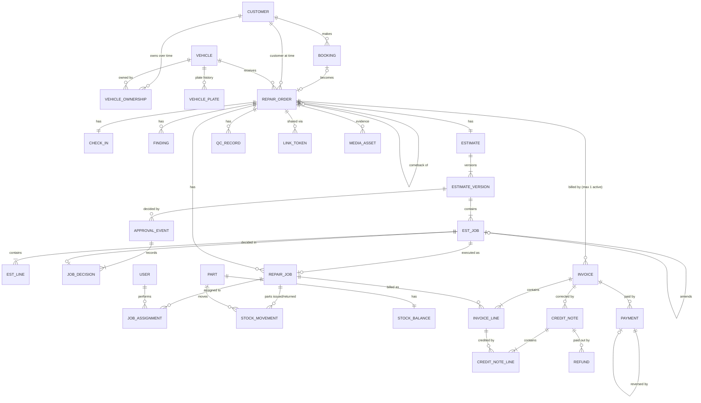

# Product Requirements Document — Garage Operations Platform
## PRD v0.2 — Critical Review and Revised Requirements

| Item | Value |
|---|---|
| Version | 0.2 (supersedes v0.1) |
| Date | 14 October 2026 |
| Status | Draft for partner review — **not approved for build** |
| Scope | Single-branch independent car repair garage, Sharjah, UAE; two partners; startup budget not yet set |
| Currency / timezone | AED / Asia/Dubai (UTC+04:00) |
| Languages | Arabic (RTL) and English (LTR) |

### Labels used in this document

| Label | Meaning |
|---|---|
| **[C]** | Confirmed partner decision (provisional, from PD-1 to PD-12 in v0.1) |
| **[A]** | Assumption — not validated; must not be hardcoded beyond what is stated |
| **[R]** | Recommendation by this review |
| **[Q]** | Unresolved question for the partners (see Section 10) |
| **[V]** | Requires professional verification (see Section 11) |

All numbers in worked examples are **illustrative arithmetic only**. They are not market prices, rates, or projections. Where a VAT rate is shown, it is used only to demonstrate the calculation. The actual rate and whether the garage charges VAT at all must be confirmed by a UAE tax agent.

---

## Contents
1. Executive Review and Top Risks
2. Prioritized Gap Register
3. Revised MVP and Deferred Scope
4. Corrected Financial Rules with Numerical Examples
5. State-Machine Definitions
6. Security and Partner Governance Review
7. Corrected Data Model and Relationship Diagram
8. Revised Acceptance Criteria for Critical Workflows
9. Dependency-Aware Implementation Backlog and Vertical Slices
10. Revised Definition of Ready and Definition of Done
11. Partner Decisions Required Before Development
12. Professional Verifications Required Before Launch
13. Change Log v0.1 → v0.2

---

## 1. Executive Review and Top Risks

### 1.1 Verdict

PRD v0.1 is comprehensive and correctly prioritizes customer approval, auditability, and partner governance. It is **not ready for development** for four structural reasons and one scoping reason:

1. **No "job" concept between the estimate and its lines.** Customers approve individual lines in v0.1. This allows nonsensical approvals, such as approving a part but declining the labor to fit it. It also makes partial approval, additional work, and invoicing caps hard to enforce. *Structural — blocks development.*
2. **A single repair-order status cannot represent parallel work.** v0.1 puts the whole repair order "On hold" when additional work is proposed. This contradicts its own exception EX-09, which says approved work may continue. *Structural — blocks development.*
3. **VAT registration was assumed** (A-1). Invoice format, cost of parts, revenue, and reports all differ depending on whether the garage is VAT-registered. The system must support both modes. *Structural — blocks development of billing.*
4. **The financial rules double-count costs** in three places: technician labor (wages and warranty labor), warranty parts (in both parts cost and warranty cost), and stock purchases (risk of being entered as both inventory and expenses). Inventory adjustments also appear in two different positions. *Blocks reporting.*
5. **Scope is too large for an undecided budget.** v0.1 classifies about 80 stories as launch "Must have," including purchase orders, supplier payment approvals, a slot-capacity engine, automated messaging, an OTP customer portal, partner drawings, and comprehensive warranty claims. Several of these duplicate what a bank mandate or accounting software already controls.

v0.2 fixes the structural defects, rewrites the financial rules, defines the state machines explicitly, and cuts the launch scope to what is needed to **open the garage safely**. A smaller set is scheduled **before the first month-end close**, and the rest is deferred.

### 1.2 Top risks

| # | Risk | Severity | Treatment in v0.2 |
|---|---|---|---|
| 1 | Build-vs-buy, budget, and launch date are undecided. Every estimate of effort is unanchored. | Critical | Section 11 — decide first. v0.2 doubles as evaluation criteria for off-the-shelf systems. |
| 2 | Invoices are non-compliant with VAT or numbering rules. | Critical | VAT mode setting with effective date; numbering assigned at issue; [V] tax agent review before launch. |
| 3 | Disputes over unapproved work, which damage the trust positioning. | High | Job-level approval, version locking, approval evidence, invoice caps per approved job. |
| 4 | Management profit figures are wrong due to double counting, which leads to bad partner decisions. | High | Section 4 rewritten with one cost bucket per item and worked examples. |
| 5 | Governance becomes so strict that the garage can't operate when a partner is unavailable. | High | Dual control limited to three action types, with a time-delayed fallback. |
| 6 | Public estimate links leak customer data or allow tampering. | High | Token specification, scoping, expiry, revocation, minimal data display. |
| 7 | The messaging provider (WhatsApp/SMS) delays launch. | Medium | Launch with staff-initiated sharing from their device; automated provider is post-launch. |
| 8 | Staff bypass the system (verbal approvals, unrecorded parts). | Medium | Simple job flow, hard guards on starting work and issuing stock, compliance reports. |

---

## 2. Prioritized Gap Register

**Type codes:** CON = contradiction · MBR = missing business rule · AMB = ambiguous/untestable · DUP = duplicate · CPX = too complex for initial release · ASM = assumption treated as requirement · DEP = blocking dependency/decision

**Blocks:** DEV = blocks development · LAUNCH = blocks opening · DEFER = can be deferred

Sorted by severity.

### 2.1 Critical

| ID | Ref (v0.1) | Type | Issue | Business impact | Resolution [R] | Blocks |
|---|---|---|---|---|---|---|
| GAP-01 | Sec. 6.4, D-21–D-23 | DEP | Build vs buy, budget, and launch date undecided. | Cannot plan, estimate, or contract. | Partners decide before any build. Use this PRD's P0 list to evaluate existing garage systems in parallel. | DEV |
| GAP-02 | A-1, US-10.2, AC-06.1, Sec. 8.1 | ASM | Assumes VAT registration; every estimate and invoice shows VAT. | Wrong invoice type and prices if not registered; wrong costs (non-recoverable VAT should be part of cost). | Add **VAT mode** setting (Not registered / Registered) with effective date, TRN, and rate as configuration. Tax is determined at invoice issue date. Cost of parts includes VAT if VAT is not recoverable. [V] V-2. | DEV (design), LAUNCH (value) |
| GAP-03 | Sec. 4.2, EX-09 | CON | Repair order goes "On hold – additional approval" while EX-09 allows approved work to continue. A single linear status can't represent jobs in different states. | Technicians are blocked unnecessarily, or work proceeds with a status that misreports reality. | Status at two levels: **job** statuses for execution and a coarse **repair order** status plus flags (`pending_approval`, `waiting_parts`). Section 5. | DEV |
| GAP-04 | US-06.4, AC-06.4, data model | MBR | Approval is per estimate line. A customer can approve a part without the labor to fit it. | Unworkable approvals, disputes, invoicing errors. | Introduce **Job** (a group of labor, parts, and fee lines for one repair). Approval and decline happen at job level only. | DEV |
| GAP-05 | Sec. 8.2 | CON | Labor is double-counted: technician wages are "direct labor" and warranty cost adds "configured internal labor cost". | Understated profit. | Labor cost exists in **one** place only: technician wages for the period. Warranty labor is tracked in hours, not in AED. Section 4. | DEV (reports) |
| GAP-06 | Sec. 8.2 | CON | Warranty parts may be counted in both "parts cost" and "warranty cost". | Understated profit. | Each job has a **charge type** (Chargeable / Warranty / Goodwill). Parts cost is split by charge type; each AED of cost appears in exactly one bucket. | DEV (reports) |

### 2.2 High

| ID | Ref | Type | Issue | Business impact | Resolution [R] | Blocks |
|---|---|---|---|---|---|---|
| GAP-07 | AC-10.8 | AMB | "Gap-free" numbering is not specified for drafts, concurrency, failed transactions, or credit notes. | Duplicate or missing numbers, compliance risk. | Drafts have no number. The number is assigned at issue inside the same transaction, using a locked counter per document type. Separate series for invoices and credit notes. Issued documents are never deleted or voided; corrections go through credit notes only. A gap-check report is provided. Whether gap-free numbering is legally required is a [V] question. | DEV |
| GAP-08 | Sec. 8, EP-12 | MBR | Nothing prevents parts purchases from also being recorded as expenses. | Parts cost counted twice. | Stock purchases are recorded only as goods receipts. The expense module has no "parts purchases" category; shop supplies not tracked as stock are a separate expense category. | DEV |
| GAP-09 | US-06.1, PD-10 | MBR | Hourly labor has no rule for when actual hours exceed the approved estimate. | Customer billed more than approved, or disputes. | The invoiced amount per job can never exceed the approved job amount. If more is needed, re-approval is required. Garage-absorbed overruns are visible in reports. | DEV |
| GAP-10 | US-06.5, EX-08 | MBR | No rule for **who** may approve: the vehicle owner, a driver, or a company representative. | Approval by an unauthorized person, disputes. | Capture an **authorized contact** (name, mobile, relationship) at check-in. Only that contact receives approval links. Changing it is logged. | DEV |
| GAP-11 | AC-06.3, US-09.2 | AMB | Public link security is undefined: entropy, storage, scope, revocation, forwarding, displayed data. | Data exposure; approval by a third party. | Token specification in Section 6.4. | DEV |
| GAP-12 | A-10, AC-06.5 | MBR | Phone approval has no confirmation back to the customer. | Weakest evidence in a dispute. | Phone approval is a configurable setting. When used, the system must generate a written confirmation message to the customer's mobile, and staff must confirm it was sent. [V] V-4. | DEV |
| GAP-13 | AC-06.6, EX-10 | MBR | No rule prevents two estimate versions being open at once, or a customer approving a superseded version. | The customer approves stale prices. | Only one version may be in "Sent" status at a time. A new version requires withdrawing the sent one, which invalidates its link. Approval submissions carry a version ID and content hash and are rejected if stale. | DEV |
| GAP-14 | EP-10 | MBR | Payment rules are missing for duplicates, interrupted card transactions, mis-entered payments, and overpayment. | Cash records don't match reality. | Section 5.D: idempotent submission, card recorded only with an approval code, reversal records, overpayment blocked. | DEV |
| GAP-15 | Sec. 3.2, US-01.3, D-5, D-6 | CPX | Second-partner approval is applied broadly (permissions, thresholds, price lists, supplier payments), and the emergency protocol is undefined. | Garage stalls if a partner is unavailable; complex to build. | Dual control limited to **three** action types. Time-delayed fallback with notification. Section 6. | DEV |
| GAP-16 | EP-09, DEP-1 | DEP | Automated WhatsApp/SMS and OTP are treated as launch-critical, but depend on provider onboarding and template approval. | Launch delay, recurring cost. | Launch with **staff-initiated sharing** (the advisor sends a generated message and link from the garage phone; the system logs it). Automated provider is P1. | LAUNCH (removed as blocker) |
| GAP-17 | Sec. 4.2 | MBR | Release path when all work is declined has no check that the vehicle has been reassembled. | Safety and liability: car returned disassembled. | A "Release check" by a technician is required before a declined-work vehicle is marked ready. | DEV |
| GAP-18 | EX-06 | MBR | No record when a customer declines **urgent safety** work. | Liability exposure. | Declined urgent jobs require a customer acknowledgment, printed on the invoice or release document. Wording is [V] V-4. | DEV |

### 2.3 Medium

| ID | Ref | Type | Issue | Business impact | Resolution [R] | Blocks |
|---|---|---|---|---|---|---|
| GAP-19 | Sec. 8.2 | CON | Inventory adjustments are placed "under cost of sales" in one row and below gross profit in the net profit formula. | Inconsistent reports. | Adjustments go in cost of sales, once. Section 4. | DEV (reports) |
| GAP-20 | Sec. 8.2 | AMB | Timing of parts cost is undefined for parts issued but not yet invoiced (work in progress) at month-end. | Month-end profit misstated. | Recognize parts cost **at invoice issue**. Issued-but-uninvoiced parts are reported as work in progress at cost. [V] V-3. | DEV |
| GAP-21 | Sec. 8.2 | AMB | Credit note cost reversal basis is undefined (current average cost or original cost). | Cost of goods drifts. | Reverse at the **original issue cost snapshot**. | DEV |
| GAP-22 | Sec. 8.1, US-06.7 | CPX | Invoice-level discounts need allocation across categories and VAT. | Complex, error-prone. | MVP: **line-level discounts only**. Invoice-level discounts deferred. | DEV |
| GAP-23 | Sec. 8.1, D-26 | AMB | VAT-inclusive price display causes rounding differences. | Totals that don't match what the customer was quoted. | MVP stores and calculates prices excluding VAT; display can show VAT-inclusive totals. The inclusive-pricing rule is [V] V-2. | LAUNCH |
| GAP-24 | EX-21 | CON | "Cancelled" is allowed only before work starts, but EX-21 describes cancelling after work has started. | No valid path; staff improvise. | "Customer stop": remaining jobs become *Cancelled by customer*, then a safety check, then invoicing of completed work. | DEV |
| GAP-25 | Sec. 4.2 | AMB | "Ready" requires an issued invoice, and "Closed" happens automatically. The ordering of QC, invoice, and payment is unclear. | Inconsistent records. | Defined explicitly in Section 5.B. | DEV |
| GAP-26 | Data model | MBR | Plate numbers change; there is no plate history. | Vehicle history lost or duplicated. | Plate history table; VIN as preferred stable key where available. | DEV |
| GAP-27 | AC-02.5 | ASM | v0.1 says a new owner sees prior service records. This is a legal question, not a product decision. | Privacy risk. | MVP: staff can see full vehicle history; no customer-facing history across owners. [V] V-1. | DEFER |
| GAP-28 | US-03.1, AC-03.1 | CPX | Self-service slot booking with a concurrency-safe capacity engine. | Large build for a single branch. | MVP: staff-entered bookings. P1: an online **booking request** that an advisor confirms. Capacity engine is P2. | DEFER |
| GAP-29 | Sec. 3.3 | CPX | Around 30 permission groups plus per-user overrides. | Costly to build and test; misconfiguration risk. | Six fixed roles plus **five sensitive per-user toggles**. Section 6. | DEV |
| GAP-30 | T-4, US-08.10 | CPX | Dual approval for *recording* supplier payments doesn't control the bank account, which is where the money actually moves. | False sense of control; duplicated effort. | Exclude supplier payables from the platform. The control is the bank mandate set in the partnership agreement, plus the accounting software. | DEFER |
| GAP-31 | US-12.7 | CPX | Partner capital and drawings in the operations platform. | Sensitive data in a widely used system. | Exclude. Recorded in accounting. Expenses paid personally by a partner are tagged "paid by Partner X" for P&L correctness. | DEFER |
| GAP-32 | EP-08 | CPX | Purchase orders, reorder levels, supplier returns, and stock reservations in the MVP. | Large scope; may not match a per-job ordering model. | MVP: catalogue, goods receipt, issue/return, adjustments, special-order receive-and-issue. Reservations and reorder P1; purchase orders P2. | DEFER |
| GAP-33 | AC-08.3 | MBR | "Negative stock not allowed" will block technicians when a part was physically received but not yet entered. | Workarounds, lost cost data. | Provide a fast **receive-and-issue** action. Negative stock stays blocked. | DEV |
| GAP-34 | EP-11 | CPX | Full warranty claim workflow (claims entity, decisions, supplier recovery) in the MVP. | Build effort for a low-frequency event at launch. | MVP: warranty terms printed on the invoice. P1: comeback repair order linked to the original, with warranty/goodwill charge type and a manager decision. Supplier recovery is a simple record (P1). | DEFER (P1, before first month-end) |
| GAP-35 | EP-12 | MBR | Equipment purchases (lifts, scanners) are not distinguished from operating expenses. | Profit distorted in the month of purchase. | Expense category type "Capital purchase", excluded from operating profit and shown separately. Depreciation is handled by the accountant. [V] V-3. | DEV (reports) |
| GAP-36 | US-12.9 | MBR | No month lock, so expenses or stock adjustments can change past reports. | Reports drift after review. | P1 month lock before the first month-end close. | DEFER (P1) |
| GAP-37 | NFR-06, AC-01.6 | AMB | "Cannot be edited or deleted by anyone" isn't technically true for a database administrator. | Overclaiming the control. | The application's database account has insert-only rights on the audit table; daily off-site export. Hash chaining is P3. | DEV |
| GAP-38 | AC-04.2b, NFR-12, AC-01.4 | AMB | Untestable wording: "evidential clarity", "typical 4G", "no English-only strings on core screens". | Disputes at acceptance. | Rewritten in Section 8 with measurable thresholds. | DEV |
| GAP-39 | A-4, A-5, A-6, A-7, A-11 | ASM | Assumptions written as hard rules (OTP, release only after payment, average costing, revenue at invoice, hosting). | Expensive rework if wrong. | Implement as **configurable defaults** where cheap (release override, VAT mode). Keep cost snapshots so a costing change is possible. Hosting region is decided before production, not before development. | DEV (design) |
| GAP-40 | US-06.8, PD-9 | MBR | Customer-supplied part acknowledgment timing isn't enforced. | Work done without acknowledgment. | The job cannot start until the acknowledgment and a part inspection outcome are recorded. The acknowledgment text is versioned. | DEV |
| GAP-41 | NFR-14 | DEP | Backup recovery objectives (how much data may be lost; how fast to restore) are "TBD". | Unknown resilience. | Partners set them; default recommendation in Section 10. | LAUNCH |
| GAP-42 | Media | MBR | No storage rules for photos: private access, size, retention. | Data exposure or cost. | Private storage, short-lived signed URLs, size limits, retention per [V] V-1. | DEV |

### 2.4 Low

| ID | Ref | Type | Issue | Resolution [R] | Blocks |
|---|---|---|---|---|---|
| GAP-43 | US-02.6 / US-13.1 | DUP | Vehicle history defined twice. | Merge into one story. | — |
| GAP-44 | US-10.6 / US-12.6 | DUP | Cash-up and cash report overlap. | P0: daily cash summary. P1: counted cash and variance. | — |
| GAP-45 | US-14.3 / US-01.3 | DUP | Approvals inbox and pending-change notifications overlap. | One approvals inbox. | — |
| GAP-46 | Sec. 2.2 KPIs | AMB | Several KPIs need data the MVP won't capture (bay utilization, technician productivity, reminder conversion). | MVP KPIs limited to those derivable from status timestamps and documents. | DEFER |
| GAP-47 | — | MBR | Old replaced parts: returned to the customer or disposed of. | Capture the customer's choice at approval; record disposition at QC. Disposal rules [V] V-7. | DEV |
| GAP-48 | — | MBR | Odometer out and road test not captured at QC. | Add to the QC checklist; odometer can't be lower than at check-in without a reason. | DEV |
| GAP-49 | — | MBR | Business date for documents isn't defined. | Business date = calendar date in Asia/Dubai at the moment of the event; stored with every financial record. | DEV |
| GAP-50 | — | MBR | Cash rounding (whether small fils amounts are rounded for cash). | [Q] D-13 in Section 11. Default: no rounding. | LAUNCH |
| GAP-51 | AC-01.8 | AMB | "Sessions end within 5 minutes". | Server-side sessions checked on every request; revocation is immediate. | — |
| GAP-52 | Sec. 7.1 | CPX | `branch_id` on every entity. | Only on top-level records (bookings, repair orders, invoices, credit notes, stock balances, settings, number sequences). | — |

---

## 3. Revised MVP and Deferred Scope

v0.2 uses three tiers:
- **A. Launch-critical (P0)** — the garage cannot open safely without it.
- **B. Post-launch (P1/P2)** — P1 is required **before the first month-end close** (about 4 weeks after opening); P2 is after the workflow is proven.
- **C. Excluded (P3)** — do not build without demonstrated need.

### A. Launch-critical MVP (P0)

| Feature | Value | Depends on | If postponed |
|---|---|---|---|
| Staff login, fixed roles, five sensitive toggles, server-side checks, 2FA for partners and finance users | Protects data and money from day one | Hosting | Cannot open safely |
| Audit log (append-only) for money, stock, price, permission, approval, release events | Trust between partners; dispute evidence | Auth | Disputes unprovable |
| Internal approvals: discount over limit, credit note, release with balance; no self-approval | Core financial control | Audit | Discounts and refunds uncontrolled |
| Dual control for admin changes (users/toggles, thresholds, VAT mode) with time-delayed fallback | Partner governance without lockout | Approvals | One partner can unilaterally change controls |
| Arabic/English, RTL, AED formatting, Asia/Dubai business date | Customer and staff usability; correct dates | — | Customer documents unusable for part of the market |
| Settings: business profile, VAT mode, numbering, warranty terms, diagnostic fee policy, thresholds | Correct documents | [V] V-2 for values | Invoices wrong |
| Customers, vehicles, plate history, authorized contact, search, duplicate warning | Core records | — | Nothing else works |
| Walk-in repair order and staff-entered bookings with day list | Accept customers | Customers/vehicles | Phone and walk-in customers can't be handled |
| Check-in: odometer, fuel, concerns, belongings, keys, photos (private storage) | Evidence; dispute protection | Media storage | Damage disputes |
| Inspection findings: severity, notes (internal vs customer), photos, fault codes | Basis of estimate | Check-in | No documented diagnosis |
| Price list: labor rates, packages, parts selling price/markup | Consistent pricing | Settings | Inconsistent quotes |
| Estimates with **jobs**, line discounts, VAT engine (both modes), bilingual PDF | Core trust promise | Price list, VAT mode | Cannot authorize work |
| Estimate versioning: one sent version at a time, withdraw, amendments, carry-forward | Approval integrity | Estimates | Stale approvals |
| Customer approval: secure link (typed name + per-job decision), in-person signature, phone approval with written confirmation | Explicit authorization | Link tokens | Unapproved work |
| Declined-urgent acknowledgment; customer-supplied part acknowledgment (if allowed at launch — [Q] D-6) | Liability protection | Approvals | Liability exposure |
| Staff-initiated sharing of links and status messages (logged) | Customer communication without provider dependency | Link tokens | Manual calls only |
| Workshop board; job assignment; technician "My jobs"; start/pause/done with guards | Execute only approved work | Approvals | Unapproved work risk |
| Parts: catalogue, goods receipt, issue/return to job, receive-and-issue for special orders, adjustments with reason | Records parts used and their cost | Catalogue | Parts cost unknown, so profit unknown |
| QC checklist (incl. road test and odometer out) and release check for declined work | Quality and safety | Jobs | Comebacks, safety incidents |
| Invoice from completed approved jobs; numbering at issue; bilingual PDF; warranty terms on invoice | Get paid correctly | Jobs, VAT mode | Cannot bill |
| Payments: multi-method, partial, idempotent, no overpayment, reversal | Reliable cash records | Invoices | Cash untraceable |
| Credit notes (with approval) and refund payout records | Lawful corrections | Invoices, approvals | Errors fixed by editing invoices |
| Delivery/handover with payment check and release override | Vehicle released only when allowed | Payments | Unpaid releases |
| Daily cash and activity summary | Daily control of the cash drawer | Payments | Cash leakage undetected |
| Backups with tested restore; paper fallback forms | Business continuity | Hosting | Data loss |

### B. Post-launch

**P1 — before the first month-end close**

| Feature | Value | Depends on | Consequence of postponing past month-end |
|---|---|---|---|
| Expense log (category types; "paid by" business or partner) | Needed for net operating profit | Settings | No management P&L; accountant has nothing to reconcile |
| Revenue, gross profit, and management P&L reports with drill-down | Partner visibility | Expenses, invoices, stock | Profit unknown |
| Accountant exports (invoices, credit notes, payments, expenses, VAT summary if registered) | Bookkeeping and tax filing | Reports | Manual re-keying |
| Month lock | Stable reported numbers | Reports | Past months change silently |
| Stock valuation and movement report | Inventory control | Parts | Shrinkage invisible |
| Comeback/warranty repair order with Warranty or Goodwill charge type; manager decision; supplier recovery record | Correct warranty cost; no fake discounts | Jobs, invoices | Warranty work disguised as 100% discounts, distorting reports |
| Counted cash and variance | Cash control | Daily summary | Variances unrecorded |
| Automated WhatsApp/SMS (templates, delivery status, failure flag) | Saves advisor time | Provider onboarding | More manual sharing |
| Customer status tracking page | Fewer "is my car ready?" calls | Link tokens | More calls |
| Online booking request (advisor confirms) | Customer convenience | Bookings | Phone bookings only |
| Stock reservations; reorder list; supplier returns | Fewer stock conflicts | Parts | Occasional double allocation; staff check manually |
| Vehicle ownership transfer | Accurate ownership | Vehicles | Workaround: register as new customer and link the vehicle |
| Check-in summary acknowledgment by customer | Stronger evidence | Links | Photos remain the evidence |
| Checklist template editing UI | Flexibility | Inspection | Use seeded templates; changes via support |

**P2 — after the workflow is proven**

| Feature | Value | Consequence of postponing |
|---|---|---|
| OTP customer portal (vehicles, invoices, warranty) | Self-service | Customers ask staff for copies |
| Maintenance reminders and deferred-work follow-ups | Repeat business | Manual follow-up |
| Customer ratings | Satisfaction KPI | Ask verbally |
| KPI dashboard | Trend visibility | Use reports |
| Slot-capacity booking engine; self-service reschedule | Scale bookings | Advisor confirms requests |
| Online payment links; booking deposits | Prepayment, fewer no-shows | Pay at counter only |
| Technician time tracking and productivity | Incentive schemes | Only needed if commission is adopted |
| Purchase orders | Formal ordering | Order by phone/WhatsApp; receive in system |
| Threshold-based approval for stock adjustments and expenses | Tighter controls | Weekly review report instead |
| Data subject request tooling (export, anonymize) | Privacy operations | Handle manually; may move to P1 per [V] V-1 |

### C. Excluded (P3 — only with demonstrated need)

| Feature | Reason |
|---|---|
| Supplier invoices, payables, and supplier payment approvals | The bank mandate and accounting software are the real control (GAP-30) |
| Partner capital and drawings ledger | Belongs in accounting (GAP-31) |
| Full double-entry accounting, payroll, WPS | External software/accountant |
| Native mobile app | Reassess after web MVP [C] PD-12 |
| Multi-branch UI | Single branch [C] PD-11; minimal `branch_id` only |
| Fleet/corporate credit accounts | [C] PD-8 |
| Insurance, bodywork, tyres, detailing workflows | [C] PD-2 |
| Invoice-level discounts, store credit | Complexity (GAP-22) |
| Audit hash chaining, data warehouse, AI features | Not proportionate at this stage |

**Assessment of the specific items you asked about:**
- **Advanced inventory:** simplify. Receipts, issue/return, adjustments, and average cost give accurate parts cost. Reservations and reorder are P1; purchase orders P2. *No loss of financial control*, because every unit leaving stock is still tied to a job or an adjustment with a reason.
- **Supplier payment approvals:** exclude. They control a record, not the money.
- **Comprehensive warranty claims:** simplify to a P1 comeback repair order with a charge type. Warranty terms on the invoice remain P0.
- **Partner drawings:** exclude from the platform.
- **Advanced P&L:** a simple management P&L is P1; the KPI dashboard is P2.

---

## 4. Corrected Financial Rules with Numerical Examples

All rules are **management reporting** rules subject to confirmation by a UAE accountant and tax agent [V] V-2, V-3. They are not statutory accounts.

### 4.1 Core principles

1. **One home per AED.** Each amount of revenue or cost appears in exactly one reporting bucket.
2. **Documents are immutable.** Reports are calculated from issued invoices, issued credit notes, payments, refunds, stock movements, and expenses. Nothing is calculated from editable drafts.
3. **Business date** is the Asia/Dubai calendar date of the event: the issue date for invoices and credit notes, the received date for payments, the movement date for stock.
4. **Amounts** are AED with 2 decimals, calculated per line and rounded half-up. Totals are sums of rounded lines. [V] V-2 for rounding rules.

### 4.2 VAT mode [A] → configurable

| Aspect | Mode: Not registered | Mode: Registered |
|---|---|---|
| VAT on sales | None charged | Configured rate per line |
| Document title | Invoice (wording per [V] V-2) | Tax invoice (fields per [V] V-2) |
| Garage TRN on documents | No | Yes |
| VAT paid on purchases | **Part of cost** (inventory cost or expense) | Recorded separately as recoverable input VAT, excluded from cost |
| Revenue | Amount charged | Amount charged excluding VAT |

The mode has an **effective date**. Each invoice records the mode, rate, and TRN that applied at issue. Estimates issued before a mode change and invoiced after it are an edge case: the system flags them so staff tell the customer before invoicing. [V] V-2 for the correct treatment.

### 4.3 Definitions

| # | Measure | Rule |
|---|---|---|
| 1 | **Gross charges** | Sum of invoice line amounts before line discounts, excluding VAT, on **Chargeable** jobs and fee lines |
| 2 | **Discounts** | Sum of line discounts, excluding VAT. Line-level only in MVP |
| 3 | **Credit notes (revenue part)** | Sum of credit note line amounts, excluding VAT, in the credit note's business date period (not the original invoice's period) |
| 4 | **Net revenue** | (1) − (2) − (3). Reported by category: Labor, Parts, Packages, Fees |
| 5 | **Parts cost of goods sold (COGS)** | Σ issue cost of parts on **Chargeable** jobs, recognized at the invoice's business date, minus the original issue cost of parts returned to stock via credit notes |
| 6 | **Work in progress (WIP)** | Issue cost of parts issued to jobs not yet invoiced. Balance-sheet style figure; **not** in profit |
| 7 | **Gross profit before labor** | (4) − (5) |
| 8 | **Direct labor cost** | Technician wages and directly related staff costs for the period, entered as expenses with category type *Direct labor*. **This is the only place labor cost appears.** |
| 9 | **No-charge work cost** | Issue cost of parts on **Warranty** and **Goodwill** jobs, recognized when the job's repair order is delivered, minus **supplier recoveries** received in the period. Labor on these jobs is **not** costed in AED (it's already in 8). It is reported as hours only. |
| 10 | **Inventory adjustments** | Net value at average cost of adjustment movements (losses − gains) in the period. Never entered as an expense |
| 11 | **Gross profit** | (7) − (8) − (9) − (10) |
| 12 | **Gross margin %** | (11) ÷ (4). Shown as "n/a" if (4) is zero |
| 13 | **Operating expenses** | Expenses with category type *Operating*, excluding recoverable VAT (registered mode only). Excludes *Direct labor* (already in 8), *Capital purchase*, and any stock purchase (stock enters only via goods receipts) |
| 14 | **Net operating profit (management)** | (11) − (13). Pre-tax. Excludes depreciation (unless the accountant provides it as an expense line), corporate tax, accruals |
| 15 | **Capital purchases** | Shown separately for information; not in profit |
| 16 | **Cash collected** | Payments received in the period (including VAT) − refunds paid in the period − payment reversals |
| 17 | **Invoice balance due** | Invoice total (incl. VAT) − credit note totals on it − payments recorded + payment reversals + refunds paid. Negative = **credit due to customer** (refund needed) |
| 18 | **Receivables** | Σ positive balances due. Should normally be near zero because no credit terms are offered [C] PD-8 |
| 19 | **VAT output** (registered) | VAT on invoices − VAT on credit notes, by business date |
| 20 | **Inventory value** | Σ on-hand quantity × average cost |
| 21 | **Partner capital and drawings** | **Not in the platform.** Expenses paid personally by a partner are recorded as expenses with "paid by: Partner X" so the P&L is correct; the settlement between partner and business is handled in accounting |

**Inventory valuation — weighted average cost [A] (confirm [V] V-3):**
- On receipt: new average = (on-hand value + received qty × unit cost) ÷ (on-hand qty + received qty). If on-hand qty is 0, average = receipt unit cost.
- Unit cost excludes recoverable VAT in registered mode and includes VAT in not-registered mode.
- Every issue stores its cost snapshot. Returns from a job or via a credit note come back at the **original issue cost**, and the average is recalculated.
- Every movement stores quantity and cost, so a future change of costing method can be recalculated from history.

**Double-counting guards (enforced by the system):**
- No expense category type for stock purchases.
- Warranty and goodwill job parts are excluded from (5) by charge type.
- No AED labor cost line exists on any job.
- Adjustments only via stock adjustment movements, never expenses.
- Credit notes reduce revenue in their own period; the original invoice is never altered.

### 4.4 Worked examples (illustrative arithmetic only)

Unless stated, the examples use **Registered mode at an illustrative rate of 5%**, and repeat key totals for **Not registered** mode.

#### Example 1 — Repair order with labor and parts

Job A "Front brake pads replacement" (Chargeable):

| Line | Qty | Unit price | Discount | Net (excl. VAT) | VAT 5% | Cost (issue snapshot) |
|---|---|---|---|---|---|---|
| Labor – fixed price | 1 | 200.00 | 20.00 | 180.00 | 9.00 | — |
| Brake pads set | 1 | 300.00 | 0.00 | 300.00 | 15.00 | 180.00 |
| Brake cleaner | 1 | 20.00 | 0.00 | 20.00 | 1.00 | 8.00 |
| **Total** | | | **20.00** | **500.00** | **25.00** | **188.00** |

- Invoice total = **525.00**. Net revenue = **500.00** (Labor 180.00; Parts 320.00). Discounts = 20.00.
- Parts COGS = **188.00**. Gross profit before labor = 500.00 − 188.00 = **312.00**.
- Technician time: **no AED labor cost** on this job (wages are counted once in the period).
- Not registered mode: invoice total = 500.00; no VAT. If the supplier charged the garage 5% VAT on the pads and cleaner, their cost becomes 189.00 + 8.40 = **197.40**, because the VAT isn't recoverable.

#### Example 2 — Partially approved estimate, then additional work

Estimate **v1** (sent):

| Job | Content | Net | VAT |
|---|---|---|---|
| A | Brake pads (as Example 1) | 500.00 | 25.00 |
| B | AC regas (labor 150.00 + refrigerant 100.00) | 250.00 | 12.50 |
| C | Wiper blades (parts 60.00) | 60.00 | 3.00 |
| | **v1 total** | **810.00** | **40.50** → 850.50 |

Customer decision on v1: **A approved, B declined, C approved**.
- Approved amount = 560.00 + 28.00 VAT = **588.00**. Job B is stored as *Declined*, can never be invoiced on this repair order, and is listed as deferred work on the vehicle history.
- Diagnostic fee: under policy "waived if any job approved" [Q] D-11, **no fee line is added**. A fee line with a 100% discount is not used, because it would inflate discount statistics.

During repair, the technician finds worn discs. Advisor creates **v2** with new Job D (labor 120.00 + discs 280.00 = 400.00 + 20.00 VAT). Jobs A and C carry forward as already approved. **Only Job D needs a decision.** Work on A and C continues; D cannot start.

Customer approves D. Final invoice = A + C + D = 960.00 + 48.00 VAT = **1,008.00**.

*Variant:* if the customer had declined everything on v1, and the policy charges a diagnostic fee of, say, 100.00 [Q], the invoice = 100.00 + 5.00 = **105.00**, the release check is required, and A/B/C are all deferred.

#### Example 3 — Credit note and refund after payment

Start: Example 1 invoice **525.00**, paid in full by card.

**3a. Goodwill reduction on labor after payment.** A credit note for labor 50.00 + 2.50 VAT = **52.50** (approved per threshold).
- Invoice balance = 525.00 − 52.50 − 525.00 = **−52.50** → credit due to customer.
- Refund recorded: 52.50 to the original card → balance **0.00**.
- Period effect: net revenue −50.00 (Labor category); VAT output −2.50; COGS unchanged; cash collected 525.00 − 52.50 = **472.50**.

**3b. Same credit note on an invoice that was only partly paid** (300.00 cash received).
- Balance = 525.00 − 52.50 − 300.00 = **172.50 still due**. **No refund** is created — a credit note is not the same as a refund.

**3c. Unused part returned to stock.** A sealed brake cleaner is returned: credit note 20.00 + 1.00 = **21.00**, with "return to stock" ticked.
- Stock +1 at the **original issue cost 8.00**; COGS −8.00 in the credit note's period; net revenue −20.00.

#### Example 4 — Warranty repair (comeback)

Sixty days after Example 1, the pads are defective. The manager accepts the comeback as **Warranty** under the printed terms.

- New repair order linked to the original. Job W "Replace defective pads", charge type **Warranty**, customer price **0.00**.
- Pads issued at the current average cost of **182.00**. Technician spends 1.5 hours.
- Customer document: a no-charge service record. Whether a zero-value tax invoice is required is [V] V-2.
- No-charge work cost = **182.00** (parts). Labor: **1.5 warranty hours**, no AED (already in wages).
- Parts COGS (definition 5) is **not** affected, since this isn't a chargeable job.
- The next month, the supplier accepts the claim and issues a credit of **150.00** (excluding VAT). The recovery is recorded in the month received: no-charge work cost that month = −150.00. Net cost of the warranty event over the two months = **32.00**.
- The defective pad goes back to the supplier and **does not** re-enter stock.

#### Example 5 — Average cost, issue, and stock write-off

Oil filter (part OF-1):

| Step | Movement | Qty | Unit cost | On hand | Average cost | Stock value |
|---|---|---|---|---|---|---|
| 1 | Opening | — | — | 10 | 20.00 | 200.00 |
| 2 | Receipt | +10 | 26.00 | 20 | (200 + 260) ÷ 20 = **23.00** | 460.00 |
| 3 | Issue to 4 jobs | −4 | 23.00 | 16 | 23.00 | 368.00 |
| 4 | Count finds 14; adjustment (reason: missing) | −2 | 23.00 | 14 | 23.00 | 322.00 |

- Step 3: 92.00 is held as WIP until the related invoices are issued, then becomes COGS.
- Step 4: inventory adjustment = **46.00** in cost of sales. **It must not also be entered as an expense.**

#### Example 6 — Monthly roll-up showing no double counting (illustrative arithmetic, not a projection)

| Line | Amount (AED) |
|---|---|
| Net revenue | 40,000.00 |
| − Parts COGS (chargeable jobs) | (14,000.00) |
| **= Gross profit before labor** | **26,000.00** |
| − Direct labor (technician wages) | (9,000.00) |
| − No-charge work cost (parts 400.00 − recoveries 150.00) | (250.00) |
| − Inventory adjustments | (300.00) |
| **= Gross profit** | **16,450.00** (margin 41.1%) |
| − Operating expenses (rent, front desk wages, utilities, software, marketing…) | (12,000.00) |
| **= Net operating profit (management, pre-tax)** | **4,450.00** |
| *Memo:* capital purchases (not in profit) | *e.g., 8,000.00* |
| *Memo:* parts purchases (in inventory, not in profit) | *e.g., 15,500.00* |
| *Memo:* cash collected incl. VAT | *from payments − refunds* |

---

## 5. State-Machine Definitions

**Actor codes:** ADV = service advisor/receptionist · TEC = technician · MGR = manager · PTR = partner · CUS = customer (via link or in person) · SYS = system. A role can act only if it holds the permission in Section 6.

**General rules for all state machines:**
- Transitions run in a single database transaction. On failure, the state is unchanged and the user sees a clear error.
- Every transition writes an audit event: actor, from-state, to-state, reason (where required), timestamp.
- Concurrent edits use optimistic locking (record version). A stale update is rejected with "this record changed — reload".

### A. Booking

| From → To | Actor | Preconditions | Audit event | Failure / recovery |
|---|---|---|---|---|
| (new) → **Requested** | CUS (online form, P1), ADV | Mobile number; plate (text allowed); preferred date ≥ today | booking.requested | Duplicate warning if same plate and date already booked |
| (new) → **Confirmed** | ADV | Date/time within opening hours; staff-entered | booking.confirmed | Over-capacity: warning only in MVP (no capacity engine) |
| Requested → Confirmed | ADV, MGR | As above | booking.confirmed | Confirmation message shared; if not shared, booking shows "customer not informed" |
| Requested → **Declined** | ADV, MGR | Reason | booking.declined | Customer informed with an alternative |
| Confirmed → Confirmed (reschedule) | ADV (MVP), CUS (P2) | New time within hours; history row kept | booking.rescheduled | Count of reschedules visible |
| Confirmed → **Cancelled** | ADV; CUS via link (P1) | Reason; customer cancellation only before cut-off [Q] D-12 | booking.cancelled | — |
| Confirmed → **No-show** | ADV | Grace period elapsed [Q] | booking.no_show | No-show count on customer |
| No-show → Checked-in | ADV | Same business day | booking.late_arrival | Recovery path for late customers |
| Confirmed → **Checked-in** | ADV | Check-in completed (creates repair order) | booking.checked_in | If check-in fails validation, booking stays Confirmed |

Terminal states: Declined, Cancelled, Checked-in, No-show (except same-day recovery).

### B. Repair order (coarse) and job (execution)

**B1. Repair order statuses**

| Status | Meaning |
|---|---|
| Checked-in | Vehicle received; check-in complete |
| Diagnosing | Inspection under way |
| Awaiting approval | Estimate sent; **no approved job yet** |
| In progress | At least one approved job not yet finished |
| QC | All approved jobs finished; quality check pending |
| Ready | QC passed (or release check passed) **and** final invoice issued |
| Delivered | Vehicle handed over |
| Closed | Delivered and balance = 0 |
| Cancelled | Ended before any work, parts issue, or invoice |

**Flags** shown alongside status (not separate states): `pending_approval` (a version is sent and undecided), `waiting_parts` (an approved job is waiting for parts), `customer_stop` (customer stopped further work).

| From → To | Actor | Preconditions | Audit |
|---|---|---|---|
| (new) → Checked-in | ADV | Customer, vehicle, authorized contact, odometer, concerns; photos ≥ configured minimum **or** reason | ro.checked_in |
| Checked-in → Diagnosing | TEC (assigned), MGR | Technician assigned to inspection | ro.diagnosis_started |
| Checked-in or Diagnosing → Awaiting approval | SYS on estimate send by ADV | Estimate version sent with ≥ 1 job | ro.awaiting_approval |
| Awaiting approval → In progress | SYS | ≥ 1 job approved | ro.work_authorized |
| Awaiting approval → Ready (declined path) | ADV | All jobs declined/not approved; **release check** passed (TEC confirms vehicle reassembled, no fluids missing); declined-urgent acknowledgments captured; fee invoice issued if policy applies (or no invoice if none due) | ro.released_without_work |
| In progress → QC | TEC, MGR | Every approved job is *Done* or *Cancelled by customer*; **no version in Sent state**; no job *Waiting parts* | ro.qc_requested |
| QC → In progress | QC checker | QC failed with notes | ro.qc_failed |
| QC → Ready | SYS on invoice issue by ADV | QC passed; invoice issued (Section D) | ro.ready |
| Ready → Delivered | ADV | Balance due ≤ 0 **or** release override approved; handover checklist (keys, belongings, old parts per customer choice, odometer out) | ro.delivered / ro.release_override |
| Delivered → Closed | SYS | Balance = 0 | ro.closed |
| Checked-in / Diagnosing / Awaiting approval → Cancelled | ADV, MGR | No parts issued, no job started, no invoice; reason | ro.cancelled |
| Ready → In progress ("Reopen for correction") | MGR | Invoice fully credited by an issued credit note; reason | ro.reopened |

**Not allowed:** any transition out of Delivered other than to Closed. A comeback after delivery is a **new** repair order linked to the original.

**Customer stops work mid-repair:** ADV records "customer stop" → all not-started or in-progress jobs become *Cancelled by customer* (work in progress jobs: technician records state reached) → parts issued but unused are returned to stock → QC/safety check → invoice for completed jobs only (and partially completed jobs only if the customer agreed a price for the partial work, recorded as an amendment) → Ready.

**B2. Job execution statuses**

| From → To | Actor | Preconditions |
|---|---|---|
| (approved decision) → **Approved** | SYS | Customer approval recorded on the version |
| Approved → **Waiting parts** | TEC, ADV | Required part not in stock |
| Waiting parts → Approved | SYS/ADV | Parts received |
| Approved → **In progress** | TEC (assigned) | Technician assigned; parts issued or available; if customer-supplied part: acknowledgment + inspection pass recorded |
| In progress ↔ **Paused** | TEC | Reason optional |
| In progress → **Done** | TEC | Completion note; parts used recorded |
| Approved / Waiting / In progress / Paused → **Cancelled by customer** | ADV | Customer stop recorded |
| Approved / Waiting → **Superseded** | SYS | An approved amendment replaced this job (Section C) |

**What happens while additional work awaits approval:** approved jobs keep running. The new job sits in the pending version and cannot be started. If an approved job physically depends on the pending decision (for example, the car can't be reassembled until the customer decides on discs), the technician sets it to *Paused* with reason "awaiting customer decision". The repair order cannot reach QC until the pending version is decided, withdrawn, or expired. If withdrawn or expired, the pending job is *Not approved* and goes to deferred work.

### C. Estimate version and job-level decisions

**C1. Version statuses**

| From → To | Actor | Preconditions | Audit |
|---|---|---|---|
| (new) → **Draft** | ADV | No other version of this estimate is in Draft or Sent | estimate.version_created |
| Draft → **Sent** | ADV | ≥ 1 job pending decision; all discounts above limit approved; totals calculated; content hash stored; link token issued | estimate.sent |
| Draft → **Discarded** | ADV | — | estimate.discarded |
| Sent → **Decided** | CUS (link, in person) or ADV (phone, with confirmation) | A decision for **every** pending job; version ID and content hash match | estimate.decided |
| Sent → **Withdrawn** | ADV | Reason; link revoked immediately | estimate.withdrawn |
| Sent → **Expired** | SYS | Validity period elapsed [Q]; link revoked | estimate.expired |

Decided, Withdrawn, Expired, and Discarded are **immutable**. In a withdrawn or expired version, pending jobs count as *Not approved*.

**C2. Job decision within a version**

| From → To | Actor | Rule |
|---|---|---|
| Pending → **Approved** | CUS / ADV (phone) | Whole job only; no line-level partial approval |
| Pending → **Declined** | CUS / ADV | If job severity is Urgent: acknowledgment required |
| Pending → **Not approved** | SYS | Version withdrawn/expired |
| *Carried forward* | SYS | Jobs already decided in earlier versions are copied as read-only references and are not re-decided |

**C3. Amendments to an approved job**

| Change | Rule |
|---|---|
| Price increase, added lines, or added scope | New version with an **amendment job** that references and replaces the original. Until approved, the original approved amount and scope apply; the added scope cannot start. |
| Price decrease or removal of a not-yet-started line | New version where the amendment is marked *Reduction — no approval needed*. The customer is notified. |
| Part substitution at the same or lower price (e.g., OEM → aftermarket) | Treated as a scope change: **approval required** [R], because the customer chose the original. |

**Invoicing cap:** the invoiced amount for each job ≤ its approved amount (latest approved amendment). Labor hours actually spent above the estimate do not change the invoiced amount.

### D. Invoice and payment

**D1. Invoice**

| From → To | Actor | Preconditions | Audit |
|---|---|---|---|
| (new) → **Draft** | ADV | Generated from jobs that are Approved **and** Done (plus permitted fee lines such as diagnostic fee); no number | invoice.drafted |
| Draft → (deleted) | ADV | Never issued | invoice.draft_deleted |
| Draft → **Issued** | ADV | QC passed (or release check on declined path); each job amount ≤ approved amount; VAT mode, rate, TRN, warranty terms, customer details snapshotted; **number assigned in the same transaction** | invoice.issued |
| Issued → Issued (credit status changes) | SYS | Credit note issued against it: *Partially credited* / *Fully credited* | invoice.credited |

Issued invoices **cannot be edited, deleted, or voided**. API attempts are rejected and logged. A repair order may have several invoices over time (after a full credit and re-issue), but **at most one that is not fully credited**.

**Payment status (derived from balance due):** Unpaid → Partially paid → Paid; or *Credit due* if a credit note makes the balance negative.

**D2. Payment record**

| From → To | Actor | Preconditions | Audit |
|---|---|---|---|
| (new) → **Recorded** | ADV | Invoice issued; amount > 0 and ≤ balance due (no overpayment; cash change is given at the counter); method set; card/transfer requires a reference (terminal approval code or transfer reference — **no card numbers**); idempotency key | payment.recorded |
| Recorded → **Reversed** | MGR (requester ≠ approver for reversals after the same business day [R]) | Reason; creates a reversal record; original untouched | payment.reversed |

**Interrupted card payment:** staff record the payment only after the terminal shows approval. If the outcome is unclear (terminal froze), nothing is recorded; the manager checks the terminal's settlement report that day and records or not. **Online payments (P2):** recorded only from a verified provider confirmation, processed idempotently.

### E. Credit note and refund

**E1. Credit note**

| From → To | Actor | Preconditions | Audit |
|---|---|---|---|
| (new) → **Draft** | ADV, MGR | References an issued invoice; lines reference invoice lines; reason code | credit_note.drafted |
| Draft → **Pending approval** | Requester | Total ≤ invoice total − prior credit notes; per-line qty ≤ invoiced qty − credited qty | credit_note.requested |
| Pending → **Issued** | Approver with permission, **≠ requester** | If total > refund threshold [Q]: partner approver | credit_note.issued (number assigned in same transaction) |
| Pending → **Rejected** | Approver | Reason | credit_note.rejected |
| Draft → (deleted) | Requester | Never submitted | credit_note.draft_deleted |

On issue: invoice credit status updates; "return to stock" lines create stock return movements at original cost; VAT reversed per invoice snapshot.

**E2. Refund payout**

| From → To | Actor | Preconditions | Audit |
|---|---|---|---|
| (auto) → **Pending** | SYS | Issued credit note leaves invoice with credit due | refund.pending |
| Pending → **Paid** | ADV, MGR | Amount ≤ credit due; method = original method by default; different method needs approval + reason [Q] D-14 | refund.paid |
| Pending → **Cancelled** | MGR | Reason (e.g., credit applied to an unpaid amount on the same invoice) | refund.cancelled |

No store credit in the MVP.

### F. Inventory

**Movement types** (all immutable; corrections by counter-movement):

| Type | Actor | Preconditions | Effect |
|---|---|---|---|
| Receipt | ADV/MGR (store permission) | Part, qty > 0, unit cost ≥ 0, supplier name, supplier reference | +qty; recalculates average |
| Issue to job | TEC (request) → ADV/MGR, or TEC if permitted | Job Approved or In progress; **qty ≤ available**; row lock to prevent two simultaneous issues exceeding stock | −qty; stores cost snapshot |
| Return from job | ADV/MGR | Job not invoiced; qty ≤ issued − returned to this job | +qty at original cost |
| Return via credit note | SYS on credit note issue | Line marked return to stock | +qty at original cost |
| Adjustment | MGR, PTR only | Reason code; counted qty | ±qty at current average |
| Receive-and-issue (special order) | ADV/MGR | Combines receipt + issue in one transaction | Net 0 on hand; cost captured |

**Reservations (P1):** Active → Consumed (on issue) / Released (job declined, cancelled, or superseded) / Expired. Available = on hand − active reservations held by other jobs. In the MVP without reservations, available = on hand.

**Failure behavior:** issue fails if stock is insufficient; the user is offered "Mark job Waiting parts" or "Receive-and-issue". No negative stock.

### G. Quality control and vehicle release

**QC record**

| From → To | Actor | Preconditions |
|---|---|---|
| (new) → **Pending** | SYS when repair order enters QC | — |
| Pending → **Passed** | QC checker (permission); **≠ technician who did the work** if setting on [Q] D-8 | All mandatory checklist items: no new warning lights, road test where applicable, odometer out (≥ check-in odometer or reason), fluids, cleanliness, old parts disposition recorded, belongings in place |
| Pending → **Failed** | QC checker | Notes; repair order back to In progress; a new QC record is created next time |

**Release:** see Section B (Ready → Delivered). A release override requires the permission "Release with balance", a reason, and generates an alert to partners. Overrides appear in a weekly report.

---

## 6. Security and Partner Governance Review

### 6.1 Simplified authorization model

**Six fixed roles** (assigned per user; a user may hold more than one):
Partner · Manager · Service advisor · Technician · Store keeper · Accountant (read-only).

**Five sensitive per-user toggles** (off by default for everyone, granted individually):

| Toggle | Grants |
|---|---|
| T1 Financial reports | Gross profit, P&L, expenses, exports |
| T2 Cost and margin visibility | Part costs, margins on estimates and stock |
| T3 Approve refunds / credit notes | Up to threshold; above threshold requires a partner holding T3 |
| T4 Manage pricing | Labor rates, packages, markups |
| T5 Administer users and settings | Users, roles, toggles, thresholds, VAT mode, numbering |

Partner A and Partner B both hold the Partner role, but each partner's toggles are set individually. There is **no permanent hierarchy** [C] PD-5.

**Why this is enough:** v0.1's ~30 permission groups mostly differentiated operational actions that role templates already cover. The five toggles capture everything that is sensitive to partners: money visibility, money out, prices, and control of controls.

### 6.2 Dual control — limited scope

| Action | Rule |
|---|---|
| Grant or remove T1–T5; create/deactivate a Partner or Manager account | Second partner must approve |
| Change thresholds, VAT mode, numbering settings | Second partner must approve |
| Credit note above threshold | A partner with T3 who is not the requester |
| Everything else | Single authorized user; audited |

**No self-approval** applies to every approval in the system, including partners.

**Partner unavailable — time-delayed fallback [R]:** if the second partner doesn't act within a configured period (e.g., a number of days set in the partnership agreement [Q] D-4), the requesting partner may apply the change. The system notifies the absent partner immediately by email/SMS, highlights the change in the audit log as "applied under fallback", and the change appears on the absent partner's dashboard until acknowledged. Operational work never needs both partners.

**Deactivation:** deactivating an account (except by dual control for Partner/Manager accounts) takes effect immediately because sessions are checked server-side on every request. Deactivating a Partner account needs the other partner's approval, but a partner can always **lock their own** account immediately (e.g., lost phone).

### 6.3 Conceptual authorization tests

| # | Scenario | Expected result | v0.1 status → v0.2 |
|---|---|---|---|
| 1 | Partner A grants themselves T1 | Pending until Partner B approves; fallback after delay with notification | Gap (unbounded) → fixed |
| 2 | Manager approves own credit note | Rejected | OK, made universal |
| 3 | Advisor gives a discount above their limit and approves it from another advisor's account on a shared tablet | Approval requires re-authentication of the approver on that device | Gap → shared-device re-auth for approvals [R] |
| 4 | Former employee's open browser session after deactivation | Next request rejected | Fixed (server sessions) |
| 5 | Technician opens a repair order not assigned to them via URL | Denied; logged | OK, tested explicitly |
| 6 | Technician tries to read prices through the API | Fields not returned | Gap → field-level filtering on server |
| 7 | User without T1 calls the P&L endpoint directly | 403; logged | OK |
| 8 | Customer changes the ID in an approval URL | Generic "link not valid" (no hint the record exists); rate limited | Gap → fixed (6.4) |
| 9 | Customer forwards the link to a friend | Friend sees vehicle make/model, masked plate, jobs, prices; can approve only by typing the authorized contact's name. Accepted risk in MVP; P1 option: OTP to the authorized mobile | Gap → explicit risk decision [Q] D-5 |
| 10 | Advisor withdraws a version while the customer has it open | Customer's submit is rejected; page shows "this estimate was updated" | Gap → fixed |
| 11 | A partner deletes an audit entry | No delete function exists; application DB account has insert-only rights on the audit table | Overclaimed → realistic control |
| 12 | Internal note leaks into customer PDF | Customer-facing outputs read only customer-facing fields | OK → tested on all outputs |

### 6.4 Customer link specification

| Property | Requirement |
|---|---|
| Token | Random, at least 128 bits, URL-safe; **stored only as a hash** |
| Scope | One purpose (estimate approval, status, invoice, acknowledgment) and one record (version or repair order) |
| Expiry | Approval links: estimate validity period [Q]; status links: until delivery + configurable days; invoice links: configurable |
| Revocation | Automatic on withdraw, expire, supersede, cancel, ownership change; manual by ADV |
| After use | Approval link becomes read-only once decided; a second submission returns the already-recorded decision (idempotent) |
| Data shown | Garage name, vehicle make/model, **masked plate**, customer first name, jobs and prices, customer notes and photos tagged "customer-visible". **Never**: internal notes, costs, other vehicles, phone numbers, technician names (configurable) |
| Abuse controls | Rate limiting per token and IP; generic error for invalid/expired/revoked tokens; no search-engine indexing |
| Evidence captured | Typed name, timestamp, IP, user agent, version ID, content hash, per-job decisions, acknowledgments |

### 6.5 Customer-supplied parts acknowledgment

Recorded per job: part description, source stated by customer, inspection outcome (pass/fail + note), the **versioned** acknowledgment text shown, method (link/signature), timestamp, accepting employee. Warranty on such jobs defaults to the configured policy (which may be "labor only" or "none") [Q] D-6, [V] V-4.

### 6.6 Items simplified without weakening controls

| v0.1 requirement | v0.2 | Why it's still safe |
|---|---|---|
| ~30 permission groups + per-user overrides | 6 roles + 5 toggles | All money/price/control actions are behind toggles |
| Second-partner approval for many actions | 3 action types + fallback | Covers "control of controls" and large money-out |
| Supplier payment dual approval | Excluded | The bank mandate controls money |
| Threshold approvals for adjustments/expenses | Restricted roles + weekly exception report (P2 thresholds) | Few users can act; every action reviewed |
| Customer OTP portal | Scoped links | Least data shown; revocable |
| Audit hash chain | Insert-only + daily off-site export | Proportionate for size |

---

## 7. Corrected Data Model and Relationship Diagram

### 7.1 Relationship diagram (MVP + P1)

### 7.2 Required schema changes from v0.1

**Add**

| # | Entity / field | Purpose |
|---|---|---|
| 1 | **EstJob** (estimate job): title, severity, charge type (Chargeable/Warranty/Goodwill), amends_job_id, customer old-parts choice | Job-level approval (GAP-04) |
| 2 | **EstLine** under EstJob (replaces EstimateLine): type (labor/part/package/fee/customer-supplied part), qty, unit price, line discount, VAT snapshot | Lines belong to a job |
| 3 | **ApprovalEvent**: version ID, content hash, method, approver name, IP/user agent, timestamp, evidence media, staff note, confirmation-sent flag | Immutable approval evidence (replaces CustomerApproval) |
| 4 | **JobDecision**: approval event, job, decision (Approved/Declined), urgent-decline acknowledgment | Per-job decisions; unique per job |
| 5 | **RepairJob**: one per approved EstJob; execution status; charge type; approved amount | Replaces WorkLine; separates approval from execution |
| 6 | **JobAssignment**: many-to-many technician ↔ repair job, from/to time | Fixes WorkLine–User cardinality |
| 7 | **Authorized contact** fields on RepairOrder (name, mobile, relationship), change history via audit | GAP-10 |
| 8 | **VehiclePlate**: emirate, code, number, valid from/to | GAP-26 |
| 9 | **NumberSequence**: document type, prefix, next value, locked on issue | GAP-07 |
| 10 | **TaxProfile**: VAT mode, rate, TRN, effective from | GAP-02 |
| 11 | **InvoiceLine** snapshot fields: repair_job_id, charge type, VAT mode/rate, cost snapshot (internal), warranty days/km | Reporting and warranty without a separate record |
| 12 | **CreditNoteLine**: invoice_line_id, qty, amount, return-to-stock flag, original cost | GAP-21 |
| 13 | **Refund** (separate from CreditNote): amount, method, reference, status | GAP-22 |
| 14 | **Payment** reversal link and idempotency key; business date | GAP-14 |
| 15 | **StockBalance**: part, on hand, average cost, row version | Concurrency-safe issue |
| 16 | **StockMovement** fields: repair_job_id, credit_note_line_id, unit cost snapshot, reason code, business date | Traceable cost |
| 17 | **LinkToken**: token hash, purpose, scope ID, expires, revoked, used at | GAP-11 |
| 18 | **CustomerSuppliedPartAck**: est_job, ack text version, inspection outcome, method, timestamp | GAP-40 |
| 19 | **QCRecord** fields: odometer out, road test, old parts disposition, checker | GAP-47/48 |
| 20 | **InternalApproval** (renamed ApprovalRequest): type (discount, credit note, release override, admin change), requester, approver (constraint ≠ requester), fallback-applied flag | Governance |
| 21 | **Expense** fields: category type (Operating/Direct labor/Capital/Excluded), paid by (Business/Partner A/Partner B), recoverable VAT | GAP-08, 31, 35 |
| 22 | **RepairOrder** fields: type (Standard/Comeback), comeback_of_id, flags | Warranty P1 |
| 23 | **SupplierRecovery** (P1): supplier name, amount, date, repair job | Example 4 |
| 24 | **Business date** on invoices, credit notes, payments, refunds, movements, expenses | GAP-49 |
| 25 | **MonthLock** (P1): period, locked by, unlocked by (dual control) | GAP-36 |

**Modify**

| # | Change |
|---|---|
| 26 | RepairOrder → Invoice: one-to-many with constraint "at most one invoice not fully credited" |
| 27 | Warranty: remove WarrantyRecord/WarrantyClaim entities from MVP; warranty terms snapshot on InvoiceLine; comeback via RepairOrder link (P1) |
| 28 | Booking: vehicle optional (plate text) until check-in links or creates the vehicle |
| 29 | `branch_id` only on top-level records (GAP-52) |
| 30 | Customer and vehicle details **snapshotted** on invoices (name, mobile, plate at time of issue) to preserve history after ownership or plate change |
| 31 | MediaAsset: visibility (internal/customer), checksum, size, linked entity, locked-after-check-in flag |
| 32 | AuditLog: sequence number; insert-only database permission |

**Remove or defer**

| # | Entity | Disposition |
|---|---|---|
| 33 | PurchaseOrder, POLine | P2 |
| 34 | SupplierInvoice, SupplierPayment | Excluded |
| 35 | PartnerTransaction | Excluded |
| 36 | ReminderRule, Reminder, Feedback | P2 |
| 37 | StockReservation | P1 |
| 38 | CashUp (counted amounts) | P1 (daily summary is a report, not an entity) |
| 39 | Bay as a scheduling resource | Keep as simple label on repair job (optional); scheduling P2 |

### 7.3 Data integrity rules

1. Unique constraint: one JobDecision per EstJob.
2. Unique constraint: one RepairJob per approved EstJob.
3. Database check: InvoiceLine amount per RepairJob ≤ RepairJob approved amount.
4. Database check: InternalApproval approver ≠ requester.
5. Stock issue and invoice number allocation run under row locks.
6. Issued Invoice, CreditNote, ApprovalEvent, Payment, StockMovement rows are never updated (except derived status fields maintained by the system) and never deleted.
7. Ownership history: staff see all repair orders for a vehicle; customer-facing outputs filter to repair orders where the requesting customer was the customer at the time.

---

## 8. Revised Acceptance Criteria for Critical Workflows

Format: Given / When / Then. "Rejected" means: no change saved, user-visible error, audit entry written for security-relevant attempts.

### 8.1 Approvals and estimates

**AC2-01 — Unapproved work cannot start**
- Given job D exists only in a version with status *Sent*
- When a technician tries to start job D, from the UI or by calling the API directly
- Then the request is rejected, job D stays not started, and the attempt is logged.

**AC2-02 — Approval of a superseded version**
- Given the customer opened version v2, and the advisor then withdrew v2 and sent v3
- When the customer submits decisions on v2
- Then the submission is rejected, no decision is recorded, and the page shows "This estimate has been updated — please use the latest link from the garage". It does not display v3's contents.

**AC2-03 — Duplicate approval submission**
- Given the customer taps "Confirm" twice within 2 seconds on a version
- When both requests reach the server
- Then exactly one ApprovalEvent is stored, and both responses show the same recorded decisions.

**AC2-04 — Expired or revoked link**
- Given a link that is expired, revoked, or for a cancelled repair order
- When anyone opens it
- Then a generic "This link is no longer valid — please contact the garage" page is shown, with no vehicle or customer data, and the response is identical for invalid, expired, and revoked tokens.

**AC2-05 — Token tampering and rate limiting**
- Given a valid token for repair order RO-1
- When the user modifies the token or a URL parameter to target another record
- Then the generic invalid-link page is shown; and after more than a configured number of invalid attempts from one IP within 10 minutes, further requests are blocked temporarily.

**AC2-06 — Increase to approved job requires re-approval**
- Given job A approved at 500.00 (excl. VAT)
- When the advisor raises job A's labor by 50.00
- Then the system creates an amendment job in a new version requiring customer approval, the invoice cap for job A stays 500.00 until the amendment is approved, and the technician cannot perform the added scope.

**AC2-07 — Hourly labor overrun**
- Given a job approved with 2.0 hours at the configured rate
- When the technician records 3.0 hours and the advisor drafts the invoice
- Then the invoice line for that job equals the approved amount, and the overrun appears in the "absorbed overruns" report.

**AC2-08 — Partial approval**
- Given v1 with jobs A, B, C
- When the customer approves A and C and declines B
- Then repair jobs exist only for A and C, B is listed under deferred work for the vehicle, and B cannot be added to any invoice for this repair order.

**AC2-09 — Declined urgent job**
- Given job B has severity Urgent
- When the customer declines B
- Then the decision cannot be submitted without the acknowledgment checkbox, and the acknowledgment text appears on the invoice or release document.

**AC2-10 — Phone approval**
- Given phone approval is enabled in settings
- When the advisor records a phone approval
- Then call time, person spoken to (must match authorized contact or be confirmed as a changed contact), and decided jobs are mandatory; the system generates a confirmation message; and the approval is marked "Phone – confirmation not sent" until the advisor confirms the message was sent.

**AC2-11 — Customer-supplied part**
- Given a job containing a customer-supplied part line
- When the technician tries to start the job before the acknowledgment and an inspection outcome are recorded
- Then the start is rejected with the missing item named.

**AC2-12 — Price list change doesn't alter sent estimates**
- Given version v1 sent with labor rate R
- When a user with T4 changes the labor rate to R2
- Then v1's totals are unchanged, and only versions created afterwards use R2.

### 8.2 Inventory

**AC2-13 — Concurrent issue of the last unit**
- Given part P has 1 unit on hand
- When two users issue 1 unit of P to different jobs at the same time
- Then exactly one issue succeeds, on-hand becomes 0, and the other user sees "insufficient stock" with options *Waiting parts* or *Receive-and-issue*.

**AC2-14 — Insufficient stock**
- Given part P has 2 units on hand
- When a user tries to issue 3
- Then the issue is rejected and on-hand remains 2.

**AC2-15 — Return at original cost**
- Given 1 unit was issued at a cost of 8.00 and the average cost is now 9.00
- When the unit is returned from the job
- Then the return movement is valued at 8.00 and the average cost is recalculated per Section 4.3.

### 8.3 Invoicing, payments, corrections

**AC2-16 — Invoice content**
- Given jobs A (Done), C (Done), D (Approved, not Done), B (Declined)
- When the advisor drafts the invoice
- Then only A and C (and permitted fee lines) are included; the invoice cannot be issued while QC is not passed.

**AC2-17 — Numbering under concurrency**
- Given two advisors issue different invoices at the same moment
- When both transactions commit
- Then they receive consecutive numbers in the invoice series; and if one transaction fails, its number is not consumed (verified by the gap report showing no gaps).

**AC2-18 — Issued invoice is immutable**
- Given an issued invoice
- When any user, including a partner, attempts to change a line, amount, date, or customer through the UI or API
- Then the request is rejected and logged; the only offered path is "Create credit note".

**AC2-19 — VAT modes**
- Given VAT mode *Not registered* effective today
- When an invoice is issued
- Then it shows no VAT lines and no TRN, and is titled per the configured non-registered wording.
- Given VAT mode *Registered* with a configured rate and TRN
- When an invoice is issued
- Then each line shows VAT at the configured rate, the TRN appears, and the mode/rate/TRN are stored on the invoice.

**AC2-20 — Duplicate payment submission**
- Given an advisor submits a 200.00 cash payment and the request is retried (double-click or network retry)
- When both requests arrive with the same idempotency key
- Then one payment is recorded.
- And if a second payment of the same amount on the same invoice is entered within 2 minutes with a different key, the system asks for confirmation.

**AC2-21 — Overpayment**
- Given a balance due of 172.50
- When an advisor enters 200.00
- Then the entry is rejected with "Amount exceeds balance due (172.50)".

**AC2-22 — Interrupted card payment**
- Given the card terminal result is unknown
- When the advisor tries to save a card payment without an approval code
- Then the save is rejected; the invoice balance is unchanged.

**AC2-23 — Credit note limits and self-approval**
- Given an invoice of 525.00 with an issued credit note of 52.50
- When a user drafts a credit note of 500.00
- Then it is rejected (maximum 472.50).
- And when the requester tries to approve their own credit note, the approval is rejected.

**AC2-24 — Refund limit**
- Given an invoice paid 300.00 and a credit due of 52.50
- When a refund of 60.00 is entered
- Then it is rejected (maximum 52.50).

### 8.4 Workflow, release, notifications, security

**AC2-25 — QC blocked by pending approval**
- Given all approved jobs are Done and version v2 is Sent
- When a user requests QC
- Then the request is rejected with "Customer decision pending on v2 — withdraw or wait".

**AC2-26 — QC self-check**
- Given the setting "QC by a different person" is on and technician T did job A
- When T tries to pass QC on that repair order
- Then the action is rejected.

**AC2-27 — Release with balance**
- Given a balance due > 0
- When the advisor marks the vehicle delivered
- Then it is rejected unless a user with the release override permission approves with a reason; an approved override sends an alert to both partners and appears in the weekly exceptions report.

**AC2-28 — Message not shared (MVP manual sharing)**
- Given the advisor generated an estimate message but didn't confirm sharing within 15 minutes
- Then the repair order shows "Customer not yet informed" on the workshop board.
- (P1, automated provider) Given the provider returns a failure, then the same flag appears within 5 minutes and a resend option is offered.

**AC2-29 — Deactivated user**
- Given user U has an active session
- When U is deactivated
- Then U's next request is rejected and redirected to login, and login fails.

**AC2-30 — Technician scoping**
- Given technician T is not assigned to repair order RO-2
- When T requests RO-2 by URL or API
- Then the response is "not found" and the attempt is logged; and on any assigned repair order, price and cost fields are absent from API responses.

**AC2-31 — Internal notes**
- Given a finding with an internal note containing the text "INTERNAL-TEST-123"
- When the estimate PDF, invoice PDF, approval page, and status page are generated
- Then none contain "INTERNAL-TEST-123" (automated test over all customer outputs).

**AC2-32 — Dual control with fallback**
- Given Partner A requests granting T1 to the manager
- When Partner B hasn't responded within the configured fallback period
- Then Partner A may apply it, Partner B is notified immediately, the audit entry is flagged "fallback", and the change stays highlighted on Partner B's dashboard until acknowledged.
- And before the period elapses, the change is not effective.

**AC2-33 — Check-in photos**
- Given the configured minimum is N photos
- When the advisor completes check-in with fewer than N
- Then completion requires a reason; and after completion, photos cannot be deleted by advisors or technicians (only marked "excluded" by a manager with a reason, kept in storage).
- Upload: images are stored at no less than a configured long-edge resolution (e.g., `[TBD]` pixels), and a photo upload of a configured maximum size completes within 10 seconds on a 10 Mbps connection (measured in test).

**AC2-34 — Localization**
- Given the language is Arabic
- When the automated UI test visits every P0 screen
- Then no untranslated keys are detected, layout direction is RTL, and amounts show "AED"/"د.إ" per the setting.

---

## 9. Dependency-Aware Implementation Backlog and Vertical Slices

### 9.1 Priorities

| Priority | Meaning |
|---|---|
| **P0** | Required to open the garage |
| **P1** | Required before the first month-end close, or high value soon after opening |
| **P2** | After the workflow is proven |
| **P3** | Only with demonstrated need |

Effort is relative (S/M/L) and assumes a custom build. If an off-the-shelf system is chosen, use this table as the evaluation checklist instead.

### 9.2 Backlog

| ID | Story | Pri | Business value | Depends on | AC | Effort | Blocks opening |
|---|---|---|---|---|---|---|---|
| **E1 Foundation** | | | | | | | |
| E1-S1 | Environments, deployment pipeline, private object storage, automated backups + restore test | P0 | Continuity | Hosting decision | NFR | M | Yes |
| E1-S2 | Staff authentication, server-side sessions, TOTP 2FA for Partner/T1–T5 holders | P0 | Security | E1-S1 | AC2-29 | M | Yes |
| E1-S3 | Six roles + five toggles, server-side and field-level enforcement, technician scoping | P0 | Data and money control | E1-S2 | AC2-30, 6.3 | M | Yes |
| E1-S4 | Append-only audit log + daily export | P0 | Partner trust, disputes | E1-S2 | AC2-18 | M | Yes |
| E1-S5 | Internal approvals engine (discount, credit note, release override), no self-approval, re-auth on shared devices | P0 | Financial control | E1-S3, E1-S4 | AC2-23, AC2-27 | M | Yes |
| E1-S6 | Dual control for admin changes with time-delayed fallback | P0 | Governance | E1-S5 | AC2-32 | M | Yes |
| E1-S7 | Arabic/English, RTL, AED, Asia/Dubai business date | P0 | Usability | — | AC2-34 | M | Yes |
| E1-S8 | Settings: business profile, TaxProfile (VAT mode), number sequences, warranty terms, fee policies, thresholds | P0 | Correct documents | E1-S6 | AC2-19 | M | Yes |
| **E2 Customers & vehicles** | | | | | | | |
| E2-S1 | Customers; duplicate warning on mobile | P0 | Records | E1-S3 | — | S | Yes |
| E2-S2 | Vehicles, plate history, VIN, ownership | P0 | Records | E2-S1 | — | M | Yes |
| E2-S3 | Search by plate/mobile/name/VIN | P0 | Speed at counter | E2-S2 | — | S | Yes |
| E2-S4 | Vehicle history (merged story) | P0 | Traceability | E8-S1 | — | S | Yes |
| E2-S5 | Ownership transfer | P1 | Accuracy | E2-S2 | — | S | No |
| E2-S6 | Data subject requests (export/anonymize) | P2 | Privacy | V-1 | — | M | No |
| **E3 Intake** | | | | | | | |
| E3-S1 | Walk-in repair order creation with authorized contact | P0 | Accept customers | E2-S3 | — | S | Yes |
| E3-S2 | Check-in (odometer, fuel, concerns, belongings, keys) + photos | P0 | Evidence | E3-S1, E1-S1 | AC2-33 | M | Yes |
| E3-S3 | Staff-entered bookings, day list, no-show, late arrival | P0 | Appointments | E2-S1 | — | S | Yes |
| E3-S4 | Online booking request + advisor confirmation | P1 | Convenience | E3-S3, E9-S1 | — | M | No |
| E3-S5 | Customer check-in acknowledgment | P1 | Evidence | E9-S1 | — | S | No |
| E3-S6 | Capacity engine, self-service reschedule | P2 | Scale | E3-S4 | — | L | No |
| **E4 Inspection** | | | | | | | |
| E4-S1 | Findings: severity, fault codes, photos, internal vs customer notes | P0 | Diagnosis | E3-S2 | AC2-31 | M | Yes |
| E4-S2 | Seeded checklist templates | P0 | Consistency | E4-S1 | — | S | Yes |
| E4-S3 | Checklist template editor | P1 | Flexibility | E4-S2 | — | S | No |
| **E5 Estimates & approval** | | | | | | | |
| E5-S1 | Price list: labor rates, packages, part prices/markups | P0 | Pricing | E1-S8 | AC2-12 | M | Yes |
| E5-S2 | Estimate builder with jobs, lines, line discounts, VAT engine | P0 | Core promise | E5-S1, E4-S1 | AC2-19 | L | Yes |
| E5-S3 | Versioning, withdraw/expire, carry-forward, amendments, invoice cap | P0 | Approval integrity | E5-S2 | AC2-02, 06, 07 | L | Yes |
| E5-S4 | Approval via secure link (typed name, per-job decision, idempotent) | P0 | Authorization | E9-S1, E5-S3 | AC2-01–05, 08 | M | Yes |
| E5-S5 | In-person signature; phone approval with confirmation | P0 | Authorization | E5-S4 | AC2-10 | M | Yes |
| E5-S6 | Urgent-decline acknowledgment | P0 | Liability | E5-S4 | AC2-09 | S | Yes |
| E5-S7 | Customer-supplied part acknowledgment | P0* | Liability | E5-S4 | AC2-11 | S | *Only if allowed at launch [Q] D-6 |
| E5-S8 | Bilingual estimate PDF | P0 | Customer document | E5-S2 | AC2-31 | M | Yes |
| **E6 Workshop** | | | | | | | |
| E6-S1 | Workshop board (status + flags) | P0 | Flow | E5-S3 | — | M | Yes |
| E6-S2 | Assignment; "My jobs"; job state guards | P0 | Execute approved work only | E6-S1 | AC2-01 | M | Yes |
| E6-S3 | Additional finding during work → new version | P0 | Approvals mid-job | E5-S3, E6-S2 | AC2-25 | S | Yes |
| E6-S4 | QC checklist, release check for declined path, customer stop | P0 | Quality, safety | E6-S2 | AC2-25, 26 | M | Yes |
| E6-S5 | Delivery/handover with release override | P0 | Release control | E8-S2, E1-S5 | AC2-27 | S | Yes |
| E6-S6 | Time tracking and productivity | P2 | Incentives | D-9 | — | M | No |
| **E7 Parts** | | | | | | | |
| E7-S1 | Parts catalogue (bilingual names, type OEM/aftermarket) | P0 | Records | E1-S7 | — | S | Yes |
| E7-S2 | Goods receipt with average cost | P0 | Cost accuracy | E7-S1 | AC2-15 | M | Yes |
| E7-S3 | Issue/return to job, receive-and-issue, concurrency | P0 | Cost per job | E7-S2, E6-S2 | AC2-13, 14 | M | Yes |
| E7-S4 | Stock adjustment (MGR/PTR, reason) | P0 | Shrinkage control | E7-S2 | — | S | Yes |
| E7-S5 | Reservations, reorder list, supplier returns, supplier recovery record | P1 | Fewer conflicts | E7-S3 | — | M | No |
| E7-S6 | Purchase orders | P2 | Formal ordering | E7-S2 | — | M | No |
| **E8 Billing** | | | | | | | |
| E8-S1 | Invoice drafting/issue, numbering, snapshots, bilingual PDF, warranty terms | P0 | Get paid | E6-S4, E1-S8 | AC2-16–19 | L | Yes |
| E8-S2 | Payments (multi-method, partial, idempotent, no overpay, reversal) | P0 | Cash records | E8-S1 | AC2-20–22 | M | Yes |
| E8-S3 | Credit notes with approval, stock return | P0 | Corrections | E8-S1, E1-S5, E7-S3 | AC2-23 | M | Yes |
| E8-S4 | Refund payout | P0 | Corrections | E8-S3 | AC2-24 | S | Yes |
| E8-S5 | Daily cash and activity summary | P0 | Cash control | E8-S2 | — | S | Yes |
| E8-S6 | Counted cash and variance | P1 | Cash control | E8-S5 | — | S | No |
| E8-S7 | Online payment links, deposits | P2 | Prepayment | D-10, provider | — | M | No |
| **E9 Customer links & notifications** | | | | | | | |
| E9-S1 | Link token service (hashing, scope, expiry, revocation, rate limit) | P0 | Secure customer access | E1-S1 | AC2-04, 05 | M | Yes |
| E9-S2 | Staff-initiated sharing (generated message + link, bilingual, "shared" confirmation log) | P0 | Communication | E9-S1 | AC2-28 | S | Yes |
| E9-S3 | Customer status page | P1 | Fewer calls | E9-S1 | — | S | No |
| E9-S4 | Automated WhatsApp/SMS provider, templates, delivery status | P1 | Efficiency | D-3, provider | AC2-28 | M | No |
| E9-S5 | OTP customer portal | P2 | Self-service | E9-S4 | — | M | No |
| E9-S6 | Reminders; ratings | P2 | Retention | E9-S4 | — | M | No |
| **E10 Reporting & expenses** | | | | | | | |
| E10-S1 | Expense log (category types, paid by) | P1 | P&L input | E1-S8 | — | S | No (blocks month-end) |
| E10-S2 | Revenue, gross profit, management P&L with drill-down | P1 | Partner visibility | E8-S3, E7-S3, E10-S1 | Sec. 4 examples as test cases | M | No (blocks month-end) |
| E10-S3 | Accountant exports; VAT summary (registered mode) | P1 | Bookkeeping | E10-S2 | — | S | No (blocks month-end) |
| E10-S4 | Stock valuation, movements, WIP | P1 | Inventory control | E7-S3 | — | S | No |
| E10-S5 | Month lock (dual control to unlock) | P1 | Stable reports | E10-S2, E1-S6 | — | S | No |
| E10-S6 | Weekly exceptions report (overrides, adjustments, discounts, reversals, fallback approvals) | P1 | Governance | E1-S4 | — | S | No |
| E10-S7 | KPI dashboard | P2 | Trends | E10-S2 | — | M | No |
| **E11 Warranty** | | | | | | | |
| E11-S1 | Comeback repair order linked to original; coverage display; Warranty/Goodwill charge type; manager decision | P1 | Correct warranty cost | E8-S1 | Example 4 | M | No |
| **E12 Readiness** | | | | | | | |
| E12-S1 | Master data load (prices, parts, checklists, templates AR/EN) | P0 | Go-live | All P0 config | — | M | Yes |
| E12-S2 | Legal texts integrated (terms, acknowledgments, warranty wording) | P0 | Compliance | V-4 | — | S | Yes |
| E12-S3 | UAT: full lifecycle + exception scenarios; training; paper fallback | P0 | Readiness | All P0 | All AC2 | M | Yes |
| E12-S4 | Security review; restore test; permission review | P0 | Safety | All P0 | Sec. 6.3 | S | Yes |

### 9.3 Vertical-slice delivery plan

**Slice 1 — Walking skeleton (first demonstrable journey)**

Register customer and vehicle → check in vehicle → record inspection → issue estimate → capture customer approval → execute approved work → perform QC → issue invoice → record payment → record delivery.

Stories (minimal versions): E1-S2 (basic login), E1-S3 (roles only, no toggles yet), E1-S7 (bilingual framework), E1-S8 (VAT mode both, numbering), E2-S1–S3, E3-S1, E3-S2, E4-S1, E5-S1 (seeded prices), E5-S2, E5-S3 (single version only), E5-S4, E9-S1, E9-S2, E6-S2, E6-S4 (QC pass/fail only), E7-S1 + receive-and-issue from E7-S3, E8-S1, E8-S2 (cash/card manual), E6-S5 (no override yet).

Mocks in Slice 1:

| Mock | Label | Replacement before production |
|---|---|---|
| Photo storage on local disk | **MOCK-STORAGE** | Private object storage with signed URLs (E1-S1) — required |
| Approval link shown on screen / copied, not sent | **MOCK-SHARE** | Staff-initiated sharing via device (E9-S2) — this *is* the production MVP behavior, so only logging is added |
| Seeded price list, parts, checklist, customers | **MOCK-DATA** | Real master data (E12-S1) — required |
| Plain PDF layout | **MOCK-PDF** | Bilingual branded templates with approved legal text (E5-S8, E8-S1, E12-S2) — required |
| VAT rate/TRN placeholder | **MOCK-TAX** | Values confirmed by tax agent (V-2) — required |

No payment-provider mock is needed; payments are recorded manually.

**Slice 2 — Changes and corrections:** full versioning and amendments, partial approval, declined path with release check, urgent-decline acknowledgment, phone and in-person approvals, customer-supplied parts (if D-6 yes), additional work during repair, customer stop, credit notes, refunds, payment reversals, discount approvals, complete audit log.

**Slice 3 — Stock and intake:** goods receipt with average cost, issue/return, adjustments, bookings and day list, workshop board with flags, link token hardening (rate limits, revocation triggers), photo storage hardening.

**Slice 4 — Control and readiness (opening gate):** toggles and field-level filtering, dual control and fallback, 2FA, internal approval re-auth, release override, daily cash summary, bilingual PDFs, master data, legal texts, backups and restore test, security review, UAT, training. **→ Garage opens.**

**Slice 5 — First month-end (P1):** expenses, reports, exports, month lock, stock reports, exceptions report, comeback/warranty repair orders, counted cash, then automated messaging and customer status page.

---

## 10. Revised Definition of Ready and Definition of Done

### 10.1 Definition of Ready (story)

1. The story has a backlog ID, priority, and the slice it belongs to.
2. Acceptance criteria are written in Given/When/Then, including **at least one negative and one authorization case**.
3. Any state transition it touches references Section 5, with actor and guard.
4. Any partner decision it depends on is answered, **or** the story implements it as a configurable setting with a stated default.
5. Financial stories have a worked example (Section 4 or new) used as a test case.
6. Fields shown to customers vs internal are identified.
7. Arabic and English labels are listed (final translation may follow).
8. Dependencies are done or explicitly mocked with a MOCK label.

### 10.2 Definition of Done (story)

1. All acceptance criteria pass as automated tests where feasible (business rules, state transitions, calculations, permissions).
2. Server-side authorization tested for allowed and denied roles, including direct API calls.
3. Required audit events are written and asserted in tests.
4. Calculations match the worked examples to the fil.
5. Concurrency and idempotency tested where the story writes money, stock, numbers, or approvals.
6. Arabic RTL and English LTR verified on affected screens and documents; no untranslated keys.
7. Business dates and display times in Asia/Dubai; amounts in AED, 2 decimals.
8. No personal data, tokens, OTPs, or secrets in logs; no internal fields in customer outputs.
9. Code reviewed by a second person; no known critical defects.
10. Deployed to staging and accepted by the product owner.
11. Any MOCK used is listed in the release notes with its replacement story.

### 10.3 Definition of Done (opening gate)

1. All P0 stories done; **no MOCK-STORAGE, MOCK-DATA, MOCK-PDF, or MOCK-TAX remaining**.
2. Professional verifications V-1, V-2, V-4, V-5, V-7 completed and changes implemented (Section 12).
3. Launch configuration set: VAT mode, numbering, thresholds, warranty terms, fee policies, roles and toggles per partner, fallback period.
4. UAT completed by both partners and front-desk staff for Slice 1–4 journeys, including AC2-01 to AC2-34.
5. Backup restore tested successfully; recovery objectives agreed (default recommendation: lose no more than 24 hours of data, restore within 1 business day [R] — partners to confirm).
6. Staff trained per role; paper fallback forms printed.
7. A plan with owners exists for P1 items due before the first month-end close.

---

## 11. Partner Decisions Required Before Development

Only decisions that **change what is built** are listed here. Launch configuration values follow in 11.2.

### 11.1 Before development

| ID | Decision | Why it blocks development | Recommendation [R] |
|---|---|---|---|
| D-1 | Build in-house, outsource, or buy/customize an existing garage system? Budget range? Target opening date? | Determines everything else | Evaluate 2–3 existing systems against Section 3A and Section 8 before committing to a build |
| D-2 | Who will act as manager at opening (hired or a partner)? Will one person be both advisor and store keeper? | Affects segregation of duties and how many approvers exist | At least two staff users who can approve each other's corrections, plus partners |
| D-3 | Messaging at launch: staff-initiated sharing (recommended), or invest in automated WhatsApp/SMS from day one? | Changes P0 scope and external dependency | Staff-initiated at launch; provider in P1 |
| D-4 | Accept dual control for the three admin action types, and the time-delayed fallback period? | Builds the governance engine | Yes; fallback period set in partnership agreement |
| D-5 | Approval via link with typed name (accepted risk of forwarded links), or require OTP from day one? | OTP needs a messaging provider | Typed name at launch; OTP in P1/P2 |
| D-6 | Accept customer-supplied parts at launch? | Adds P0 story and legal text | If unsure, start with "not accepted" and enable later |
| D-7 | Allow phone approval at all? | Adds flow and dispute risk | Allow, with written confirmation |
| D-8 | Must QC be done by someone other than the technician? | Validation rule | Yes when staffing allows; configurable |
| D-9 | Technician commission at launch? | Needs time tracking (P2) and changes labor cost reporting | Salary only at launch |
| D-10 | Booking deposits or online payments at launch? | Requires a payment gateway | No at launch |

### 11.2 Before launch (configuration — does not block development)

| ID | Decision |
|---|---|
| D-11 | Diagnostic fee policy: amount, when charged, when waived |
| D-12 | Cancellation and no-show rules; estimate validity period; booking grace period |
| D-13 | Cash rounding (default: none) |
| D-14 | Refund methods allowed (default: original method only) |
| D-15 | Warranty terms for labor, garage-supplied parts, customer-supplied parts |
| D-16 | Thresholds: advisor discount limit, manager discount limit, credit note threshold for partner approval |
| D-17 | Each partner's toggles (T1–T5); whether the manager sees costs (T2) or reports (T1) |
| D-18 | Minimum check-in photos; quiet hours for messages |
| D-19 | Recovery objectives for backups |
| D-20 | Storage charges for uncollected vehicles (if any) |
| D-21 | Opening hours, working week, public holidays |
| D-22 | Branding and document wording (AR/EN) |
| D-23 | Which accountant/software receives exports (needed before first month-end) |

---

## 12. Professional Verifications Required Before Launch

| ID | Professional | Specific questions | Affects |
|---|---|---|---|
| V-1 | UAE lawyer (data protection) | Applicable data protection law; consent wording for service vs marketing messages; retention periods for customer data, photos, invoices; hosting/data residency and cross-border transfers (cloud, messaging providers); whether a vehicle's new owner may see prior service records | Settings, media, hosting, E2-S6 |
| V-2 | UAE tax agent | Is the business required (or advised) to register for VAT, and from when? Mandatory content and language of tax invoices and credit notes; whether sequential/gap-free numbering is required; rounding; treatment of VAT-inclusive display; zero-value documents for warranty work; recoverable VAT on parts and expenses; applicability and timing of any e-invoicing requirements | E1-S8, E5-S2, E8 |
| V-3 | Accountant | Weighted average cost acceptable? Recognizing parts cost at invoice and WIP treatment; warranty cost and supplier recovery timing; capital vs operating expenses and depreciation; partner-paid expenses; export format for their software; corporate tax considerations for management vs statutory profit | Section 4, E10 |
| V-4 | UAE lawyer (consumer/contract) | Enforceability of link-based and phone approvals; estimate validity; declined-urgent-work acknowledgment wording; customer-supplied parts disclaimer; warranty terms; storage charges and uncollected vehicles; cancellation terms; customer terms (AR/EN) | E5, E6, E12-S2 |
| V-5 | UAE lawyer (partnership) | Decision rights, bank signing mandate, thresholds, dual-control and fallback period, deadlock, drawings, related-party purchases | Section 6 |
| V-6 | Bank / payment provider | Card terminal procedures, settlement reports for reconciliation, refund rules | E8-S2, E8-S4 |
| V-7 | Sharjah authorities / PRO | Trade license activities for the services in PD-1; workshop and premises approvals; civil defence; handling and disposal of oil, batteries, refrigerant, and replaced parts; any record-keeping obligations | QC old-parts disposition, retention |
| V-8 | Employment advisor | Technician contracts; if commission is introduced later, how it must be documented | E6-S6 (P2) |
| V-9 | Messaging provider | Sender registration and template rules for WhatsApp/SMS in the UAE | E9-S4 (P1) |

---

## 13. Change Log v0.1 → v0.2

| # | Area | Change |
|---|---|---|
| 1 | Estimates | Added **jobs** between estimates and lines; approval is per job, not per line |
| 2 | Approvals | One sent version at a time; withdraw/expire; amendments; content hash; idempotent submission; invoice cap per job |
| 3 | Approvals | Authorized contact on each repair order; phone approval requires written confirmation; declined-urgent acknowledgment |
| 4 | Status model | Two-level model: repair order statuses + flags, and job execution statuses; explicit transitions, guards, and recovery paths for 7 state machines |
| 5 | Workflow | Release check for declined work; customer stop path; reopen-for-correction via full credit note |
| 6 | VAT | VAT registration no longer assumed; VAT mode with effective date; cost includes non-recoverable VAT |
| 7 | Numbering | Number assigned at issue under lock; separate credit note series; no void |
| 8 | Finance | Rewrote all definitions; labor cost in one place; charge types for warranty/goodwill; WIP; adjustments in cost of sales; capital purchases separate; partner drawings removed; 6 worked examples |
| 9 | Inventory | Receive-and-issue for special orders; original-cost returns; reservations moved to P1; purchase orders to P2 |
| 10 | Payments | Idempotency, no overpayment, approval code required for card, reversal records; refunds separated from credit notes |
| 11 | Discounts | Line-level only in MVP |
| 12 | Governance | 6 roles + 5 toggles replace ~30 permission groups; dual control limited to 3 action types; time-delayed fallback; universal no-self-approval; re-auth for approvals on shared devices |
| 13 | Security | Customer link specification; field-level filtering; insert-only audit log (hash chain moved to P3) |
| 14 | Scope | Launch scope cut to P0; P1 tied to first month-end close; supplier payables, partner drawings, accounting excluded; automated messaging, online booking, status page, warranty claims moved to P1; OTP portal, reminders, capacity engine, payments online to P2 |
| 15 | Messaging | Staff-initiated sharing at launch removes provider dependency |
| 16 | Data model | 25 additions, 7 modifications, 7 removals/deferrals (Section 7.2); integrity constraints |
| 17 | Testability | 34 rewritten acceptance criteria covering concurrency, duplicates, expired links, interrupted payments, stock shortages, version conflicts |
| 18 | Delivery | Five vertical slices; Slice 1 completes the full customer journey; mocks labeled with replacement requirements |
| 19 | Decisions | Split into 10 decisions before development and 13 launch configuration values |
| 20 | Duplicates | Merged vehicle history stories, cash reports, and approval inbox |
