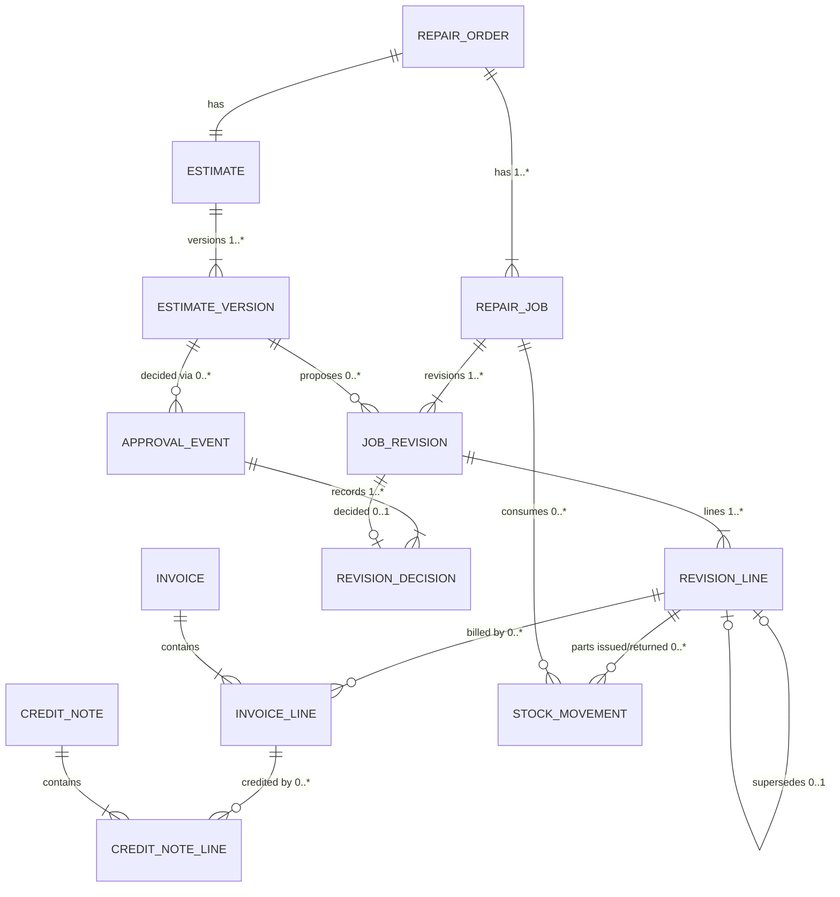

# Garage Operations Platform — Targeted Architecture and Business-Rule Review
## PRD v0.2 → v0.2.1 Addendum

| Item | Value |
|---|---|
| Version | 0.2.1 (addendum — amends v0.2; does not replace it) |
| Date | 14 October 2026 |
| Purpose | Resolve remaining contradictions and data-integrity risks before the build-vs-buy decision |
| Out of scope | Code, Prisma models, SQL, API design, full PRD rewrite |

**Labels:** [C] confirmed partner decision · [A] assumption · [R] recommendation · [Q] partner decision needed · [V] needs verification by a qualified UAE professional (tax agent, accountant, or lawyer).

**All amounts are illustrative arithmetic in AED.** Where a tax amount appears, it uses an illustrative 5% rate to show the mechanics only. Nothing in this document asserts legal or tax compliance.

---

## Contents
1. Unresolved contradictions in v0.2
2. Corrected job / revision / approval data model
3. Corrected state transitions
4. Corrected financial formulas and reconciled examples
5. Database integrity and concurrency controls
6. Scope and feasibility recommendations
7. Revised acceptance criteria (affected requirements only)
8. Partner decisions and professional verifications still required
9. Change log v0.2 → v0.2.1

---

## 1. Unresolved Contradictions in v0.2

| ID | v0.2 reference | Contradiction | Severity | Resolved in |
|---|---|---|---|---|
| X-01 | §5.C, §7.2 #1–5, §7.3 #1–2 | Job identity is ambiguous. "One decision per EstJob" and "one RepairJob per approved EstJob" conflict with amendments being **new** EstJobs and with jobs "carried forward" into later versions. An approved amendment would create a second RepairJob for the same physical work, so the same repair could be billed twice. | **Critical** | §2 |
| X-02 | §6.2 | The time-delayed fallback applies to **all** dual-control actions, including a partner granting privileges to themselves. Waiting out the timer becomes a privilege-escalation path. | **Critical** | §3.6 |
| X-03 | §5.C1 | A version can only become "Decided" when **every** pending job is decided, but customers often approve some jobs now and think about others. It is undefined whether decisions made before a withdrawal or expiry survive it. | High | §3.1–3.2 |
| X-04 | §5.D, §4.3 #17, §7.2 #26 | No mechanism moves a customer's credit from a fully credited invoice to its replacement invoice. Credit is either stuck or forced into an unnecessary cash refund and re-payment. | High | §4.2 |
| X-05 | §4.3 #5 | Parts cost is recognized "at invoice" but reversed only when parts return to stock. A full credit note plus a replacement invoice counts the parts cost **twice**. Issued parts that are never billed stay in work-in-progress forever. | High | §4.3 |
| X-06 | §7.3 #3 | Claims a "database check" enforces the invoice cap. A row-level CHECK constraint cannot enforce a sum across multiple invoice and credit-note rows. | High | §5 |
| X-07 | §5.C1 vs AC2-10 | Phone approval: the state machine records the decision immediately, but AC2-10 marks it "confirmation not sent" afterwards. It is unclear whether work may start in between. | High | §3.5 |
| X-08 | §5.B1 "declined path", §4.4 Ex. 2 | A diagnostic fee can be invoiced even though the customer never authorized diagnosis. "Ready" requires an issued invoice, but no rule covers the case where nothing is due. | High | §3.4 |
| X-09 | §4.2, §7.2 #10 | Tax treatment is configured only at business level (one mode, one rate). There are no line-level tax codes, and no rule for when the tax configuration changes between estimate approval and invoice issue. | High | §4.4 |
| X-10 | §6.2 | Removing privileges or deactivating a user requires a second partner. Risk-**reducing** actions should never wait. | Medium | §3.6 |
| X-11 | §6.3 #9, AC2-10 | The typed name in an approval link is treated as identity. It only proves possession of the link. There is no step-up check for high-value or sensitive approvals. | Medium | §3.7 |
| X-12 | §5.B1 | QC is blocked while any version is "Sent". A customer who never answers about an optional job blocks delivery indefinitely. | Medium | §3.2 |
| X-13 | §5.B1 "customer stop" | Pricing partial work is called an "amendment", but reductions need no approval. The customer's agreement to the partial charge isn't captured. | Medium | §3.3 |
| X-14 | §5.F | Parts may be issued to any approved job, including lines that a pending revision proposes to replace (e.g., the original part during a pending substitution). | Medium | §3.3 |
| X-15 | §5.B1 Ready | "Ready" requires an issued invoice, but warranty repair orders and fully declined repair orders may have nothing to invoice. | Medium | §3.4 |
| X-16 | §5.D2 | The payment reversal rule ("requester ≠ approver after the same business day") is vague and inconsistent with the general no-self-approval rule. | Low | §3.8 |
| X-17 | §6.3 #3 | Re-authentication on shared devices appears only in a test scenario, not in a requirement or acceptance criterion. | Low | §3.6, AC |

---

## 2. Corrected Job / Revision / Approval Data Model

### 2.1 Design decisions [R]

1. **A job has a stable identity.** A *RepairJob* is the logical repair ("Front brakes"). It exists once per repair order, no matter how many estimate versions mention it.
2. **Changes are revisions of a job.** A *JobRevision* is a proposed change to one job: the original scope, added scope, a price change, a reduction, or a substitution. Each revision is **proposed in exactly one estimate version** and receives **at most one decision**. Decisions are never edited.
3. **Lines are the billable atoms.** A *RevisionLine* is one labor, part, or fee line. A line in a later revision may **supersede** exactly one earlier line of the same job (price change, reduction, substitution). Added scope simply adds lines.
4. **"Carried forward" is display only.** A later version shows earlier approved revisions as read-only context in its immutable snapshot (the document the customer sees, with its content hash). Earlier revisions are **not** copied into the new version as records and are **not** re-decided.
5. **Lapsed revisions are not reused.** If a version is withdrawn or expires, its undecided revisions become *Lapsed* (terminal). To propose the same work again, the advisor creates a **new** revision in the new version. This keeps "one proposing version, at most one decision" true for every revision.
6. **At most one pending revision per job.** This prevents two pending revisions from trying to supersede the same line.
7. **Authorized scope** of a job = all lines of its *Approved* revisions, minus lines superseded by a line in another *Approved* revision.
8. **Invoicing is line-based.** Every invoice line references one authorized RevisionLine. The **net billed** quantity and amount per RevisionLine (issued invoice lines minus issued credit-note lines) can never exceed what is authorized.

### 2.2 Entities

| Entity | Key fields | Mutability |
|---|---|---|
| **RepairJob** (logical job) | repair_order, title, job type (Repair / Diagnostic), charge type (Chargeable / Warranty / Goodwill), execution status | Execution status changes; identity fixed |
| **EstimateVersion** | estimate, version no., status, sent_at, expires_at, **snapshot** (rendered content incl. context), **content hash**, link token | Status only; snapshot immutable once sent |
| **JobRevision** | job, revision no., kind (Original / Add scope / Price change / Reduction / Substitution / Partial-work agreement), **proposed_in_version**, status (Draft / Pending / Approved / Declined / Lapsed), lapse reason | Status moves once from Pending to a terminal status |
| **RevisionLine** | revision, type (labor / part / fee / customer-supplied part), item ref, qty, unit price, line discount, net amount, tax code (estimate-time), **supersedes_line** (nullable, same job), frozen flag (derived) | Immutable once the revision is sent |
| **ApprovalEvent** | version, method (link / in-person signature / phone / garage reduction), verification level (possession / step-up / in-person), approver name, evidence (IP, device, media, call details, confirmation-sent record), content hash, idempotency key, timestamp | Immutable |
| **RevisionDecision** | approval event, revision, decision (Approved / Declined), urgent-decline acknowledgment | Immutable |
| **InvoiceLine** | invoice, **revision_line**, qty, unit price, discount, net, tax snapshot, cost snapshot | Immutable |
| **CreditNoteLine** | credit note, invoice line, credit kind (**Quantity** — reverses billed units / **Amount** — price adjustment only), qty, net, tax, return-to-stock flag | Immutable |
| **StockMovement** (issue/return) | part, qty, unit cost, repair job, **revision_line** (required for part issues to chargeable jobs) | Immutable |

### 2.3 Concrete example — Job A approved for 500, then 150 of additional work approved

| Step | Event | Records created | Effect |
|---|---|---|---|
| 1 | Advisor drafts estimate v1 | RepairJob **J-A** "Front brakes" (Chargeable). EstimateVersion **EV-1** (Draft). JobRevision **JR-A1** (J-A, rev 1, Original, proposed in EV-1). RevisionLines **RL-1** labor (gross 200, disc 20, net 180), **RL-2** brake pads 300, **RL-3** brake cleaner 20 | Nothing authorized yet |
| 2 | Advisor sends EV-1 | EV-1 status Sent; snapshot + hash **H1**; JR-A1 Pending; link token issued | Customer can decide |
| 3 | Customer approves | ApprovalEvent **AE-1** (EV-1, link, hash H1, idempotency key). RevisionDecision **RD-1** (JR-A1, Approved) | JR-A1 Approved. EV-1 Closed (nothing pending). J-A authorized amount = **500.00** (RL-1, RL-2, RL-3) |
| 4 | Work starts; technician finds worn caliper slider pins | Finding recorded. J-A continues on RL-1..3 | — |
| 5 | Advisor drafts and sends EV-2 | EstimateVersion **EV-2** (Sent, hash **H2**). JobRevision **JR-A2** (J-A, rev 2, **Add scope**, proposed in EV-2, Pending). Lines **RL-4** slider pin kit 100, **RL-5** labor 50. EV-2 snapshot shows JR-A1 as "Already approved — 500.00" (context only, no record copied) | Only JR-A2 needs a decision. Issuing the slider kit to RL-4 is **blocked** (not authorized). RL-1..3 work continues |
| 6 | Customer approves | ApprovalEvent **AE-2** (EV-2, hash H2). RevisionDecision **RD-2** (JR-A2, Approved) | JR-A2 Approved. EV-2 Closed. J-A authorized = RL-1..RL-5 = **650.00**. **RD-1 and AE-1 untouched** |
| 7 | Invoice issued | Invoice **INV-1** with lines IL-1..IL-5, each referencing RL-1..RL-5 one-to-one | Net billed per line = authorized per line. Any second line referencing RL-2 would push net billed quantity to 2 > authorized 1, so issue is rejected |

**Variants on the same job:**

| Variant | Records | Authorized result |
|---|---|---|
| Customer declines the 150 | RD-2 = Declined | J-A stays 500.00; RL-4/RL-5 never billable; shown as deferred work |
| Price increase (pads 300 → 330) | JR-A3 (Price change) with **RL-6** pads 330, supersedes RL-2. Requires approval. RL-2 is **frozen** (no stock issue) while JR-A3 is Pending | Approved: RL-2 superseded, J-A = 530 (with RL-1, RL-3, RL-6). Declined: RL-2 stays authorized at 300 |
| Reduction (labor 180 → 150) | JR-A4 (Reduction) with **RL-7** labor 150, supersedes RL-1. Recorded by an ApprovalEvent with method *Garage reduction*; customer notified; no customer decision needed | RL-1 superseded; J-A reduced by 30 |
| Substitution (OEM pads 300 → aftermarket 250) | JR-A5 (Substitution) with **RL-8** supersedes RL-2. **Requires customer approval** even though cheaper (the customer chose the original) | As price change |

**Supersession guards [R]:** a line can only be superseded if (a) it belongs to the same job, (b) it is currently authorized, (c) it has no net billed quantity, and (d) for parts, no stock has been issued against it, unless the issued stock is first returned. A Reduction's new net amount must be lower than the line it supersedes, and the item must be the same; otherwise it is a Price change or Substitution requiring approval.

### 2.4 Corrected relationship diagram

**Cardinalities explained:**

| Relationship | Cardinality | Why |
|---|---|---|
| Repair order → RepairJob | 1 to 1..* | A repair order has at least one job (the diagnostic job counts) |
| RepairJob → JobRevision | 1 to 1..* | Every job starts with an Original revision; amendments add revisions |
| EstimateVersion → JobRevision | 1 to 0..* (each revision has exactly one proposing version) | Fixes X-01: a revision never "appears" in two versions as a record |
| JobRevision → RevisionDecision | 1 to 0..1 | At most one customer decision; Lapsed revisions have none |
| ApprovalEvent → RevisionDecision | 1 to 1..* | One submission may decide several revisions, **all from the same version** (enforced by a composite reference — see §5) |
| RevisionLine → RevisionLine (supersedes) | 0..1 to 0..1 among approved revisions | A line is replaced at most once by an approved line (transactional rule; see §5) |
| RevisionLine → InvoiceLine | 1 to 0..* | Several invoices may reference a line over time (original, then replacement after a full credit), but **net billed** ≤ authorized |
| InvoiceLine → CreditNoteLine | 1 to 0..* | Partial credits over time; net credited ≤ invoiced |

### 2.5 Schema changes versus v0.2 §7.2

| v0.2 | v0.2.1 |
|---|---|
| EstJob, EstLine, JobDecision, RepairJob "one per approved EstJob", EstJob "amends" | Replaced by **RepairJob** (logical), **JobRevision**, **RevisionLine** (with supersedes), **RevisionDecision** |
| ApprovalEvent | Kept; adds **verification level**, **idempotency key**, **confirmation-sent record** (phone), method *Garage reduction* |
| InvoiceLine → repair_job | InvoiceLine → **revision_line** |
| CreditNoteLine | Adds **credit kind** (Quantity / Amount) |
| StockMovement → repair_job | Adds **revision_line** (required for part issues to chargeable jobs) |
| — | **CreditApplication** (§4.2) |
| — | **TaxCode** and **TaxProfile** history (§4.4) |
| — | **AdminChangeRequest** with risk class (§3.6) |
| Derived status fields on issued documents | Moved to separate status records or calculated, so issued document rows have **no** updatable columns (§5) |

---

## 3. Corrected State Transitions (affected workflows only)

Actors: ADV advisor · TEC technician · MGR manager · PTR partner · CUS customer · SYS system.

### 3.1 Estimate version

| From → To | Actor | Preconditions | Effect on revisions |
|---|---|---|---|
| (new) → Draft | ADV | No other version of this estimate in Draft or Sent | — |
| Draft → **Sent** | ADV | ≥ 1 revision in Draft; discounts above limit approved; snapshot rendered and hashed; previous version not Sent | Draft revisions → Pending |
| Sent → Sent (partially decided) | CUS / ADV | Submission decides **some** pending revisions; version still Sent; hash matches; not expired | Decided revisions → Approved / Declined |
| Sent → **Closed** | SYS | No pending revisions remain | — |
| Sent → **Withdrawn** | ADV | Reason; link revoked | Remaining Pending → **Lapsed** (withdrawn) |
| Sent → **Expired** | SYS (scheduler) **or at submission time** if `now > expires_at` | — | Remaining Pending → **Lapsed** (expired) |
| Draft → Discarded | ADV | — | Draft revisions deleted (never sent) |

**v0.2 change:** "Decided" (requires all jobs decided) is replaced by "partially decided" plus "Closed".

### 3.2 Partial approvals, withdrawals, expiry — rules

| Situation | Decisions that remain valid | What becomes invalid | Which jobs may continue |
|---|---|---|---|
| Some revisions approved, others undecided | All recorded decisions | Nothing yet | Jobs with approved revisions may start their authorized lines |
| Advisor withdraws the version | All decisions already recorded (immutable) | Undecided revisions → Lapsed; link revoked | Same as above; lapsed work cannot start |
| New version sent after a withdrawal | Earlier decisions unchanged | — | New revisions in the new version need decisions; re-proposed work is a **new** revision |
| Approved job executing while another revision is pending | Approved revision(s) | — | Authorized lines continue. Lines **superseded by the pending revision are frozen** (no stock issue, technician warned). Lines of the pending revision cannot be worked. If the job physically can't proceed, TEC sets it to Paused ("awaiting customer") |
| Approval submission arrives concurrently with a withdrawal | Whichever transaction locks the version first wins (§5) | If withdrawal wins: the submission is rejected, nothing recorded. If the submission wins: its decisions stand, then the withdrawal lapses only what is still pending | Per resulting decisions |
| Estimate expires after some revisions were approved | Approved and declined decisions remain | Undecided → Lapsed (expired) | Approved work continues |
| Customer never answers an optional revision (X-12) | — | At the "Request QC" step, ADV may **withdraw** the version with reason "no response"; this lapses pending revisions and unblocks QC | — |

**QC guard (replaces v0.2):** QC may be requested only when no version is Sent **and** every job with an authorized scope is Done or Cancelled by customer. The advisor resolves a stalled Sent version by withdrawing it.

### 3.3 Job execution (RepairJob)

| From → To | Actor | Preconditions |
|---|---|---|
| Not authorized → **Authorized** | SYS | First revision of the job Approved |
| Authorized → Waiting parts → Authorized | TEC / ADV / SYS | Parts for an authorized line not in stock / received |
| Authorized → **In progress** | TEC (assigned) | Customer-supplied part acknowledgment and inspection recorded if applicable |
| In progress ↔ Paused | TEC | Reason |
| In progress → **Done** | TEC | All authorized lines complete or explicitly marked "not performed" with reason |
| Done → **In progress** | SYS | A new revision of this job is approved before QC (reopens the job) |
| Any non-Done → **Stopped by customer** | ADV | Customer stop recorded (§4.5 scenario 1) |
| Authorized / In progress → partial-work agreement | ADV + CUS | A revision of kind **Partial-work agreement** supersedes lines with reduced amounts. Unlike a Reduction, it **requires a customer decision** (in person, link, or phone), because the customer is agreeing to pay for partially completed work (fixes X-13). If the customer refuses, the agreement is recorded as declined and the original lines are not billed; the garage decides goodwill or follow-up outside the system [Q] D-31 |

**Stock issue guard (fixes X-14):** a part issue to a chargeable job must reference an **authorized, non-frozen** RevisionLine. Issuing more units than the line authorizes is allowed only with a reason (e.g., a consumable spilled); the excess cost stays on the job and is classified at close (§4.3). Warranty/goodwill jobs follow the same rule with their own revisions.

### 3.4 Diagnostic authorization and declined path (fixes X-08, X-15)

**Diagnostic job:** every repair order where diagnosis is chargeable gets a **Diagnostic** RepairJob at check-in with an Original revision containing the fee line(s) per policy.

| Step | Rule |
|---|---|
| Fee acceptance | At check-in, the diagnostic revision is sent in **version v0** and accepted by in-person signature on the check-in summary (preferred) or link/phone per §3.5. The fee amount and the waiver condition shown to the customer are part of the v0 snapshot |
| No fee policy | If the configured policy charges no diagnostic fee, no diagnostic job is created and no acceptance is needed |
| Guard | Checked-in → Diagnosing requires: no fee policy, **or** diagnostic revision Approved. If the customer refuses the fee, the vehicle is released without diagnosis (release check not required — nothing was disassembled; TEC confirms) |
| Extended diagnosis | Additional diagnostic time beyond the accepted amount is an **Add scope** revision on the diagnostic job, needing approval |
| Waiver | If the policy waives the fee when repairs are approved [Q] D-11, at invoice drafting the system sets the diagnostic job to **Waived by policy** (recorded with policy version). Waived fees are **not invoiced** and are **not** counted as discounts; reports show them as a memo (count and value waived) |

**Repair order — all repair revisions declined or lapsed:**

| From → To | Actor | Preconditions | Customer document |
|---|---|---|---|
| Awaiting approval → **Release check** | ADV | No authorized repair scope; urgent-decline acknowledgments captured | — |
| Release check → **Ready** | TEC confirms reassembly (no missing parts/fluids, warning lights as at check-in); then ADV | If a diagnostic fee is due (authorized, not waived): **invoice issued for the diagnostic job only**. If nothing is due: **no invoice**; a numbered **Vehicle Release Note** is issued (non-financial: check-in summary, findings, declined jobs, acknowledgments). Whether a zero-value tax document is needed is [V] V-2 | Invoice (fee) **or** Release Note |
| Ready → Delivered → Closed | ADV / SYS | Balance due = 0 or approved release override | Handover record |

**Ready (general rule, replaces v0.2):** QC passed (or release check passed) **and** every billable job is either covered by an issued invoice or has nothing billable (warranty/goodwill/waived/declined). A repair order with nothing billable reaches Ready with a Release Note or a no-charge Service Record.

### 3.5 Phone approval (fixes X-07)

**Rule:** a phone approval is a **single atomic step**. The advisor records the call details and decisions, the system generates the written confirmation message, the advisor shares it to the authorized contact's mobile **on file**, and confirms it was sent. **Only then** is the ApprovalEvent created. Until that step completes, nothing is approved and **work cannot start**.

- If the advisor abandons the step, no decision exists.
- The confirmation is outbound only; it does not wait for a customer reply.
- If the customer later disputes, evidence = call details + confirmation sent to the number on file.
- Phone approval is never accepted for revisions that require step-up verification (§3.7) unless step-up is completed.

### 3.6 Admin changes, fallback, and dual control (fixes X-02, X-10, X-17)

**Risk classes:**

| Class | Examples | Rule |
|---|---|---|
| **R0 — Risk-reducing** | Revoke a role or toggle; deactivate or lock a user; force sign-out; tighten a threshold; lock one's own account | **Immediate**, single authorized user (any partner; managers for non-partner staff), both partners notified |
| **R1 — Operational settings** | Opening hours, message templates, checklist templates, minimum photo count | Single user with the relevant permission; audited |
| **R2 — Second person; fallback allowed** | Grant a non-admin toggle (T1–T4) to **another** non-partner user; create a Manager account; tax profile change with an attached accountant document | Second partner approves. If no response within the fallback period [Q] D-4, the requester may apply it; the other partner is notified immediately; the change is flagged and highlighted until acknowledged |
| **R3 — Second person always; no fallback** | Any grant to **oneself**; granting T5 (administration) to anyone; creating or reactivating a Partner account; **loosening** any approval threshold; disabling or changing dual control or the fallback period; changing numbering series; credit notes above threshold | Must be approved by a second authorized person. No timer. If unavailable, the request waits |

**Why R3 has no fallback:** these actions either expand the requester's own power or weaken the controls themselves. Waiting is the safe failure mode; daily operations never depend on them. Refunds above threshold wait too. The customer is told the refund is being processed. Deadlock beyond that is a partnership-agreement matter [V] V-5.

**Privilege escalation controls [R]:**
1. No user can change their own roles, toggles, or thresholds (R3).
2. A grantor can only grant privileges they hold.
3. Approver ≠ requester for every approval (database-enforced; §5).
4. Every privilege change alerts **both** partners and appears in the weekly exceptions report.

**Shared devices [R]:**
1. Shared workshop tablets auto-lock after a configurable idle time (default suggestion: 5 minutes [Q]).
2. Every **approval** action requires the approver to re-enter their PIN/password at that moment, regardless of who is signed in. Partner approvals of R2/R3 also require 2FA.
3. A quick "switch user" exists so staff don't share sessions.

### 3.7 Customer link — possession vs identity (fixes X-11)

| Level | What it proves | Used for |
|---|---|---|
| **L1 Possession** | Someone holding the link, typing a name, approved | Default approvals below the step-up threshold |
| **L2 Step-up** | The authorized contact confirmed via a channel bound to the mobile number **on file** | Approvals above the step-up threshold; declining urgent safety work; customer-supplied part waivers; changing the authorized contact |
| **L3 In person** | Signature in front of staff | Any approval; mandatory if L2 isn't available and step-up is required |

**Accepted residual risk at L1 [Q] D-5:** a forwarded link or someone with access to the customer's phone could approve work. Mitigations: the link shows minimal data; only the authorized contact's number receives it; each approval generates a confirmation message to that number; the customer can dispute within the working day.

**Proportionate L2 for the MVP (no messaging provider needed):** a **callback verification**. The advisor calls the authorized contact on the mobile **on file** (not a number supplied during the session), confirms the decisions, and records call time and the person spoken to on the ApprovalEvent as *step-up: callback*. When an SMS/WhatsApp provider exists (P1), L2 can be a one-time code to the number on file.

**Step-up threshold** [Q] D-30: an approved amount per submission (AED, configured by partners). Default recommendation: start low and review after 60–90 days.

### 3.8 Payment reversal (fixes X-16)

| From → To | Actor | Rule |
|---|---|---|
| Recorded → Reversed | MGR or PTR with permission | Reason mandatory. Approver ≠ the user who recorded the payment, **always**. Reversal is a new record; the original is untouched |

### 3.9 Invoice and corrections (amended)

| Transition | Added rule |
|---|---|
| Draft → Issued | Each line references an authorized RevisionLine; the cap check runs under lock (§5); tax is determined per §4.4 |
| Credit note issue | Each line chooses **Quantity** credit (reverses billed units; affects parts cost — §4.3) or **Amount** credit (price adjustment only) |
| **CreditApplication** (new) | Moves credit due from one invoice to another invoice of the **same customer** (MVP: same repair order) without cash movement. Requires MGR/PTR; approver ≠ requester when amount is above the credit-note threshold |

---

## 4. Corrected Financial Formulas and Reconciled Examples

All rules are management reporting rules pending [V] V-2 (tax) and V-3 (accounting).

### 4.1 Building blocks per invoice *i*

| Symbol | Meaning (all incl. tax unless noted) |
|---|---|
| T | Invoice total at issue (fixed) |
| C | Σ issued credit-note totals against *i* |
| P | Σ payments recorded to *i* − Σ reversals of those payments |
| R | Σ refunds **paid** out of *i*'s credit |
| A_in | Σ credit applied **to** *i* from other invoices |
| A_out | Σ credit applied **from** *i* to other invoices |

### 4.2 Billing formulas

| Measure | Formula | Notes |
|---|---|---|
| **Balance B** | T − C − P − A_in + R + A_out | Signed |
| **Invoice outstanding** | max(B, 0) | Receivable |
| **Customer credit due** | max(−B, 0) | Owed to customer |
| **Refund outstanding** | Σ refund records in *Pending* status on *i* | Invariant: refund outstanding ≤ credit due. **Unresolved credit** = credit due − refund outstanding; should be 0 at day end (exception report) |
| Repair order balance | Σ B over its invoices | |
| **Cash collected (period)** | Σ payments by received date − Σ reversals by reversal date − Σ refunds paid by paid date | Credit applications and credit notes are **not** cash |
| **Net revenue (period)** | Σ invoice line net (excl. tax, after line discount) by issue date − Σ credit-note line net by credit-note date | Diagnostic waivers are not revenue and not discounts |
| **Discounts (period)** | Σ line discounts on invoice lines issued in the period | Credit notes are reported separately, never as discounts |
| **Output tax (period)** | Σ invoice line tax − Σ credit-note line tax, grouped by tax code | Credit-note tax uses the **original invoice line's** tax snapshot, pro rata [V] V-2 |

**Guards:**
- A payment ≤ invoice outstanding.
- Credit-note total ≤ T − C. Per line, credited qty ≤ invoiced qty − previously credited qty (Quantity credits), and credited amount ≤ remaining line net.
- A refund ≤ credit due − refund outstanding.
- A credit application ≤ min(credit due on source, outstanding on target), same customer.

### 4.3 Parts cost rule (fixes X-05)

| Measure | Rule |
|---|---|
| **Line unit cost** u | For each part RevisionLine: (Σ issue cost − Σ returned cost) ÷ (Σ issued qty − Σ returned qty) on that line |
| **Net billed qty** q | Σ invoiced qty − Σ **Quantity**-credited qty on that line |
| **Parts COGS event** | u × Δq, dated at the invoice or credit-note business date. Amount credits do not change q, so they don't change COGS |
| **Work in progress (WIP)** | Net issued cost on the repair order − cumulative COGS recognized − cost already classified at close |
| **Close sweep** | When a repair order is Closed or Cancelled, and whenever a later credit note changes q after closure: remaining WIP is classified by the job's charge type: Chargeable → **Unrecovered job cost**; Warranty/Goodwill → **No-charge work cost** |
| **Inventory adjustments** | Stock adjustments not linked to a job (counts, damage in storage) |

**Gross profit (replaces v0.2 §4.3 #11):**

Net revenue − Parts COGS − **Unrecovered job cost** − Direct labor − No-charge work cost (net of supplier recoveries) − Inventory adjustments.

**Net operating profit:** gross profit − operating expenses (unchanged definition otherwise).

This removes double counting in four ways:
- A part's cost moves between WIP, COGS, and close-sweep buckets but exists in exactly one at any time.
- A full credit note plus a replacement invoice nets to one COGS recognition.
- Unbilled issued parts don't sit in WIP forever.
- Warranty cost is recognized at close through the same sweep (v0.2 said "at delivery"; the result is the same, with one mechanism).

### 4.4 Tax configuration (fixes X-09)

| Element | Specification | Verification |
|---|---|---|
| **TaxProfile** (history) | Registration status (Not registered / Registered), TRN, effective from/to, registration evidence attachment | [V] V-2: whether and when registration applies |
| **TaxCode** (history) | Code, Arabic/English label, treatment category, rate, effective from/to. Categories are placeholders (e.g., Standard, Zero-rated, Exempt, Out of scope, Not registered) — **which ones exist and which items they apply to is for the tax agent** | [V] V-2 |
| Item defaults | Each labor rate, package, part, and fee has a default TaxCode; override per line requires permission | [V] V-2 |
| Estimate | Lines carry an **estimated** tax code and amount; the snapshot states that tax is calculated per the rules applying at invoice issue | Wording [V] V-2/V-4 |
| **Approval scope** | Customer approval caps the **net (pre-tax)** amount per line. Tax is not part of the cap | [V] V-4 |
| Invoice issue | Tax determined using the TaxProfile and TaxCodes effective on the **invoice business date** (tax point [V] V-2). Each line snapshots: tax code, treatment, rate, tax amount, registration status, TRN | [V] V-2 |
| Change between estimate and invoice | If the tax payable differs from the approved snapshot's estimated tax (rate, code, or registration change), the advisor must notify the customer before issuing (not re-approval). The notice is logged | [V] V-2/V-4 whether notice suffices |
| Credit notes | Use the original invoice line's tax snapshot, never current settings | [V] V-2 |
| Rounding | Per line, half-up, 2 decimals (configurable method) | [V] V-2 |
| Not registered | TaxCode "Not registered": no tax shown; supplier tax paid becomes part of cost (v0.2 §4.2, unchanged) | [V] V-2/V-3 |

### 4.5 Reconciled examples (v0.2 §4.4, re-tested)

| v0.2 example | Re-test with v0.2.1 formulas | Result |
|---|---|---|
| Ex 1 (500 net, 25 tax, 525 total; COGS 188) | Revenue 500; COGS = Σ u×Δq = 180 + 8 = 188; WIP after invoice 0 | ✔ Unchanged |
| Ex 2 (partial approval; v2 adds Job D) | Job D is a **new logical job** (different repair), not an Add-scope revision. Diagnostic fee: the diagnostic job is **Waived by policy**, not a discounted line. Invoice 960.00 + 48.00 = 1,008.00 | ✔ Amount unchanged; representation corrected |
| Ex 3a (labor credit 52.50 after full payment) | T 525, C 52.50, P 525 → B = −52.50 → credit due 52.50 → refund paid R 52.50 → B = 0. Cash = 525 − 52.50 = 472.50. Amount credit → COGS unchanged | ✔ |
| Ex 3b (same credit, 300 paid) | B = 525 − 52.50 − 300 = 172.50 outstanding; credit due 0; no refund | ✔ |
| Ex 3c (cleaner returned) | Quantity credit 1 with return to stock: Δq = −1 → COGS −8.00; stock +1 at 8.00 | ✔ |
| Ex 4 (warranty 182, recovery 150 next month) | Warranty RO closes → sweep: No-charge work cost 182 in month of close; recovery −150 in month recorded | ✔ (recognition point now "close") |
| Ex 5 (average cost, write-off 46) | Unchanged; issues to jobs reference revision lines | ✔ |
| Ex 6 (monthly roll-up) | Add line "Unrecovered job cost" (0 in the example). Figures unchanged | ✔ |

### 4.6 Financial edge cases

Base for scenarios 1–3 and 8: Job A from §2.3 before the add-scope (RL-1 labor 180, RL-2 pads 300 cost 180, RL-3 cleaner 20 cost 8). Illustrative 5% tax.

| # | Scenario | State changes | Reporting effect | Needs accountant decision? |
|---|---|---|---|---|
| 1 | **Partial completion, customer stops** — pads fitted on one axle side only; cleaner unopened | ADV records customer stop. Job → Stopped by customer. Cleaner returned to stock (+1 at 8.00). Partial-work agreement revision: RL-9 labor 90 supersedes RL-1; RL-3 superseded with zero (removed). Customer approves in person. Invoice: RL-9 90 + RL-2 300 = 390 + 19.50 tax | Revenue 390; COGS 180 (pads); cleaner back in stock; WIP 0. **If the customer refuses** the agreement: nothing invoiced; at close, WIP 180 → Unrecovered job cost 180 | Treatment of refused partial work (unrecovered cost vs. claim against customer) [V] V-3, V-4 |
| 2 | **Parts issued but cannot be returned** (e.g., a fluid opened by mistake, not billed) | Issue movement stays; no return movement possible. Excess issue recorded with reason | At close: its cost → Unrecovered job cost (chargeable job). Not an inventory adjustment, because it's job-linked | Whether job-linked waste should be reported as unrecovered cost or with inventory losses [V] V-3 |
| 3 | **Completed job invoiced next business day** (or after month-end) | Day 1: job Done; WIP 188. Day 2: invoice issued | Day 1 (or month-end): WIP 188 (not in profit). Day 2: revenue 500 and COGS 188 in the same period — matched | Whether revenue/COGS should follow completion date or invoice date; tax point [V] V-2, V-3 |
| 4 | **Credit note in a later month** — October invoice 525; November amount credit 52.50 | November credit note; refund paid in November | October unchanged (month lock respected). November: revenue −50.00, output tax −2.50, cash −52.50. If it were a Quantity credit with return to stock, November COGS −cost | Which tax period the credit note belongs to [V] V-2 |
| 5 | **Warranty recovery in a later month** — warranty RO closed in October (cost 182); supplier credit 150 in November | October: sweep 182 → No-charge work cost. November: SupplierRecovery 150 recorded | October −182; November +150 (negative no-charge cost) | Recognize recovery when the claim is accepted, or when the credit/cash is received [V] V-3 |
| 6 | **Return after average cost changed** — 10 @ 8.00; issue 1 @ 8.00 → 9 @ 8.00 (72.00); receive 10 @ 9.90 → 19 units, 171.00, average **9.00**; return the issued unit | Return movement at **original 8.00**: 20 units, 179.00, average **8.95** | If uninvoiced: WIP −8.00. If invoiced earlier and returned via Quantity credit: COGS −8.00 in the credit note's period | Acceptability of original-cost returns under weighted average [V] V-3 |
| 7 | **Partner pays a business expense personally** — Partner A pays a 1,050.00 utility bill (1,000 + 50 tax) | Expense: category Operating, paid by Partner A, recoverable tax 50 (registered) or cost 1,050 (not registered) | P&L: operating expense 1,000 (or 1,050). Cash collected unaffected. Memo: amount paid personally by Partner A. **Reimbursing the partner is not entered as an expense** (it's settled in accounting); duplicate-expense warning on same payee/amount/date | How to record the partner balance and reimbursement [V] V-3, V-5 |
| 8 | **Invoice fully credited and replaced** — INV-1 525 paid in full; wrong customer details | CN-1 525 (Quantity credit on all lines, no return to stock). INV-2 525 issued. CreditApplication 525 INV-1 → INV-2 | INV-1: B = 525 − 525 − 525 + 525 (A_out) = 0. INV-2: B = 525 − 525 (A_in) = 0. Cash 525 (once). Revenue +500 −500 +500 = 500. COGS: +188 (INV-1), −188 to WIP (CN-1), +188 (INV-2) = 188 net. Tax 25 net | Whether a full credit plus re-issue is the correct correction for a customer-detail error [V] V-2 |

---

## 5. Database Integrity and Concurrency Controls

Legend: **DB** = database constraint (row-level CHECK, NOT NULL, unique, partial unique index, foreign key, or permissions) · **TX** = transactional application logic · **LOCK** = row lock (pessimistic) · **OPT** = optimistic concurrency (row version) · **IDEM** = idempotency key · **TEST** = automated integration test required.

**Principle:** row-level CHECK constraints validate a single row only. Any rule involving a **sum across rows** is enforced by transactional logic under a lock, optionally backed by a counter column maintained in the same transaction (the CHECK then validates the counter row, not the underlying rows).

| Rule | Mechanism | Detail |
|---|---|---|
| Approver ≠ requester (all approvals) | DB (row CHECK) + TEST | Both IDs on the same row |
| Decision's revision belongs to the event's version | DB (composite foreign key) | Decision references (revision, version) pair; revision row carries its proposing version |
| At most one decision per revision | DB (unique) + TEST | |
| At most one pending revision per job | DB (partial unique index on job where status = Pending) | Partial indexes are database-specific; supported by common relational databases [A] |
| At most one Sent version per estimate | DB (partial unique index) | |
| At most one "not fully credited" invoice per repair order | DB (partial unique index on a credit-status column) + TX | Credit status lives in a separate status row updated in the credit-note transaction |
| Invoice cap across multiple invoice lines and credit notes | **TX + LOCK + TEST** | During invoice and credit-note issue, lock each referenced RevisionLine, compute net billed qty/amount from issued invoice and credit-note lines, compare to authorized. Optional: maintain `net_billed_qty` / `net_billed_amount` counters on the RevisionLine in the same transaction with a row CHECK `counter ≤ authorized`. **A plain CHECK on invoice lines cannot do this** |
| A line is superseded at most once by an approved line | TX + LOCK (lock the superseded line) + TEST | The one-pending-revision rule reduces the risk |
| Supersede only unbilled, un-issued lines | TX + LOCK + TEST | |
| Stock never negative | DB (row CHECK on_hand ≥ 0 on the balance row) + LOCK + TEST | Issue = conditional decrement under row lock on the part's balance row; average cost updated under the same lock |
| Issue only to authorized, non-frozen lines | TX + TEST | |
| Document numbering (invoice, credit note, release note) | LOCK (sequence row per series, locked in the issue transaction) + DB (unique series+number) + TEST | Native database sequences are **not** gap-free on rollback, so they're not used for these series |
| Duplicate approval submissions | IDEM (unique key on ApprovalEvent) + DB (unique decision per revision) + TEST | Second identical request returns the first result |
| Approval vs withdrawal race | LOCK (version row) + TX + TEST | Both operations lock the version row; approval checks status = Sent, not expired, hash matches, each revision still Pending |
| Expiry at submission time | TX | Check `now > expires_at` even if the scheduler hasn't run |
| Payment retries | IDEM (unique key on payment) + LOCK (invoice balance row) + TEST | Balance check and insert in one transaction |
| Refund / credit application ≤ credit due | LOCK (source invoice balance row) + TX + TEST | |
| Concurrent edits to drafts (estimates, repair orders) | OPT + TEST | Stale update rejected with "reload" |
| Issued documents immutable | DB (application database account has no UPDATE/DELETE rights on issued document tables; derived statuses stored elsewhere) + TEST | |
| Audit log append-only | DB (insert-only permission) + daily off-site export | |
| Business date present on financial records | DB (NOT NULL) | |
| Phone approval atomicity | TX + TEST | ApprovalEvent created only with confirmation-sent record in the same transaction |
| Step-up required above threshold | TX + TEST | Submission rejected at L1 if the revision total exceeds threshold or revision is a sensitive type |

**Required integration test suites (minimum):** concurrent last-unit issue; concurrent invoice issue (numbering); invoice cap across invoice → full credit → replacement invoice; duplicate approval and payment submissions; approval racing withdrawal; approval after expiry with scheduler stopped; privilege self-grant attempt; R3 fallback attempt; shared-device approval without PIN; tax setting changed between estimate and invoice.

---

## 6. Scope and Feasibility Recommendations

These recommendations hold whether you build or buy. If you buy an existing garage system, use the "minimum acceptable" column as evaluation criteria; don't assume any particular product meets it without a demonstration.

| Capability | Launch blocker? | Minimum acceptable at launch [R] | Can be simplified or handled elsewhere |
|---|---|---|---|
| Weighted-average inventory costing | **No** — but cost per issued part **is** | Each issued part carries an actual or average cost so parts cost and margin are known | If most parts are special orders, actual cost per receipt is effectively the same. Average costing for stocked items could live in accounting software if the garage system records quantities and receipt costs [V] V-3 |
| Receive-and-issue for special orders | **Yes** (if per-job ordering is common [A]) | One step that records supplier, cost, and job | — |
| Credit notes and refunds | **Yes**, simplified | Credit note (Quantity/Amount), single approval, refund record, credit application to a replacement invoice | Store credit, partial multi-invoice allocation, refund workflow automation → later |
| Dual control with delayed fallback | Dual control **yes**; fallback **no** | R0 immediate; R2 and R3 require the second partner. No fallback at launch | Fallback (R2 only) can follow in P1, once both partners agree the period in writing |
| Bilingual PDF generation | Invoice and credit note **yes**; estimate PDF **no** | Bilingual printable invoice/credit note/release note meeting the tax agent's field list [V] V-2 | Estimate can be a printable web page and a link; a branded estimate PDF later |
| Public approval links | **No** | In-person signature at the counter, phone approval with confirmation, callback step-up | Links strongly recommended for the trust positioning but add security surface; can follow shortly after opening if budget is tight |
| Detailed financial reporting | **No** | Daily cash summary; invoice, credit-note, and payment registers; WIP and parts cost per invoice; exports | Expenses, net operating profit, and P&L can be produced in accounting software from the exports. Then the platform's **expense module can be dropped**, avoiding double entry [Q] D-23 |

**Genuine launch blockers (both paths):** customer/vehicle records; check-in with photos; findings; job-level versioned estimates with recorded approvals; work blocked without authorization; parts issue with cost; QC and release check; numbered invoices, credit notes, release notes; payments with reversal; credit application; audit log; roles with server-side checks; R0/R2/R3 controls; backups with tested restore; Arabic/English documents [V] V-2.

---

## 7. Revised Acceptance Criteria (affected requirements only)

Replaced v0.2 criteria are noted. New criteria are numbered AC21-xx.

**AC21-01 (replaces AC2-06) — Add scope preserves original approval**
- Given J-A has revision JR-A1 approved for 500.00 via AE-1
- When the advisor sends EV-2 containing JR-A2 (Add scope, 150.00) and the customer approves it
- Then AE-1 and RD-1 are unchanged, a new AE-2 and RD-2 exist, J-A's authorized amount is 650.00, and EV-2's snapshot shows JR-A1 as context without a decision control.

**AC21-02 — No duplicate billing**
- Given J-A's authorized lines RL-1..RL-5 are fully invoiced on INV-1
- When a user drafts another invoice including RL-2
- Then issuing it is rejected because RL-2's net billed quantity would exceed its authorized quantity.

**AC21-03 — Invoice cap after full credit and replacement**
- Given INV-1 fully credited by Quantity credits
- When INV-2 is issued for the same lines
- Then the issue succeeds, and net billed per line equals the authorized quantity; issuing an INV-3 for the same lines is rejected.

**AC21-04 — Concurrent invoices against the same lines**
- Given two invoice drafts both referencing RL-2 (authorized qty 1)
- When both are issued at the same time
- Then exactly one succeeds; the other is rejected and consumes no document number.

**AC21-05 (replaces AC2-02) — Approval racing withdrawal**
- Given EV-2 is Sent with JR-A2 Pending
- When the customer's approval and the advisor's withdrawal are submitted simultaneously
- Then either (a) the approval is recorded and the withdrawal lapses nothing further, or (b) the withdrawal is recorded, JR-A2 is Lapsed, and the approval is rejected with "This estimate has been updated". Never both a decision and a lapse on JR-A2.

**AC21-06 — Partial decision then withdrawal**
- Given EV-1 has JR-A1, JR-B1, JR-C1 Pending
- When the customer approves JR-A1 only, and the advisor later withdraws EV-1
- Then JR-A1 remains Approved and its job may proceed; JR-B1 and JR-C1 become Lapsed; re-proposing B requires a new revision JR-B2 in a new version.

**AC21-07 — Expiry after partial approval**
- Given JR-A1 Approved and JR-B1 Pending in EV-1, and EV-1's expiry time has passed but the scheduler has not run
- When the customer submits a decision on JR-B1
- Then the submission is rejected as expired, JR-B1 becomes Lapsed, and JR-A1 remains Approved.

**AC21-08 — Frozen superseded line**
- Given JR-A3 (Price change) Pending supersedes RL-2
- When a user issues pads to RL-2
- Then the issue is rejected with "Line awaiting customer decision".

**AC21-09 (replaces AC2-10) — Phone approval atomicity**
- Given phone approval is enabled and JR-B2 is Pending
- When the advisor records a phone approval but does not complete the confirmation-sent step
- Then no ApprovalEvent exists, JR-B2 stays Pending, and the technician cannot start its work.
- And when the step is completed, the ApprovalEvent contains call time, person spoken to, the confirmation message, and the mobile on file it was sent to.

**AC21-10 — Step-up for high-value or sensitive approvals**
- Given the step-up threshold is X and a submission would approve revisions totalling more than X (or declines an Urgent revision, or waives customer-supplied-part warranty)
- When the customer submits via link at L1
- Then the decisions are held as "verification required" (not recorded as decisions); the advisor completes callback verification (or the customer signs in person) and only then is the ApprovalEvent created with level L2 or L3.

**AC21-11 — Diagnostic authorization before diagnosis**
- Given the diagnostic fee policy charges a fee
- When a technician tries to start diagnosis before the diagnostic revision is approved
- Then the action is rejected.
- And if the customer refuses the fee, the repair order can be released without diagnosis, and no invoice is issued.

**AC21-12 — All repairs declined, no fee due**
- Given all repair revisions are Declined or Lapsed and the diagnostic job is Waived by policy (or no fee policy)
- When the advisor completes the release check
- Then no invoice is issued, a numbered Vehicle Release Note is generated showing declined jobs and acknowledgments, and the repair order can move to Ready only after the technician confirms reassembly.

**AC21-13 — All repairs declined, fee due**
- Given the diagnostic revision was approved for a fee and all repair revisions are declined
- When the advisor issues the invoice
- Then it contains only the diagnostic lines; any attempt to add a repair line is rejected.

**AC21-14 — Waiver is not a discount**
- Given the diagnostic fee is waived by policy because repairs were approved
- When reports for the period are produced
- Then the waived fee appears in the "waived diagnostic fees" memo and not in discounts or revenue.

**AC21-15 — Credit application**
- Given INV-1 has credit due 525.00 and INV-2 (same customer) has outstanding 525.00
- When a manager applies 525.00 from INV-1 to INV-2
- Then both balances are 0.00, cash collected is unchanged, and an attempt to apply more than min(credit due, outstanding) is rejected.

**AC21-16 — Parts cost through credit and replacement**
- Given the scenario in §4.6 #8
- When the period report is produced
- Then parts COGS for these documents totals 188.00 and WIP is 0.00.

**AC21-17 — Close sweep**
- Given a chargeable job with 188.00 of parts issued and nothing invoiced
- When the repair order is closed
- Then 188.00 is reported as Unrecovered job cost in the closing period, and WIP for the repair order is 0.00.

**AC21-18 — Tax change between estimate and invoice**
- Given a revision approved with estimated tax under tax code S at rate r1
- When the tax code's rate changes to r2 effective before the invoice business date
- Then the invoice uses r2, the approved net amount is unchanged, the advisor is required to log a customer notice before issue, and the line snapshot stores code, rate, and amount used.

**AC21-19 — Credit note uses original tax**
- Given an invoice line issued at rate r1
- When a credit note is issued after the rate changed to r2
- Then the credit note line's tax is calculated at r1.

**AC21-20 (replaces AC2-32) — Fallback scope**
- Given Partner A requests a grant to **themselves**, or grants T5, or loosens a threshold
- When the fallback period elapses without Partner B's approval
- Then the change is **not** applied and remains pending.
- Given Partner A requests T1 for the manager (R2) and fallback is enabled
- When the period elapses
- Then Partner A may apply it; Partner B is notified immediately; the audit entry is flagged "fallback".

**AC21-21 — Risk-reducing actions are immediate**
- Given any partner revokes a toggle or deactivates a user
- When they confirm
- Then the change is effective immediately without a second approval, and both partners receive a notification.

**AC21-22 — Shared-device approval**
- Given advisor S is signed in on a shared tablet and a discount above S's limit needs manager approval
- When manager M approves on that tablet
- Then M must enter their own PIN/password at that moment; the approval is recorded as M's; and S cannot approve as M without M's credential.

**AC21-23 (replaces part of AC2-23) — Payment reversal approver**
- Given advisor S recorded a payment
- When S attempts to reverse it
- Then the reversal is rejected; a different user with reversal permission must perform it, with a reason.

**AC21-24 — Release Note or Service Record when nothing is billable**
- Given a warranty repair order with no chargeable jobs
- When QC passes
- Then the repair order can move to Ready with a no-charge Service Record and no invoice (pending [V] V-2 on zero-value documents).

---

## 8. Partner Decisions and Professional Verifications Still Required

### 8.1 Partner decisions

New or changed since v0.2 §11:

| ID | Decision | Default recommendation [R] | Needed before |
|---|---|---|---|
| D-1 | Build, outsource, or buy; budget; opening date | Evaluate 2–3 systems against §6 before committing | Everything |
| D-4 (changed) | Enable the R2 fallback? If so, how many days? | No fallback at launch; revisit in P1 | Development (if enabled) |
| D-5 (changed) | Accept L1 (link possession) residual risk below the step-up threshold? | Yes, with confirmation message to number on file | Development |
| D-11 (changed) | Diagnostic fee policy, including whether it's waived when repairs are approved | Charge only with pre-authorization at check-in; decide waiver rule | Launch |
| D-23 (changed) | Where are expenses and the P&L produced: platform or accounting software? | Accounting software; drop the platform expense module | Development |
| D-30 (new) | Step-up threshold (AED per approval submission) and which approvals always need step-up | Start low; review after 60–90 days | Launch |
| D-31 (new) | Policy when a customer stops work and refuses to pay for partial work | Garage decides case by case; cost reported as unrecovered | Launch |
| D-32 (new) | Shared-tablet idle lock time; PIN length for approvals | 5 minutes; per-user PIN | Launch |
| D-33 (new) | Credit applications limited to the same repair order, or any invoice of the same customer? | Same repair order at launch | Development |
| D-34 (new) | Should the advisor notify customers of a tax change before invoice issue, or should such cases need re-approval? | Notify (subject to [V] V-2/V-4) | Development |

All other v0.2 §11 decisions stand.

### 8.2 Professional verifications

| ID | Professional | Questions added or sharpened in v0.2.1 |
|---|---|---|
| V-2 | UAE tax agent | Which tax treatment categories apply to labor, parts, packages, diagnostic fees, and storage fees? Tax point: completion date or invoice date? Correct tax period for a credit note issued in a later month. Credit-note tax at the original rate. Is a zero-value tax document needed for warranty or declined-work releases? Is a full credit note plus replacement invoice the correct way to correct customer details? Is notifying the customer enough when the tax changes between approval and invoice? Rounding method |
| V-3 | Accountant | Parts cost recognized at invoice with WIP; "unrecovered job cost" classification; job-linked waste vs. inventory loss; warranty recovery timing (accepted vs. received); original-cost returns under weighted average; partner-paid expenses and reimbursement; whether average costing can sit in accounting software instead of the platform |
| V-4 | UAE lawyer (consumer/contract) | Enforceability of approvals at L1 (link possession), callback step-up, and phone approval with written confirmation; diagnostic fee pre-authorization wording; partial-work agreements and refused payment; approval capping net (pre-tax) amounts |
| V-5 | UAE lawyer (partnership) | R2/R3 classification; whether a fallback is acceptable and for how long; deadlock handling; partner-paid expenses |

V-1, V-6, V-7, V-8, V-9 unchanged from v0.2.

---

## 9. Change Log v0.2 → v0.2.1

| # | Area | Change |
|---|---|---|
| 1 | Data model | Replaced EstJob/EstLine/JobDecision/"one RepairJob per approved EstJob" with **RepairJob (logical) → JobRevision → RevisionLine**, and **RevisionDecision** (at most one per revision) |
| 2 | Data model | Each revision is proposed in exactly one version; carried-forward jobs are snapshot context only; lapsed revisions are never reused |
| 3 | Data model | Line supersession for price change, reduction, substitution, and partial-work agreements; one pending revision per job; supersession guards |
| 4 | Billing | Invoice lines reference RevisionLines; invoice cap = net billed per line ≤ authorized, enforced under lock (not by a row-level CHECK) |
| 5 | Estimate states | "Decided" replaced by partial decisions plus "Closed"; withdrawal and expiry lapse only pending revisions; expiry checked at submission |
| 6 | Execution | Frozen lines during pending supersession; Done → In progress when a new revision is approved; parts issue requires an authorized, non-frozen line |
| 7 | Execution | Partial-work agreement requires customer decision (no longer treated as a reduction) |
| 8 | QC | QC guard clarified; stalled optional revisions resolved by withdrawal |
| 9 | Diagnostics | Diagnostic job with pre-authorization in version v0; waiver by policy is not a discount; declined path produces a fee-only invoice or a numbered Vehicle Release Note |
| 10 | Ready rule | Ready no longer requires an invoice when nothing is billable (Release Note or no-charge Service Record) |
| 11 | Phone approval | Atomic: approval exists only after confirmation is sent; work cannot start before |
| 12 | Customer links | Verification levels L1/L2/L3; step-up threshold; callback verification as MVP step-up |
| 13 | Governance | Admin changes classed R0–R3; risk-reducing actions immediate; fallback only for R2; never for self-grants, admin grants, threshold loosening, or control changes |
| 14 | Governance | Grantor can only grant what they hold; approvals on shared devices require the approver's credential at that moment; payment reversal approver ≠ recorder always |
| 15 | Finance | Separate formulas for balance, outstanding, credit due, refund outstanding, cash collected, revenue, discounts, output tax |
| 16 | Finance | **CreditApplication** added for replacement invoices |
| 17 | Finance | Credit-note lines split into Quantity and Amount credits |
| 18 | Finance | Parts cost follows net billed quantity; close sweep moves residual WIP to Unrecovered job cost or No-charge work cost; gross profit formula updated |
| 19 | Tax | TaxProfile and TaxCode history; line-level tax codes; approval caps net amounts; tax determined at invoice date; credit notes use original snapshot; all treatments marked [V] |
| 20 | Integrity | Control matrix assigning each rule to DB constraint, transaction, lock, idempotency, and tests; issued documents have no updatable columns |
| 21 | Scope | Fallback, estimate PDF, public links, expense module, and full P&L no longer launch blockers; credit notes, receive-and-issue, bilingual invoice/credit note remain blockers |
| 22 | Acceptance criteria | 24 new or replaced criteria (AC21-01 to AC21-24); AC2-02, AC2-06, AC2-10, AC2-23 (part), AC2-32 replaced |
| 23 | Decisions | D-4, D-5, D-11, D-23 changed; D-30 to D-34 added; V-2 to V-5 sharpened |
